# Calificarea unui release

## Pe scurt

Un singur dosar candidat grupează planul, rezultatele și raportul fiecărei selecții. Pregătirea se face în afara proiectului; dosarul activ se înlocuiește numai după calificarea noului APK, conform [retenției](../platform/ATF_ReleaseRetention.md). [Politica RAG](../feedback/ATF_Release_RAG.md) fixează proveniența și verdictul read-only înaintea promovării.

## Ordinea verificărilor

```mermaid
flowchart LR
    DIFF[Diferență și riscuri] -->|fixează| SOURCE[Surse și dependențe]
    SOURCE -->|execută în TMP| JVM[Componente și contracte]
    JVM -->|confruntă datele| HTML[HTML detașat]
    HTML -->|permite| APK[Build și identitate APK]
    APK -->|verifică schimbarea| NATIVE[Sanity Android selectat]
    NATIVE -->|confruntă live și guvernanța| HANDOFF[Dosar calificat]
```



<details>
<summary>Legendă: fiecare etapă păstrează propriul verdict</summary>

Un raport de componentă califică intrările și comparațiile JVM. Sanity-ul califică interacțiunea pe APK-ul identificat; browserul verifică accesul la dovezi. Publicarea GitHub este un pas ulterior al operatorului.

</details>

| Pas | Selecție și rezultat necesar |
|---|---|
| 1. Diferență | Identificați baza, fișierele modificate/adăugate/șterse și contractele afectate. Selectați straturile după risc, nu doar după eticheta versiunii; fixați în TMP inventarul complet al surselor și bibliotecilor copiate. |
| 2. Componente | Executați oracolele schimbate și refuzurile relevante. [Componentele Gradle](ATF_GradleComponents.md) și [suita istoricului](ATF_DisplayComponents.md#raportarea-componentelor-istoricului) capturează contextul și comparațiile. Fiecare selecție executată publică HTML Extent prin `atf-reporting`; JUnit-ul temporar se confruntă cu HTML-ul înaintea eliminării copiilor finale. |
| 3. Publicare | Confruntați exact identitățile și rezultatele JUnit–HTML pe fiecare selecție; inspectați fallback-ul numai dacă a fost selectat și calificat. Verificați cauza originală, abort-ul, lipsa capturii și imaginile inline Base64. XML-ul rămâne oracol temporar, nu raport duplicat în dosarul final. FAIL-urile controlate califică publicatorul și sunt delimitate de testele produsului. |
| 4. HTML | Aplicați [revizia interactivă minimă](../reporting/ATF_Audit.md#revizia-interactivă-minimă) pe HTML-ul identificat prin hash; păstrați proprietarii, controalele și limitele probei. |
| 5. APK | Construiți din snapshot în TMP; verificați versiunea, SDK-urile, bytes, SHA-256, CRC, semnătura și alinierea. Debug și Release au identități distincte. |
| 6. Android | Rezervați dispozitivul; rulați scenariul scurt al schimbării și profilul care distinge riscul. Restaurați datele și configurația. O partidă completă nu se repetă pe toate rezoluțiile. |
| 7. Predare | Confruntați sursele live, rapoartele, populația testelor, linkurile și guvernanța relevantă. Arhivați precedentul verificat înaintea înlocuirii dosarului activ și APK-ului. |

## Organizarea dosarului candidat

| Intrare | Conținut canonic |
|---|---|
| `README.md` | Pașii în ordine, selecțiile efective, starea fiecăreia și legăturile către rezultate. |
| `qualification.json` | Inventarul selecțiilor, comenzi, surse, hash-uri și limite; un pas neexecutat rămâne `PENDING`, fără total dedus. |
| `component/` | HTML-ul auditat al suitei și fallback-ul calificat, cu inputuri și comparații capturate în timpul testului. |
| `e2e/` | HTML-ul execuției Android identificată; republicarea istorică își păstrează proveniența. |
| `diagnostics/` | Numai dovezi distincte justificate: rezultat JUnit nemigrat, semnătură, crash ori control al randării. |

Nu copiați PNG/XML/JSON deja incluse integral în HTML după confruntarea octeților și a accesului offline. Păstrați încă dovezile unice necesare și declarați excepția; [predarea compactă](../reporting/ATF_Handoff.md#livrabil-compact-și-excepții) deține criteriul complet.

## README-ul dosarului

Prima parte oferă raportul principal și starea calificării. Detaliile rămân schematice, cu o singură sursă pentru fiecare rezultat; README-ul trimite la inventar și la [strategia comună](README.md), fără a copia regulile generale.

| Secțiune | Informație necesară |
|---|---|
| Scop și stare | Proprietatea verificată, baza comparației și starea reală: pregătire, execuție încheiată ori calificare acceptată. |
| Identitate | APK și hash când există, surse/biblioteci și momentul identificării; o amprentă observată ulterior nu este prezentată drept captură inițială. |
| Deschidere | Link direct la HTML-ul canonic și ordinea scurtă de citire: context, invocare, input/acțiune, comparație și captură. |
| Selecții | Selectorul sau comanda și rezultatul fiecărei selecții, cu unitatea numărată, erori și omiteri. |
| Suprapuneri | Relația clasă–suită, parametrizări, checkpoint-uri și aceeași selecție în două renderere; totalurile nu se adună automat. |
| Revizie | Hash-ul HTML-ului, verificarea statică și interactivă efectuată, browserul și proprietarii verificați. |
| Dovezi separate | Pentru fiecare fișier: motiv concret, consumator ori întrebare diagnostică și identitate; JUnit fără comparații capturate își păstrează limita. |
| Limite și pas următor | Cazuri neexecutate, surse schimbate după rulare și criteriul rămas înaintea build-ului sau promovării. |

- **Stări:** `PENDING` exprimă un pas neexecutat; `SKIP`/abort exprimă rezultatul invocării. Un rezultat `FAIL` sau o eroare de publicare se păstrează, împreună cu impactul asupra calificării.
- **Istoric:** o probă anterioară poate fi reper explicit, cu binarul și scopul ei. Mutarea documentelor sau actualizarea README-ului nu califică un APK nou.
- **Retratare:** la corecția documentelor, păstrați sursa rezultatelor și descrieți selecția reverificată; o compoziție de rezultate trecute nu devine o singură rulare integrală nouă.

## Comenzi și limite

### Verdictul RAG read-only

Evaluatorul RAG consumă dovezile deja produse și emite un verdict read-only.

- Intrări: plan JSON, manifestul candidatului, raportările Extent selectate și rădăcina snapshot-ului sursă.
- Nu construiește, nu rulează teste, nu apelează Git și nu mută ori publică fișiere.
- Scrie numai verdictul JSON, în afara proiectului, candidatului și snapshot-ului.
- Fiecare verificare citează calea, SHA-256 și JSON Pointer/linia sursei.
- Contractul detaliat este în [guvernanța RAG](../feedback/ATF_Release_RAG.md).

Planul fixează versiunea, canalul (`LOCAL`, `TEST` sau `PRODUCTION`), riscul, platformele, grupurile componente, schimbarea fluxului utilizatorului și decizia E2E cu motiv.

| Grup Android | Dovadă necesară |
| --- | --- |
| `atf-validation`, `atf-test-android`, `atf-tests` | Fiecare suită Maven primară are HTML Extent canonic și rezultate fără FAIL/ERROR/SKIP. |
| `whist-lab-app-commands`, `whist-lab-app-bidding`, `whist-lab-app-history`, `whist-lab-app-display` | Fiecare selecție Gradle are HTML Extent și receipt proprii, legate de aceeași amprentă ca APK-ul. Rapoartele distincte nu se concatenează; JUnit XML singur nu satisface poarta. |
| Fiecare grup selectat | Receipt propriu și aceleași căi/hash-uri de sursă ca build-ul APK. |

Porțile platformei cer receipt-uri legate prin hash pentru componente, build APK, identitate și semnare. Stadiul publicat cere și dovada descărcării anonime.

- Flux neschimbat: E2E poate rămâne `NOT_RUN` cu justificare explicită.
- Flux schimbat: verdictul cere rapoarte E2E trecute.
- `NOT_RUN` nu devine rezultat pozitiv.

Din rădăcina proiectului, cu planul și candidatul păstrate în locația TMP:

```powershell
$ProjectRoot = (Get-Location).Path
node .\atf-tests\tools\evaluate-release-rag.mjs `
  --project-root $ProjectRoot `
  --candidate-dir $CandidateDir `
  --source-root $SourceSnapshotDir `
  --plan-file $QualificationPlan `
  --output $VerdictFile
```

Variabilele indică dosarul de versiune din candidatul TMP, rădăcina completă a surselor fixate, planul JSON și destinația verdictului. Creează destinația separat, în afara tuturor intrărilor.

`READY_FOR_HUMAN_REVIEW` înseamnă numai că probele citite au trecut verificările implementate. Evaluatorul nu inspectează indexul Git și nu poate dovedi absența unor fișiere omise din input manifest; înainte de promovare, operatorul confruntă commitul și arborele complet. O ieșire `BLOCKED` conține verificările care au eșuat și hash-urile dovezilor, nu o corecție automată.

### Acceptanța APK-ului semnat

Smoke-ul [WhistReleaseSmokeE2eTest](../../atf-test-android/src/test/java/atf/android/e2e/display/flow/WhistReleaseSmokeE2eTest.java) verifică pachetul instalat, pagina inițială și configurarea fără pornirea altei partide. [Acceptanța licitației](../../atf-test-android/src/test/java/atf/android/e2e/release/README.md) are un domeniu separat: un prefix real de Whist românesc, recomandare, alegere manuală, dialog și contract restaurat.

| Selecție | Precondiție suplimentară | Criteriu de închidere |
|---|---|---|
| Home și configurare | APK-ul semnat instalat și hash confruntat | Controale vizibile, configurare accesibilă și revenire la pagina inițială. |
| Interfață comună | Backup verificat înaintea editării profilului și același APK identificat | Limbă RO/EN, anulare fără salvare, nume păstrat între limbi și preferințe restabilite după relansare. |
| Licitație și restaurare | Copie verificată a datelor, rezervare exclusivă și restaurare obligatorie | Recomandarea legală rămâne neconfirmată; alegerea manuală supraviețuiește dialogului, iar contractul confirmat și scorurile publice se păstrează după oprirea procesului. |
| Istoric și afișaj | Profil și intrări explicite, cu aceeași identitate a binarului verificat | Coloane, marcaje și accesul la conținut conform diferenței de cod; fixture-urile Debug se disting de execuția APK-ului Release. |

Preflight-ul înregistrează identitatea și controlul datelor înaintea oricărei schimbări. Lipsa transportului ADB, a rezervării sau a copiei nu este o omitere de test trecută: pasul rămâne `PENDING` până la o execuție reală. Refuzul browserului de a deschide un raport local rămâne limită de revizie interactivă; auditul static al HTML-ului nu îl înlocuiește.

Din rădăcina proiectului, lansatorul existent pregătește TMP și un cache Maven privat:

```powershell
.\scripts\run-whist-responsive-sanity.ps1 -ComponentsOnly -ComponentSuite History
.\scripts\run-whist-responsive-sanity.ps1 -ComponentsOnly -ComponentSuite History -ComponentRenderer fallback
.\scripts\run-whist-responsive-sanity.ps1 -ComponentsOnly -ComponentSuite Display
```

- **Istoric:** raportul suitei selectate conține toate comparațiile capturate; `WORKING_STATE.json` păstrează calea HTML-ului și selecția.
- **Display:** HTML-ul acoperă pilotul de istoric, iar celelalte componente păstrează JUnit. Un raport al subsetului nu atribuie auditul comparațiilor întregii selecții.
- **Guvernanță:** folosiți [lansatorul izolat](../governance/README.md#rulare-izolată) și controalele documentelor, frontierelor și livrării afectate. O modificare concurentă invalidează certificarea acelei copii.
- **Promovare:** un rezultat trecut aparține surselor executate. Sursele schimbate ulterior cer evaluarea diferenței și reverificarea relevantă, înaintea build-ului final.

[Strategia comună](README.md) · [Selecțiile de display](ATF_Display.md) · [Procesul livrării](../platform/ATF_AndroidDelivery.md#procesul-unei-versiuni)
