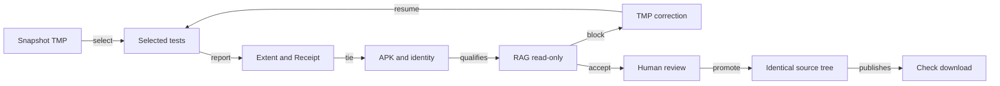
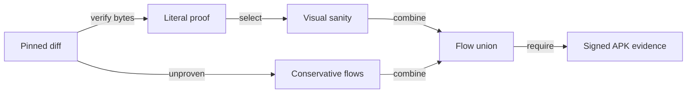

# Release qualification

## Overview

The candidate dossier contains the test plan, results and report for each selection. Prepare it outside the checkout and replace the active dossier only after qualifying the new APK, as defined by the [retention policy](../platform/ATF_ReleaseRetention.md). The [platform evidence policy](../../config/release-platform-rag-policy.json) defines the provenance requirements and checks for the read-only verdict before promotion.

The official repository branch is `main`. Push qualified code to `main` and tag the verified source commit for the version.

## Order of checks


<details>
<summary>Legend: each stage keeps its own verdict</summary>

The component report validates JVM inputs and comparisons. The sanity check validates interaction with the identified APK, and the browser verifies access to the evidence. An operator publishes the release on GitHub after qualification.

</details>

| Step | Selection and required result |
|---|---|
| 1. Diff | Pin the complete copied-source and library inventory in external staging. The [selector](#selection-of-diff-tests) identifies the baseline, changed paths and evidence required by affected flows. |
| 2. Components | Run the affected oracles and rejection checks. [Gradle components](ATF_GradleComponents.md) and the [history suite](ATF_DisplayComponents.md#reporting-of-historical-components) capture the context and comparisons. Each Gradle selection has its own Extent HTML report and receipt, published through `atf-reporting`. Temporary JUnit results are checked against the HTML before the temporary copies are removed. |
| 3. Reporting | Reconcile exact JUnit and HTML identities and outcomes per selection. Check original causes, aborts, missing captures and inline Base64 images. Keep XML as a temporary independent oracle; controlled failures qualify reporting and remain separate from product verdicts. |
| 4. HTML | Apply [minimum interactive revision](../reporting/ATF_Audit.md#minimum-interactive-revision) to the HTML identified by hash; keep owners, controls and sample limits. |
| 5. APK | Build the pinned external snapshot; verify version, SDKs, bytes, SHA-256, CRC, signature and alignment. Debug and Release have distinct identities. |
| 6. Android | Acquire the device lease; run focused changed-flow scenarios and risk-relevant profiles. Restore data and configuration. Do not repeat a full match at every resolution. |
| 7. Handoff | Verify the relevant live sources, reports, executed tests, links and governance. Record the previously qualified release before replacing the active dossier and APK. |

## Candidate dossier layout

| Entry | Canonical content |
|---|---|
| `README.md` | Steps in order, actual selections, status of each and links to results. |
| `qualification.json` | Selection inventory, commands, sources, hashes and limits; unexecuted stages remain `PENDING`, without inferred totals. |
| `component/` | The audited HTML of the suite and the qualified fallback, with inputs and comparisons captured during the test. |
| `e2e/` | Identified Android execution HTML; republished historical evidence preserves its original provenance. |
| `diagnostics/` | Only justified separate evidence: unmigrated JUnit results, signing, crash or rendering diagnostics. |

Do not duplicate PNG, XML or JSON already fully included in HTML after verifying bytes and offline access. Preserve required unique evidence and declare its reason; the [compact-handoff contract](../reporting/ATF_Handoff.md#compact-handoff-and-exceptions) defines the boundary.

## Contract of reports by suite

Each executed primary selection owns a canonical Extent report and an execution receipt.

- The paths are unique: the component uses `reports/component/{group}/component-report.html`; E2E uses `reports/e2e/{suite}/report.html` and `execution.json` side by side.
- Embed PNG captures as Base64 in the suite report.
- Component and E2E reports have separate owners and invocation populations.

| Selection | Minimum receipt | Verified link |
|---|---|---|
| Maven or Gradle component | `execution.json` per group and common source receipts | The HTML hash, test counts and results, source provenance and inventory match the qualified manifest. |
| Android E2E | `execution.json` next to the suite HTML | The installed APK, version, commit and source fingerprint, protocol, results, Extent hash and inline PNG image count match the manifest and report. |

- The release manifest hashes HTML and its receipt separately.
- The evaluator rejects missing or duplicate files, unsafe paths, absent receipts and mismatched outcomes, hashes or provenance.
- `executionReceipt` links each E2E group to the receipt beside its report.
- JUnit XML remains temporarily independent; the final dossier does not keep a second report.
- The captures are inline Base64; release folder does not duplicate PNG files already incorporated.

## Release dossier README

Start with the main report and qualification status. Keep details schematic, with one source per result; link the README to its inventory and the [shared strategy](README.md) rather than duplicating generic rules.

| Section | Information required |
|---|---|
| Purpose and status | The property checked, the basis of the comparison and the actual status: preparation, completed execution or accepted qualification. |
| Identity | APK and hash when applicable, source and library identity, and observation time; a later fingerprint is not an original execution capture. |
| Opening | Direct canonical HTML link and reading order: context, invocation, input/action, comparison and capture. |
| Selections | The selection or command and the result of each selection, with the unit counted, errors and omissions. |
| Overlap | The class-suite relationship, parametrization, checkpoints and the same selection in two renderers; totals do not automatically add up. |
| Review | HTML hash, completed static and interactive checks, browser and inspected owners. |
| Separate evidence | For each file: specific reason, consumer or diagnostic question and identity; JUnit without captured comparisons remains within its limit. |
| Limits and next step | Unexecuted cases, source changes since execution and remaining build or promotion criteria. |

## Public README contract

- **Public README:** the main page advertises the current version and direct download. SHA-256 stays in manifests and evidence; RAG separately verifies that the link identifies the binary.
- **Candidate:** `release/index.json` retains published editions and may declare `candidateVersion`. Check README consistency with `release/candidate.json` in `PREPARED`; use the [branch test channel](../platform/ATF_AndroidDelivery.md#distribution-through-github) for access before qualification.
- **Promotion:** after qualification, move manifest and evidence into `release/{version}/`, update `currentVersion` and `versions`, and remove `candidateVersion`. The README belongs to the source fingerprint; a later link change requires reevaluation.

- **Status:** `PENDING` means unexecuted; `SKIP` or abort records an actual invocation outcome. Preserve `FAIL` and publication errors with their qualification impact.
- **History:** label earlier evidence with its binary and purpose. Moving documents or updating a README does not qualify a new APK.
- **Correction:** retain original result provenance and identify the rechecked selection. Combining historical results does not create one new execution.

## Commands and boundaries

### Read-only RAG verdict

The RAG evaluator consumes the evidence already produced and issues a readonly verdict.

- Inputs: JSON plan, candidate manifest, selected Extent reports and source-snapshot root.
- It doesn't build, run tests, call Git, or move or publish files.
- Write only the JSON verdict, outside the project, candidate and snapshot directories.
- Each check cites its evidence path, SHA-256 and JSON Pointer or line.
- The verdict embeds the exact plan as UTF-8 Base64 in `qualificationPlan.contentBase64`; its hash supports review without a separate temporary plan copy.
- Unresolved gaps are tracked in [feedback register](../feedback/README.md#prioritized-todos).

The plan declares version, channel (`LOCAL`, `TEST` or `PRODUCTION`), risk, platforms, component groups, flow-change status and a justified E2E decision.

### Evaluator regression tests

Node regression tests use the same bounded process executor as Git checks. Read output from process start and retain child diagnostics on failure. [Component coverage](../../atf-tests/src/test/java/atf/tests/governance/documentation/release/rag/scope/ComponentEvidenceScopeComponentTest.java)

Component tests run the evaluator against local fixtures. Each class owns one contract and uses the shared Node test launcher.

| Contract | Component test | What it checks |
|---|---|---|
| Provenance | [ReleaseRagProvenanceComponentTest](../../atf-tests/src/test/java/atf/tests/governance/documentation/release/rag/ReleaseRagProvenanceComponentTest.java) | Snapshot, the integrity of the payload, the citation of the plan and the re-use of component evidence. |
| Android | [ReleaseRagAndroidComponentTest](../../atf-tests/src/test/java/atf/tests/governance/documentation/release/rag/ReleaseRagAndroidComponentTest.java) | Signature, attaching E2E proof to APK and source, data isolation and flow selection. |
| GitHub | [ReleaseRagGithubComponentTest](../../atf-tests/src/test/java/atf/tests/governance/documentation/release/rag/ReleaseRagGithubComponentTest.java) | Access mode, download identity and GitHub retention against simulated GitHub inventories. |

When moving a case, compare its Extent receipts by method, parameterized invocation index and outcome. Check that the new class accounts for the identity change and that the audited comparison count matches for each invocation.

## Candidate lifecycle



<details>
<summary>Legend: candidate's stages and responsibilities</summary>

The APK source snapshot is the reference for comparing suite inputs. RAG verifies receipts, hashes and provenance; the release owner compares the complete inventory and justifies risk-based selection. The verdict permits human review before promotion and publication.

</details>

| Android group | Required evidence |
| --- | --- |
| `atf-validation`, `atf-test-android`, `atf-tests` | Each primary Maven suite has canonical Extent HTML and no FAIL, ERROR or SKIP. |
| `whist-lab-app-commands`, `whist-lab-app-bidding`, `whist-lab-app-history`, `whist-lab-app-display` | Each base Android collection has its own Extent HTML and receipt. Changes to jointly compiled inputs require reevaluation. |
| `whist-lab-app-achievements` | The collection introduced by `introducedComponentGroupsByPlatform`; `sinceReleaseVersion` makes it mandatory from the stated threshold. The report is separate, and JUnit XML alone does not satisfy the gate. |
| `whist-lab-app-atf-card-table-ui` | JVM suite for shared-UI contracts, introduced at `0.20.2`, with a separate Extent report and receipt. |
| Each selected group | Its own receipt and identical inputs within suite scope. `source-provenance.json` binds original inventory, execution and report. |

### Snapshot and preflight before Maven

The [component launcher](../../scripts/run-component-suites.ps1) and [governance launcher](../../scripts/run-atf-governance.ps1) use the [same snapshot preparation](../../scripts/AtfQualificationSnapshot.ps1). Maven compiles and checks the same temporary copy. Published-evidence checks read historical Git objects at the specified commit rather than that checkout's live files.

[Temporary-directory preflight](../../atf-tests/tools/qualification-temp-root.mjs) runs before creating the run directory, copying sources or invoking Maven.

- `TMP`, `TEMP` and the system-selected temporary directory must resolve to existing external directories.
- Check both declared paths and physical destinations after resolving links. A checkout in any ancestor, including a worktree `.git` file, produces `QUALIFICATION-TEMP-IN-CHECKOUT`.
- A non-existent, relative or inaccessible path produces `QUALIFICATION-TEMP-INVALID`.

| Moment | Control and proof |
| --- | --- |
| Pinning | `source-inputs.json` identifies build sources. `release-inputs.json` separately inventories every retained `release/` file, including catalog and dossiers. |
| Before Maven | [Artifact preflight](../../atf-tests/tools/check-release-artifacts.mjs) compares APK names, bytes and SHA-256 with catalog and `.sha256` files. `release-preflight.log` records observed identities or rejection causes. |
| Closure | Compare copy and checkout inventories again. Any added, changed or deleted input invalidates the result; the receipt names its location and path. |

`-PinnedSourceInputs` links the launch to the list used for selection. A change between plan and execution stops the process before Maven. The `release/` fingerprint shall be kept separately so that the evidence file does not fall into the APK source's fingerprint.

- The [signing source boundary](../../.atf-signing/README.md) excludes local private material from source identity and staging. The same Git revision must reconstruct with identical inputs with or without a local key.
- Public certificate identity remains source input. Unrelated additions stay visible and invalidate a pinned source list.
- [Component controls](../../atf-tests/src/test/java/atf/tests/governance/support/SigningSourceIsolationComponentTest.java) verify reconstruction, private-key rotation, forged manifests and indirect paths.

### Selection of diff tests

Calculate the selection before the build, from the snapshots copied by the inventory launchers.

- For a new version, the base is the current edition of `release/index.json`.
- When reassessing a retained version, the base is the previous edition of the same catalogue.
- The base shall be published and qualified, with the inventory of sources linked by hash to the manifest.

```powershell
$ProjectRoot = (Get-Location).Path
node .\atf-tests\tools\plan-release-tests.mjs $ProjectRoot $SourceSnapshotDir `
  $SourceInputsFile $ReleaseVersion $SelectionFile
```

`$SourceInputsFile` is the JSON list from [Get-AtfSourceInputs.ps1](../../scripts/Get-AtfSourceInputs.ps1), outside snapshot and checkout. `$SelectionFile` is a new external output file. The result lists added, modified and deleted paths, applied rules, mandatory suites and required E2E groups. [Selector rules](../../atf-tests/tools/release-test-scope.mjs)

| Result | Action |
| --- | --- |
| RO/EN help | `HowToPlay.java` and related guide content run in the rules suite. Screen, navigation and engine-rule changes retain their flow gates. |
| Editorial change | Run governance and reuse compatible evidence for other suites. E2E can remain `NOT_RUN` with a reason. |
| Bidding change, table, score, profile or other identified flow | Select the native samples indicated in `requiredE2eGroups`. Component tests shall remain mandatory for their contracts. |
| Product path or unclassified shared entry | Select all the flow samples provided by the selector and check the component perimeter. |
| Android version increment | E2E exemption applies only if replacing exactly `versionName` and `versionCode` reproduces the published build-file hash. Check component evidence against its own inputs separately. |

In the `schemaVersion: 2` qualification plan, keep `releaseVersion`, `scope`, `componentGroups` and `userFlowChanged` from the selection.

- Complete `channel`, `declaredPlatforms`, `changeRisk` and `e2e`. The plan may require further evidence.
- For `e2e.status: PASS`, list passing groups in `e2e.groups`, including every group required by the diff.
- The evaluator recomputes selection and rejects a different baseline, understated flow impact or missing group.

Use the calculated selection when launching the components. `$PreviousComponentEvidence` indicates the folder with the evidence available for reuse.

```powershell
$Selection = Get-Content -LiteralPath $SelectionFile -Raw | ConvertFrom-Json
.\scripts\run-component-suites.ps1 -SourceRoot $ProjectRoot -PinnedSourceInputs $SourceInputsFile `
  -Groups $Selection.componentGroups -ReuseFrom $PreviousComponentEvidence
```

`runComponentGroups` identifies affected suites against the published baseline. The launcher verifies each evidence group's original sources before deciding which groups actually run.

### Visual contracts and mandatory flows

The [visual contract registry](../../atf-tests/tools/visual-change-contracts.mjs) narrows native selection only after verifying the source bytes before and after a change. Every changed path contributes its own required flows; the final selection is their union.

| Contract | Allowed change | Required component owners | Required native sanity |
|---|---|---|---|
| Game header typography | Numeric initializers of `TITLE_SP`, `PROGRESS_SP`, `BID_SUMMARY_SP` | `whist-lab-app-display` | `signed-release-smoke`, `responsive-ui-sanity` |
| Card rank typography | Numeric initializers of `INDEX_SIZE_SP`, `RANK_SCALE`, `INVERTED_SIZE_DP` | `whist-lab-app-display`, `whist-lab-app-atf-card-table-ui` | `signed-release-smoke`, `responsive-ui-sanity`, `signed-release-auto-game` |

- [Source admission](../../atf-tests/tools/visual-contract-sources.mjs) reconstructs the baseline from its pinned Git commit and verifies both SHA-256 values. Uniform checkout EOL conversion is admitted only when it reproduces the recorded baseline hash.
- All non-literal source text must remain equal. Added methods, expressions, changed names, missing owners, added or deleted contracts, invalid text and unavailable source bytes retain all native flow gates.
- Mixed bidding, persistence, scoring, profile and achievement changes add their existing flows. Unknown runtime files and changed binaries, including a repackaged AAR or JAR, retain the conservative selection.
- Component selection and evidence reuse keep their existing dependency boundaries. A `PROVEN` visual classification proves literal-change eligibility; it does not mark a native test as passed.



<details>
<summary>Legend: selection and execution</summary>

Each path is classified independently. Verified constants select their component owners and signed-APK sanity; other changed paths retain their own mandatory flows. The evaluator recomputes the selection and rejects omitted native evidence even when all components pass.

</details>

[Component contracts](../../atf-tests/src/test/java/atf/tests/governance/documentation/release/rag/scope/VisualContractScopeComponentTest.java) cover the literal proof, mixed changes, fallback decisions and the real planner with mock repositories. Native timing remains separate: `e2e.prepare-device`, `e2e.run.<group>` and `e2e.extent-evidence` record profile preparation, scenario execution and evidence validation; selection alone does not prove elapsed-time savings.

### Re-use of component evidence

The evaluator compares the added, deleted and modified files. [Scope suite](../../atf-tests/tools/component-evidence-scope.mjs) determines what differences can affect the result.

- Governance checks the complete inventory.
- Shared-UI components have their own scope. Consumer-only changes can reuse the library report; library sources, tests, resources, compile configuration and audit bridge remain in scope.
- Independent Maven modules can reuse results after Android-UI-only or Web-only changes when dependencies are unchanged. Known native collections also exclude the separate browser module; governance still runs, and changes to their own inputs, JVM libraries or unknown paths require execution.
- Game Gradle collections follow jointly compiled code and configuration. Documentation and other-suite-only files do not invalidate them; unknown paths conservatively select `RUN`.

| Decision | Action |
|---|---|
| `MATCH` | Use execution with identical inventory. |
| `REUSE` | Keep original Extent HTML, receipt and execution fingerprint; every difference is outside suite scope. |
| `RUN` | Run the selection and inspect affected inputs in the decision. |
| `INVALID` | Recover original evidence or execute the selection if the Receipt, provenance or report cannot be validated. |

- `componentEvidenceOrigin` identifies the original `reports/component/snapshots/{id}/` directory. Retain `source-inputs.json`, `source-provenance.json`, `source-component-run.json` and, when declared, `release-inputs.json`.
- For a new candidate, the evaluator requires the `atf-tests` release inventory and compares it with the candidate catalog. Older provenance without that inventory can support other suites only within their dependency boundaries.
- Extent HTML and `execution.json` retain canonical suite paths and belong to the candidate's integrity inventory.
- A partially failed aggregate run can supply passing groups when sources remain stable. Every mandatory group still needs its own valid evidence.
- The launcher accepts only catalog groups. `-ReuseFrom` takes a prior component run or `reports/component` directory with original receipts.
- `component-reuse.json` records decisions and snapshot IDs. Retain it with Extent, execution receipts and original snapshots. Set `componentEvidenceOrigin` per reused group and `androidComponentsReceipt` relative to `reports/component` for the Android-component gate. [Launcher contract](../../scripts/README.md)

### Native execution and validator provenance

Native reports retain their original APK, execution commit, source fingerprint, scenario and captures. The [source admission](../../atf-tests/tools/android-e2e-provenance.mjs) separates those execution facts from the content-addressed revision of the running Node validator. Validation never relabels an old receipt with the current commit.

| Input family | Reuse boundary |
|---|---|
| APK and runtime | Identical APK SHA-256 and runtime input fingerprint; changed game sources, binaries, resources or unknown inputs require a new flow. |
| Scenario | Native infrastructure and launcher inputs remain identical, along with flow selection, API, display profile and responsive matrix. |
| Validator | Top-level Node modules under the release-tool directory have their own observed revision; changing them triggers validation, not native execution. An optional `validatorRevision` in the E2E request or plan pins that revision. |
| Editorial metadata | Documentation and the bilingual review record can change without changing native runtime identity. |
| Original evidence | Preserve receipt, report and isolation bytes. Each group owns `source-provenance.json`; groups share the original source-input document under its fingerprint. |

New executions record that provenance automatically. For older schema-2 evidence, export from the original qualified directory into a fresh external run containing `e2e-request.json`, then import into the prepared candidate. The export preserves original bytes and flattens prior reuse to the first execution snapshot.

- `prepare-android-e2e.mjs export <original-edition> <external-run> <group>` prepares the bundle. `apply-android-e2e.mjs <prepared-candidate> <external-run>` validates and imports it. The normal planner and evaluator recheck runtime, scenario, validator pin, payload hashes and original captures; old evidence without sufficient provenance keeps the conservative `RUN` decision.

- `prepare-android-e2e.mjs inspect <edition> <external-run>` performs the same read-only admission for the request in that run. Its profile is a recorded-evidence consistency check; a new release still requires the profile selected by RAG. Missing snapshots, forged validator fingerprints, changed runtime or scenario inputs and damaged captures block reuse.

### Native samples and Android gates

User-visible flow changes require focused E2E for the affected flow. Achievement-catalog acceptance opens the signed APK screen, checks local progress and returns home; components retain threshold, replenishment and popup-persistence oracles.

- Platform gates require hash-linked receipts for components, APK build, identity and signature.
- Published qualification requires a verified download in the declared mode: `AUTHENTICATED` or `ANONYMOUS`.
- Unchanged flow: E2E can remain `NOT_RUN` with explicit justification.
- Changed flow: require passing E2E evidence for its selected groups.
- `NOT_RUN` never counts as a passing result.

### Qualification timeline

| Entry point | Measured ranges |
|---|---|
| Launcher `timing.json` | Snapshot and preflight, cache preparation, Maven compilation, suites or shared Gradle launch, report checks, Android preparation and restoration. |
| Receipt beside HTML | Extent generation and HTML audit in JVM and Android; Gradle includes session completion and audit. |
| RAG verdict and GitHub observation | Each gate, inventory, download, hashing and publication comparison. |
| [Measured command](../../scripts/Measure-AtfReleaseCommand.ps1) | Build APK, signing, push, publication or audit executed separately. The control block returns a single numerical output code. |

Each stage records UTC start and end, monotonic duration and outcome. `REUSED` and `NOT_RUN` carry reasons and zero execution time. For parallel processes, the [timeline assembler](../../atf-tests/tools/assemble-release-timeline.mjs) computes the union of observed intervals and reports gaps separately.

The timeline shall keep the difference between the monotone duration and the UTC interval of the same stage.

```powershell
.\scripts\Measure-AtfReleaseCommand.ps1 -Stage apk.build -TimingFile $BuildTiming -Command {
  & $GradleLauncher --offline :app:assembleRelease | Out-Host
  $LASTEXITCODE
}
node .\atf-tests\tools\assemble-release-timeline.mjs $ProjectRoot $TimelineFile @TimingReceipts
```

Choose the receipts of the same qualification, including the RAG verdict. The timeline does not deduce durations for missing phases. [Verification before cleaning](../platform/ATF_ReleaseRetention.md#local-cleaning-after-delivery)

### Promotion, push and public download link

The read-only verdict neither commits nor publishes. After `READY_FOR_HUMAN_REVIEW`, the release owner completes each step separately:

1. Compare candidate inventory with qualified snapshots, including new files and exclusions; confirm same fingerprint and a clean Git tree containing exactly qualified sources.
2. Commit the sources and push the commit to `main`. Create the version tag on the verified commit. The build and the manifest must identify that commit and the same qualified APK.
3. Publish APK and checksum through the declared channel. For GitHub, use [resumable publication](../platform/ATF_AndroidDelivery.md#resumable-publishing-on-github) and retain its run journal. Update `release/index.json`, catalog and main README so version and direct link identify the same artifact.
4. After the push, read the README from the repository, extract the link shown there and download the URL in the mode declared by `publication.accessMode`. For `AUTHENTICATED`, use a GitHub account with access and record only the fact that the download was authenticated, the URL, HTTP 200, byte count, SHA-256 and CRC. Do not retain the token or headers. For `ANONYMOUS`, download without cookies or authorization and record verification of the page and checksum separately.
5. Record publication and download evidence in the release dossier, commit and push the evidence, then read the README again and download from that exact link using the same declared access mode.

The [Android delivery guide](../platform/ATF_AndroidDelivery.md#source-and-evidence-commits) defines executable steps and distribution receipts. If a step cannot be verified, retain `PENDING` or `BLOCKED`; a local check alone cannot justify promotion.

From the project root, with plan and candidate in external staging:

```powershell
$ProjectRoot = (Get-Location).Path
node .\atf-tests\tools\evaluate-release-rag.mjs `
  --project-root $ProjectRoot `
  --candidate-dir $CandidateDir `
  --source-root $SourceSnapshotDir `
  --plan-file $QualificationPlan `
  --output $VerdictFile
```

- Variables identify the candidate version directory, pinned source root, JSON plan and new verdict file. Create its parent outside every input directory.
- `READY_FOR_HUMAN_REVIEW` confirms only the read evidence that has passed the checks implemented.
- The evaluator does not inspect the Git index. It compares the complete inventory at the pinned location with the manifest. Before promotion, the operator checks the commit and its tree.
- The verdict includes `DIFF_SCOPE`, with the identity of the basis and candidate, the rules applied by route and the resulting groups.
- `BLOCKED` shows failed checks and evidence hashes without applying an automatic correction.

### Retention on GitHub after publication

Before withdrawal, check [kept downloads and editions](../platform/ATF_ReleaseRetention.md#download-verification-before-rotation).

- Finish payload edits and push the final catalog and manifests before collection. The collector seals their bytes against local `origin/main`, requires the same remote commit and rechecks the seal after observation.
- Use `GH_TOKEN` or `GITHUB_TOKEN` with draft access. The collector reads all release pages, including drafts, plus every tag and asset.

```powershell
node .\atf-tests\tools\collect-github-release-retention.mjs $ProjectRoot $GithubRetentionFile
```

Pass that observation through `--github-retention-file $GithubRetentionFile`. `GITHUB_RETENTION` requires exactly the two indexed versions, tags at their declared source commits, and exact APK/checksum assets with matching name, URL, size and downloaded SHA-256.

The collector writes the inventory in a new external file and reports deviations as `BLOCKED`. If access or collection fails, the diagnosis identifies the step, and the evaluator asks for a full observation. After the authorized withdrawal, collect a new observation and resume the evaluation. [Retention process](../platform/ATF_ReleaseRetention.md#github-reset)

### Documentation editions

The release check expects English documentation on `main` and its Romanian counterpart on `main_RO`. It reads the English candidate commit and the published Romanian commit.

- Update both editions when a contract changes. Preserve document paths, heading levels, tables, diagram topology, executable examples and link destinations.
- For archived releases, preserve the files listed in the integrity manifest. Use `.en.md` or `.ro.md` companions for the other language when needed.
- Commit the two editions, fetch `main_RO`, and run the paired inspection below. After editorial review, record its `review` object in `config/documentation-editions.json`.
- The `DOCUMENTATION_EDITIONS` check blocks qualification when a counterpart is missing or the inventories differ from the reviewed hashes. Review changes to meaning against the owning code or test.

```powershell
git fetch origin main_RO
node atf-tests/tools/documentation-editions.mjs inspect . HEAD origin/main_RO
node atf-tests/tools/documentation-editions.mjs verify . HEAD
```

### Evidence freshness

Freshness policy reads UTC timestamps with milliseconds and a `Z` suffix. Expiry occurs exactly at the deadline; missing, invalid or future timestamps block new actions.

| Evidence | Window | When a new observation is obtained |
|---|---|---|
| Android preflight | 5 minutes after successful ADB, boot and profile checks | Before protected actions when expired or when lease, serial, ADB route or requested profile changes. |
| Post-publication GitHub inventory | 15 minutes after stable branch, tag and asset rereads | On expiry or catalog, tag, release, asset or access changes. Collect a fresh observation. |
| GitHub rotation preflight | 5 minutes after download confirmation and branch/latest reread | Immediately before retirement; honor `expiresAtUtc` and repeat verification after state changes. |
| Hash-pinned artifacts and evidence | No time-only expiry | Reverify when bytes, sources, scenario or required identity changes. APKs, signatures, reports, captures and historical download receipts retain their audit value. |

The [executable policy](../../config/release-platform-rag-policy.json) defines these windows. RAG rechecks GitHub inventory freshness at the end of current evaluation; historical revalidation uses the original verdict and pinned evidence.

### Preflight Android

The [responsive launcher](../../scripts/run-whist-responsive-sanity.ps1) acquires the lease and runs [shared preflight](../../scripts/check-android-release-device.ps1) before copying Maven sources or cache. Signed-APK selections use the same check immediately after leasing, before installation, backup or interaction.

```powershell
$device = @{
    AdbExecutable=$AdbExecutable; Serial=$Serial; AdbServerSocket=$AdbServerSocket
    LeasePath=$LeasePath; LeaseId=$LeaseId; Receipt=(Join-Path $CandidateRun 'android-preflight.json')
    ExpectedApi=$ExpectedApi; ExpectedDisplayProfile=$ExpectedDisplayProfile
}
.\scripts\check-android-release-device.ps1 @device
```

| Control | Acceptance criterion |
| --- | --- |
| Lease and ADB | Active lease matches serial and lease ID. ADB reports `device` through the requested route within each command's timeout. |
| Boot | `sys.boot_completed` is exactly `1`. |
| Profile | API is numeric and matches the requested value when specified. Compare effective resolution and density as `WIDTHxHEIGHT@DPI`, preferring `Override` over `Physical`. |

- Signed E2E that changes game state requires verified backup/restore or a temporary secondary Android user. The [isolation script](../../scripts/Invoke-AtfAndroidDisposableUser.ps1) requires Whist absent in the fresh user and verified removal afterward, under the same active lease; it preserves the original user.
- APK and `whist.records.runRoot`, `atf.android.artifacts` and `atf.match.evidenceDir` must stay outside the checkout. Installation files, profile/game exports, captures and receipts belong to the external run directory. Remove the device's temporary APK after installation; private saves stay in the disposable user until removal.

- The expected values come from the selection plan; `ExpectedApi=0` and the empty profile require the observation of valid values. In responsive mode, the profile describes the initial state and `Profiles` describes the matrix applied in the scenario.

- `android-preflight.json` keeps the result, UTC observation and the cause of the refusal. The responsive launcher rechecks the device after Maven and restores the second evidence in `android-preflight-execution.json`.
- Temporary-user preparation checks preflight freshness before creation. Durable cleanup verifies the creation identity and active recovery lease separately; it never treats recovery as a passing application test.
- Android user inventories accept LF and CRLF transport line endings. Duplicate IDs, incomplete rows and unavailable services remain refusals; normalization never authorizes cleanup of an unidentified profile.

### Disposable-user recovery

The [ownership helper](../../scripts/AtfAndroidUserOwnership.ps1) stores creation intent before `pm create-user` and the returned ID before package registration. By default, the durable journal is `.imp/local/android-ownership/<creationLeaseId>.json` under `WHIST_EVIDENCE_ROOT` or the default external evidence root. Keep that journal when removing regenerable staging.

| State | Safe recovery action |
|---|---|
| `CREATING` | Match the generated name against the observed user list; reject absent or ambiguous ownership. |
| `CREATED` / `READY` | Require the exact ID and name, exclude original and pre-existing users, verify original package state, then switch back. |
| `REMOVING` / `REMOVED` | Confirm removal without repeating a completed deletion; reject an ID reused by another user. |

Acquire an active lease for the same serial and original run path before recovery. Pass the original journal explicitly if the recovery lease differs; recreate a deleted run directory at that exact external path first. An unreadable user or package list stops cleanup without inferring absence.

`Invoke-AtfAndroidDisposableUser.ps1 -Phase Recover` requires `RunRoot`, `Serial`, `AdbExecutable`, `LeasePath`, `LeaseId` and `OwnershipJournal`. It records creation and recovery lease IDs with `applicationVerdict: NOT_RUN`; it does not generate successful readiness or E2E-cleanup receipts. The journal preserves preparation and cleanup failures; rerun preparation only after ownership recovery is confirmed.

### Resume a qualification

| Evidence | When re-used | When repeated |
|---|---|---|
| Build and signing | Identical APK and input manifest, with matching package and certificate checks. | Changed build inputs require a new binary and impact evaluation. |
| Components | Supply original `reports/component` receipts and provenance through `-ReuseFrom`; inspect group decisions. | Rerun affected or invalid groups; governance also checks the retained release inventory. |
| Signed E2E | Preserve original HTML, verdict, captures, APK, profile and isolation receipts; compare scenario differences before reuse. | Rerun affected flows after relevant binary, contract, profile or scenario changes, or missing mandatory evidence. |

Prepare isolated staging and Maven cache before leasing the device. Verify compiled-class provenance and validate each flow's captures and report on completion. Keep external run journals and original teardown receipts.

### Starting and resuming a game on the signed APK

- Choose groups from the selection calculated by RAG. Prepare an external JSON with `releaseVersion`, `groups` and `executionProfile`. The profile contains `api` (number), `displayProfile` and `responsiveProfiles` (matrix portrait, separated by comma).
- Use the same value at `e2e.executionProfile` in RAG plan. Since 0.21.5, E2E executions included in RAG require this profile and receipts v2. Evidence v1 keeps the contract of the published edition.

```powershell
.\scripts\run-whist-signed-e2e.ps1 -CandidateDir $CandidateDir `
  -SourceRoot $SourceSnapshotDir -SelectionFile $AndroidSelectionJson `
  -RunRoot $FreshRunRoot -Group $SelectedGroup -ApkPath $ExternalApk

node .\atf-tests\tools\apply-android-e2e.mjs $CandidateDir $FreshRunRoot
```

- The launcher writes `e2e-reuse.json` before Maven or device leasing. Compatible evidence produces `REUSE` and ends the command.
- For `RUN`, Maven compiles in isolated staging and cache. The launcher compares JAR/POM pairs and the selected compiled method, then invokes Surefire for that method only.
- Option `-PrepareOnly` stops after compiling check without Android.

- Execution verifies the exact JUnit case, PASS trace, original captures and Extent bytes. Check the restoration receipt as well.
- Import revalidates the accepted dossier and updates the `PREPARED` manifest. Resume only `RUN` groups; preserve other groups' original reports and receipts. Then evaluate the whole candidate.

### Acceptance of signed APK

- [WhistReleaseSmokeE2eTest](../../atf-test-android/src/test/java/atf/android/e2e/display/flow/WhistReleaseSmokeE2eTest.java) verifies the installed package, home and configuration without starting a match. [Bidding acceptance](../../atf-test-android/src/test/java/atf/android/e2e/release/README.md) separately checks a real Romanian-Whist prefix, recommendation, manual choice, dialog and restored contract.

| Selection | Additional precondition | Closure criterion |
|---|---|---|
| Home and configuration | Signed APK installed with verified hash | Visible controls, accessible settings and return home. |
| Common interface | Temporary secondary user or backup checked with same identified APK | Language RO/EN, cancellation without saving, name preserved between languages and re-established preferences after relaunch. |
| Bidding and restoration | Exclusive booking and isolation receipt with teardown checked | The legal recommendation remains unconfirmed; manual choice survives dialogue and the confirmed contract and public scores are maintained after the process has stopped. |
| History and display | Explicit profile and inputs with the same verified binary identity | Columns, markers and content access selected by the diff; distinguish Debug fixtures from Release execution. |

Verify APK identity and data isolation before changing application state. Unexecuted E2E stays `PENDING`. Static HTML audit verifies the file; interactive review verifies access and rendering.

From the project root, the launcher prepares external staging and a private Maven cache:

```powershell
.\scripts\run-whist-responsive-sanity.ps1 -ComponentsOnly -ComponentSuite History
.\scripts\run-whist-responsive-sanity.ps1 -ComponentsOnly -ComponentSuite History -ComponentRenderer fallback
.\scripts\run-whist-responsive-sanity.ps1 -ComponentsOnly -ComponentSuite Display
```

- **History:** the selected suite report captures every comparison; `WORKING_STATE.json` records HTML path and selection.
- **Display:** responsive-launcher HTML covers only its historical subset. Use aggregation for complete component coverage and provenance.
- **Governance:** use the [isolated launcher](../governance/README.md#isolated-execution). Concurrent changes invalidate that copy's attestation.
- **Promotion:** past results belong to executed sources. Later source changes require diff evaluation and relevant rechecks before the final build.

[Common strategy](README.md) · [Display selections](ATF_Display.md) · [Delivery process](../platform/ATF_AndroidDelivery.md#process-of-a-version)

## Work profiles for resumption

Set `$EvidenceRoot` to an existing external directory and `$Version` to the candidate version. From the qualified checkout, reserve separate working, report, evidence and device-test directories.

```powershell
$shortCommit = git rev-parse --short=12 HEAD
$run = Join-Path $EvidenceRoot "$Version-$shortCommit"
$scratch = Join-Path $run 'workspace'
New-Item -ItemType Directory -Path $scratch -Force | Out-Null
$env:TMP = $scratch
$env:TEMP = $scratch
```

Resume the same identity in the same directory. Use a new one when commit, APK or input inventory changes. Keep each stage's verdict and receipt beside its report.

| Work profile | Preparation | Resume condition |
|---|---|---|
| Components | Pin sources and active release inventory; retain isolated Maven cache, classes, classpath and stage receipts until delivery completes. | Reuse reports through selection and accepted hashes; compilation reuse also verifies sources, classes and libraries. |
| Headless Android | Retain signed APK, requested API/display profile, selection and lease path. Give each test its own run directory and temporary user. | Run only flows lacking valid APK, snapshot, selection and profile evidence. Recheck boot, active window and clean profile; after host restart, verify lease and profile before cleanup. |
| Publication | Retain verdict, draft ID, upload journal and APK/checksum hashes. | Resume the same journal after reconciling IDs and uploaded bytes. Check the `main` link and refresh expired GitHub observations. |

Retain work profiles and caches during reruns. After verified publication and Git reconstruction, preserve final reports, receipts, required EOL recipe and learning data. Regenerable build directories and isolated caches can then be removed. [Post-delivery retention](../platform/ATF_ReleaseRetention.md#local-cleaning-after-delivery)

### Reuse and cleanup boundaries

| Resource | During qualification | After verified delivery |
|---|---|---|
| Component evidence | Reuse only groups admitted by the source, dependency and report hashes. Keep their original receipts and snapshots, including the honest status of a partially failed attempt. | Keep canonical Extent reports and all provenance needed to verify them; compiled classes and private dependency caches are regenerable. |
| Runtime profile | The component launcher passes `atf.test.run.scope=suite` and its reporting properties directly to the owning JVM. Its preflight rejects inherited `JAVA_TOOL_OPTIONS`, `_JAVA_OPTIONS` and `JDK_JAVA_OPTIONS`, including whitespace values, before staging or Maven. | Keep the applied profile and its diagnosis with the final audit; remove temporary launchers once their mechanism is documented. |
| Native evidence | Use one verified preparation through `-PrepareOnly` and `-PreparedFrom`. Reuse an accepted flow only when APK, relevant sources, scenario, profile and original captures satisfy admission. | Keep signed-APK identity, inline captures, execution and isolation receipts. A preparation cache is not a qualification result. |
| Publication observations | Finish payload edits and push the evidence commit before collecting retention. Refresh expired or invalidated observations without rebuilding the APK or rerunning accepted suites. | Keep the publication journal, verified download and final verdict. A historical observation proves its recorded state, not current GitHub availability. |
| Git reconstruction | Resolve the qualified tag locally and verify its commit before testing source and payload reconstruction. | Preserve the Git proof and EOL recipe. Delete staging only after `cleanupEligible: true` and verified local projection. |

Use stage receipts for elapsed durations and state whether measurements overlap. When UTC timestamps and monotonic durations diverge, preserve both and use `elapsedMs` for measured stage cost. Do not claim an end-to-end duration or a speedup from incomplete or overlapping measurements. [Launcher boundaries](../feedback/ATF_Governance.md#qualification-of-claims-and-launchers)

- Keep owner-retained local state in `.imp` under the external evidence root: signing material, local device configuration, valuable learning data and final receipts absent from Git. Cleanup must exclude that directory and every descendant, including paths reached through links.

- Canonical sources and their Git repository belong to the project checkout, not a disposable build directory. Preserve uncommitted work before recovering a checkout; an old worktree is not a cache until that work is accounted for.

### Snapshot Git and local projection

The source snapshot records its reviewed Romanian documentation commit as well as both document inventories.

- Verify that the pinned commit remains published in the Romanian branch ancestry.
- Later branch edits do not rewrite the immutable release pair; the current English/Romanian pair has its own review.
- Reject unreviewed source prose and unpublished translation commits while keeping release reproducibility separate from ongoing documentation maintenance.

Maven checks source reconstruction and the published release projection separately. Each Node test uses the same bounded executor; fixtures use real Git and isolated directories for mixed EOL, changed payload, local edits and release rotation. [Reconstruction](../../atf-tests/tools/release-git-snapshot.test.mjs) · [Projection](../../atf-tests/tools/local-release-sync.test.mjs)

### Resume validated steps

After interruption, retain the run directory and workspace. Resume from the same pinned checkout with the same `TMP` and `TEMP` used during preparation. Give the next attempt a new output directory.

```powershell
& .\scripts\run-component-suites.ps1 -SourceRoot $ProjectRoot -RunRoot $NextAttempt `
  -ResumeFrom $InterruptedAttempt -PinnedSourceInputs $SourceInputs -Groups $RequiredGroups
```

| Step | What validates and what resumes |
|---|---|
| Resume identity | Compare source and release fingerprints in workspace and checkout. Reject changed inventories and concurrent use of one workspace. |
| Maven | Persist a receipt after each selection. Verify compiled classes, resources and JARs before resuming an interrupted run; missing or invalid compilation provenance requires fresh preparation. |
| Gradle | Persist an atomic checkpoint after each task passes JUnit/Extent parity. HTML without its checkpoint can diagnose interruption but does not authorize reuse; rerun that task. |
| Reports | Preserve accepted report bytes and provenance. Run missing, incomplete, corrupt or failed selections in the new directory. |
| Signed-APK preparation | Compile with `-PrepareOnly` and reuse through `-PreparedFrom`. Verify APK SHA-256 and source fingerprint before reusing classes or libraries; each execution gets a fresh JUnit directory. |
| Native flows | Import complete evidence through `apply-android-e2e.mjs`. Admission checks accepted reports before Maven preparation or device access. |

| Level | Bid verification |
|---|---|
| Game component | Opening four one-card hands, dealer rotation, transition to two cards and score checkpoint. Check alternate choices, recommendation precedence and confirmed-contract persistence across hand sizes. |
| Driver component | XML hierarchy and an achievement notification after the run starts. Mock ADB verifies observation order and gesture counts. |
| APK E2E | Visible recommendation, alternate choice, score dialog and contract preserved after restart. Play at most one preparatory hand when the opening bid is forced. |
