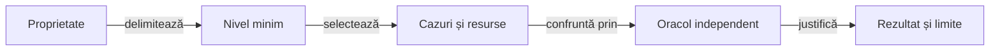

# Testarea Whist Lab

<!-- atf-testing-strategy-owner -->

## Pe scurt

Testarea separă corectitudinea unei reguli, colaborarea componentelor, calitatea politicii și interacțiunea Android.
Nivelul exprimă limita verificată, iar colecția selectează cazurile și costul execuției.

## Alegerea verificării

| Întrebare | Ghid |
|---|---|
| Ce verific unitar, ca o componentă, prin integrare sau cap la cap? | [Arhitectură și matrice](ATF_Architecture.md) |
| Ce selecție rulez pentru schimbarea mea? | [Colecții și comenzi](ATF_Collections.md) |
| Cum justific o decizie AI fără mâinile adverse reale? | [Componente și oracole](ATF_AiComponents.md) |
| Cum transfer lecțiile către alt joc sau un produs nou? | [Lecții, mock-uri și adaptoare](../learning/ATF_PolicyEvolution.md#lecții-transferabile-către-alte-jocuri-și-produse) |
| Cum verific regulile și scorul unei partide? | [Verificarea jocului](ATF_Gameplay.md) |
| Cum pregătesc și controlez dispozitivul? | [Testarea Android](ATF_Android.md) |
| Cum verific geometria, derularea și capturile? | [Profiluri de ecran](ATF_Display.md) |
| În ce ordine pregătesc testele și dovezile unui release? | [Calificare pas cu pas](ATF_ReleaseQualification.md) |
| Ce pot verifica despre display fără emulator? | [Componente display](ATF_DisplayComponents.md) |

## De la proprietate la rezultat

Legendă: așteptarea precede prezentarea

Testul stabilește așteptarea din regulă, invariant sau implementare independentă. Publicarea păstrează rezultatul capturat și nu repetă jocul ori oracolul.

O modificare de politică adaugă [evaluarea rezervată](../learning/README.md) după regresiile de domeniu. O modificare de publicare cere [auditul rezultatului](../reporting/ATF_Audit.md), iar reorganizarea se verifică prin [guvernanță](../governance/README.md).

Pentru un alt joc, [admiterea domeniului](../learning/ATF_GameTransfer.md) cere reguli confirmate, observație permisă și oracol înaintea primelor componente. Colecțiile Whist și un mock al lor păstrează domeniul pentru care au fost construite; adaptorul nou își califică propriile stări și tranziții.

## Strategia comună

Acesta este documentul normativ unic al strategiei de testare. Ghidurile tematice descriu aplicarea unui contract, iar README-urile testelor descriu selecțiile și precondițiile; toate se raportează la aceeași strategie, indiferent de release.

| Schimbare | Verificare principală | Completare necesară |
|---|---|---|
| Regulă, scor sau salvare | Unitare și componente cu intrări controlate, inclusiv cazuri negative. | Replay al unei partide înregistrate dacă se schimbă interpretarea istoricului. |
| Geometrie și display | Componente pentru limite, intersecții, centrare și populația extremă. | Sanity nativ pe profilurile care disting riscul: mână minimă/maximă, locuri la masă și licitare. |
| Navigare sau interacțiune | Un parcurs reprezentativ prin elementele afișate. | Matricea suplimentară verifică display-ul; repetarea partidei complete cere un risc nou. |
| Serializare și publicare | Contracte de format, probe negative și replay offline. | Identitatea rezultatului, randarea Extent și disponibilitatea fallback-ului se califică separat. |
| Documentație și arhivare | Guvernanță, linkuri locale și integritatea dovezilor mutate. | Publicarea confruntă separat adresa versiunii și snapshot-ul notelor. |

Componentele folosesc un oracol independent de calculul verificat. Replay-ul citește trace-ul existent și păstrează identitatea lui; o republicare nu devine o nouă execuție Android.

Selecția urmează riscul observabil. [Matricea de afișaj](ATF_Display.md#matricea-minimă-după-risc) păstrează variațiile geometrice în componente și adaugă Android pentru font, gesturi și compoziția reală; o combinație nouă se adaugă când poate distinge un defect.

- **Izolare:** construiți în TMP și păstrați rulările intermediare în depozitul extern configurat; scenariile native cer rezervare exclusivă, stare inițială explicită și restaurarea datelor.
- **Audit:** fiecare verdict se leagă de surse, dependențe și binarul executat; checkpoint-ul păstrează acțiuni, așteptat/observat, aserții și captură, după nivelul verificării.
- **Randare:** confruntați pașii, secțiunile expandabile și imaginile cu trace-ul; consemnați distinct verificarea statică și interacțiunea efectivă în browser.
- **Limite:** un test omis, un diagnostic incomplet ori un eșec de publicare rămâne explicit în dosarul rezultatului; nu este transformat în PASS funcțional.

## Ce înseamnă verificat

| Verdict | Dovadă | Limită |
|---|---|---|
| Execuție | Cazurile reale au evaluat contractul și refuzurile relevante; cauza originală și curățarea sunt păstrate. | Un test verde nu dovedește că toate comparațiile sale au fost publicate. |
| Date publicate | Invocările și comparațiile capturate se regăsesc la proprietarul corect, cu inputul și observația necesare înțelegerii. | Prezența în HTML nu dovedește că datele sunt accesibile în interfața raportului. |
| Randare | HTML-ul identificat prin hash este verificat detașat: secțiuni pliabile, ultimul rând, navigare și imagine integrală când există. | Revizia raportului nu execută din nou aplicația sau oracolul. |

[Contractul auditului](../reporting/ATF_Audit.md) deține aceste verificări. În dosarul unei rulări, fiecare verdict își declară scopul; un control static sau o probă pe un singur proprietar nu califică implicit întregul arbore interactiv.

- **Populație:** clasa, metoda și invocarea parametrizată identifică un caz; aserțiunile, checkpoint-urile și mâinile jucate sunt unități distincte.
- **Suprapunere:** o clasă rulată individual, apoi prin suită, ori aceeași selecție în Extent și fallback nu adaugă automat alte cazuri unice.
- **Raportare:** selecțiile de componentă și E2E publică rapoarte Extent agregate pe suită sau scop declarat, cu comparațiile capturate în timpul testului. Rezultatul JUnit și capturile fac parte din auditul selecției, fără a substitui datele comparației; unitarele rămân o categorie distinctă.
- **Închidere:** selecția executată se confruntă cu selecția cerută; un caz dispărut, un abort sau o omisiune relevantă se explică înaintea calificării.

## Rezultate pe versiuni

| Intrare | Responsabilitate |
|---|---|
| Strategia și matricea | Nivelul minim, selecția după risc, proprietarul și condițiile de acceptare; fără rezultate ale unei execuții. |
| README-ul testelor | Clasele sau suitele selectate, precondițiile, comenzile și interpretarea rezultatului. |
| Dosarul release-ului | Identitățile efectiv verificate, rapoartele agregate și starea acoperirii fiecărei selecții. |

Un raport canonic reprezintă o selecție identificată. Suitele focalizate sunt submulțimi declarate ale selecției primare; aceeași invocare executată prin mai multe intrări se numără o singură dată în populația unică.

- **Navigare:** componenta și E2E au intrări distincte către HTML-urile canonice ale selecțiilor.
- **Conținut:** PNG-ul rămâne inline Base64; XML-ul sau JSON-ul necesar auditului este încorporat cu identitate și proveniență.
- **Retenție:** copia separată se elimină după confruntarea datelor și verificarea HTML-ului detașat. Datele unice încă nemigrate blochează acceptarea formei finale și rămân explicit identificate.

- **Versiune:** [catalogul livrărilor](../../release/README.md) trimite la rezultate, capturi și limite; acest ghid păstrează strategia generică. Istoricul urmează [politica de retenție](../platform/ATF_ReleaseRetention.md).

- **Proces:** [indexul livrărilor](../../release/index.json) selectează dosarul activ. [Contractul livrării](../platform/ATF_AndroidDelivery.md#dosarul-unei-versiuni) deține structura și publicarea; matricea de mai sus deține selecțiile executabile.
