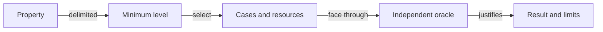

# Whist Lab test strategy

<!-- atf-testing-strategy-owner -->

## Overview

Testing separates the correctness of a rule, component collaboration, quality of policy and interactions on Android and Web.
The level expresses the limit checked and the collection selects cases and the cost of execution.

## Choice of verification

| Question | Ghid |
|---|---|
| What do I check unitary, as a component, through integration or butt? | [Architecture and matrix](ATF_Architecture.md) |
| What selection do I run for my change? | [Collections and commands](ATF_Collections.md) |
| How do I justify an AI decision without real adverse hands? | [Parts and oracles](ATF_AiComponents.md) |
| How do I transfer lessons to another game or a new product? | [Lessons, mockings and adapters](../learning/ATF_PolicyEvolution.md#lessons-to-other-games-and-products) |
| How do I check the rules and score of a game? | [Game verification](ATF_Gameplay.md) |
| How do I prepare and control the device? | [Testarea Android](ATF_Android.md) |
| How do I check geometry, rewind and catch? | [Screen profiles](ATF_Display.md) |
| In what order do tests and evidence of a release prepare? | [Step by step qualification](ATF_ReleaseQualification.md) |
| What can I check about the display without the emulator? | [Componente display](ATF_DisplayComponents.md) |
| How do I check the game, geometry and gestures in the browser? | [Adapter and Playwright Components](../../atf-ui-browser/README.md#verification) |
| How do I audit Gradle components without parallel reports? | [Gradle catch and collections](ATF_GradleComponents.md) |

## From property to result

Legend: Waiting before presentation

The test shall determine the waiting in the rule, invariant or independent implementation. Publication keeps the result captured and does not repeat the game or the oracle.

A policy change adds [reserved assessment](../learning/README.md) After regressions of the domain. A change of publication requires [results audit](../reporting/ATF_Audit.md), and reorganisation shall be verified by [Governance](../governance/README.md).

For another game, [admission of domain](../learning/ATF_GameTransfer.md) requires confirmed rules, permitted observation and oracle before the first components. The Whist collections and their mock retain the domain for which they were built; the new adapter qualifies for its own states and transitions.

## Common strategy

This is the single regulatory document of the test strategy. Thematic guidelines describe the application of a contract and the test READMERS describe the selections and preconditions; they all relate to the same strategy, regardless of the releases.

| Schimbare | Main verification | Required completion |
|---|---|---|
| Rule, score or rescue | Uniting and components with controlled inputs, including negative cases. | Replay of a registered game if the historical interpretation changes. |
| Geometry and display | Components for boundaries, intersections, centreyards and extreme population. | NATURAL SANITY ON RISK-DISTINCT PROPROLIES: Minimum / Maximum Hand, Table Places and Bidding. |
| Navigation or interaction | A representative path through the displayed items. | The additional matrix checks the display; repeating the full game requires a new risk. |
| Serial and publication | Format contracts, negative evidence and offline replica. | The result identity, the Extent rendering and the availability of fallback shall be qualified separately. |
| Documentation and archiving | Governance, local links and integrity of the evidence moved. | Publication faces the address of the version and the snapshots of the notes separately. |

Components use an oracle independent of the verified calculation. The player reads the existing track and keeps his identity; a republican does not become a new Android execution.

The selection follows the observable risk. [Display matrix](ATF_Display.md#minimum-matrix-by-risk) keeps geometric variations in the components and adds Android for font, gestures and actual composition; a new combination is added when it can distinguish a defect.

- **Isolation: ** built in TMP and keep intermediate runs in the external warehouse configured; native scenarios require exclusive reservation, explicit initial status and data restoration.
- **Audit: ** each verdict is linked to sources, dependencies and executed binaries; checkpoint keeps actions, expected / observed, assertions and capture, after verification level.
- **Randare: ** face steps, expandable sections and tracer images; clearly note the static check and effective interaction in the browser.
- **Limits: ** an omitted test, incomplete diagnosis or publication failure remains explicit in the result file; it is not converted into functional PASS.

### Transfer of checks

- Identify the property and entries that may deny it.
- Run the matrix on the actual component implementation. Add a negative check for every refusal you transfer.
- Keep an Android route for each distinct link between visible control, engine effect and platform storage. [Transfer matrix](ATF_Architecture.md#moving-the-checks-from-e2e-to-components)

## What does it mean checked

| Verdict | Evidence | Limit |
|---|---|---|
| Implementation | Real cases have assessed the contract and relevant refusals; the original cause and cleaning is preserved. | A green test does not prove that all its comparisons have been published. |
| Date publicate | The captured inventions and comparisons shall be found at the correct owner, with the input and observation necessary for the understanding. | The presence in HTML does not prove that the data are accessible in the report interface. |
| Randare | HTML identified by hash is checked detached: folding sections, last row, navigation and full image when there is. | The report review does not reexecute the application or the oracle. |

[Audit contract](../reporting/ATF_Audit.md) has these checks. In the case of a running, each verdict declares its purpose; a static check or a single owner test does not necessarily qualify the entire interactive tree.

- **Population: ** class, method and parametric invoicing identify one case; assertions, checkpoints and played hands are distinct units.
- **Overlay: ** an individual run class, then through the suite, or the same selection in Extent and fallback does not automatically add other unique cases.
- **Reporting: ** component selections and E2E publish aggregate Extent reports on the suite or stated purpose, with comparisons captured during the test. JUnit results and catches are part of the selection audit without replacing the comparison data; the units remain a separate category.
- **Closure: ** the execution is faced with the required selection; a missing case, an abort or a relevant omission is explained prior to the qualification.

## Results on versions

| Intrare | Responsibility |
|---|---|
| Strategy and matrix | Minimum level, risk selection, owner and acceptance conditions; no results of execution. |
| Test README | Selected classes or suites, preconditions, controls and interpretation of the result. |
| Relay folder | The actual verified identities, aggregated reports and the status of each selection coverage. |

A canon report is an identified selection. Focused suites are declared subsets of primary selection; the same invocation executed through multiple entries is counted once in the single population.

- **Navigation: ** component and E2E have distinct entries to canonical HTMLs of the selections.
- **Content: ** PNG remains inline Base64; the XMLor or JSON required for the audit is incorporated with identity and provenance.
- **Retention: ** separate copy is deleted after data confrontation and detached HTML verification. Unmigrated single data block acceptance of the final form and remain explicitly identified.

- **Version:** [Release catalog](../../release/README.md) send to results, catches and limits; this guide keeps the generic strategy. History follows [retention policy](../platform/ATF_ReleaseRetention.md).

- **Process:** [delivery index](../../release/index.json) select the active folder. [Delivery contract](../platform/ATF_AndroidDelivery.md#folder-of-a-version) hold the structure and publication; the above matrix holds the executable selections.
