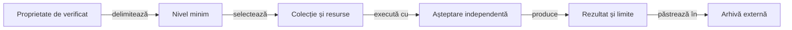

# Ghidurile de testare Whist Lab

## Pe scurt

Acest director explică alegerea verificării potrivite, pregătirea datelor și interpretarea rezultatului.
Ghidurile separă corectitudinea regulilor, evaluarea jucătorilor, integrarea Android și publicarea rezultatelor.

## De la contract la verificare

Legendă: nivelul, selecția și rezultatul

Nivelul exprimă limita verificată, iar colecția selectează cazurile și costul execuției. Rezultatul păstrează intrările și comparațiile originale; o prezentare nouă a datelor nu înseamnă o execuție nouă a jocului.

## Unde încep

| Întrebare | Ghid |
|---|---|
| Ce verific unitar, ca o componentă, prin integrare sau cap la cap? | [Arhitectură și matrice](architecture/README.md) |
| Ce selecție rulez pentru schimbarea mea? | [Colecții și comenzi](collections/README.md) |
| Cum construiesc situații valide și așteptări independente pentru AI? | [Testarea deciziei](ai/README.md) |
| Cum verific o partidă și scorul ei? | [Verificarea jocului](gameplay/README.md) |
| Cum pregătesc și controlez o execuție Android? | [Testarea Android](android/README.md) |
| Cum verific geometria, derularea și capturile? | [Profiluri de ecran](android/display/README.md) |
| Cum verific rezultatul publicat și imaginile încorporate? | [Auditul publicării](reporting/README.md) |
| Cum verific documentele, pachetele și limitele modulelor? | [Guvernanță](governance/README.md) |

## Alegerea scopului minim

- O regulă, un calcul ori o frontieră de stare pornește de la o verificare mică, cu intrări controlate.
- O modificare de politică adaugă evaluarea candidatului înghețat pe distribuții noi, după regresiile de domeniu.
- O modificare de interacțiune cere acțiuni și observații noi în aplicația identificată, pe un dispozitiv rezervat.
- O modificare a publicării verifică identitatea datelor și accesul la ele în prezentare.
- O reorganizare actualizează linkurile și consumatorii documentelor, apoi verifică structura și clasificarea.

## Responsabilități și date

Regulile și oracolele stabilesc așteptarea, iar politica de prezentare stabilește ce date sunt publicate. Partidele, capturile, rezultatele numerice și inventarele de execuție se păstrează în depozitul extern configurat.

[Regulile jocului](../GAME_RULE_PROFILES.md) · [Îmbunătățirea jucătorilor](../AI_LEARNING_ARCHITECTURE.md) · [Publicarea rezultatelor](../reporting/README.md) · [Principiile documentației](../DOCUMENTATION_GOVERNANCE.md)
