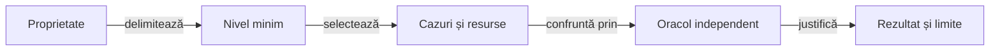

# Testarea Whist Lab

## Pe scurt

Testarea separă corectitudinea unei reguli, colaborarea componentelor, calitatea politicii și interacțiunea Android.
Nivelul exprimă limita verificată, iar colecția selectează cazurile și costul execuției.

## Alegerea verificării

| Întrebare | Ghid |
|---|---|
| Ce verific unitar, ca o componentă, prin integrare sau cap la cap? | [Arhitectură și matrice](ATF_Architecture.md) |
| Ce selecție rulez pentru schimbarea mea? | [Colecții și comenzi](ATF_Collections.md) |
| Cum justific o decizie AI fără mâinile adverse reale? | [Componente și oracole](ATF_AiComponents.md) |
| Cum verific regulile și scorul unei partide? | [Verificarea jocului](ATF_Gameplay.md) |
| Cum pregătesc și controlez dispozitivul? | [Testarea Android](ATF_Android.md) |
| Cum verific geometria, derularea și capturile? | [Profiluri de ecran](ATF_Display.md) |
| Ce pot verifica despre display fără emulator? | [Componente display](ATF_DisplayComponents.md) |

## De la proprietate la rezultat

Legendă: așteptarea precede prezentarea

Testul stabilește așteptarea din regulă, invariant sau implementare independentă. Publicarea păstrează rezultatul capturat și nu repetă jocul ori oracolul.

O modificare de politică adaugă [evaluarea rezervată](../learning/README.md) după regresiile de domeniu. O modificare de publicare cere [auditul rezultatului](../reporting/ATF_Audit.md), iar reorganizarea se verifică prin [guvernanță](../governance/README.md).

## Strategia comună

| Schimbare | Verificare principală | Completare necesară |
|---|---|---|
| Regulă, scor sau salvare | Unitare și componente cu intrări controlate, inclusiv cazuri negative. | Replay al unei partide înregistrate dacă se schimbă interpretarea istoricului. |
| Geometrie și display | Componente pentru limite, intersecții, centrare și populația extremă. | Sanity nativ pe profilurile care disting riscul: mână minimă/maximă, locuri la masă și licitare. |
| Navigare sau interacțiune | Un parcurs reprezentativ prin elementele afișate. | Matricea suplimentară verifică display-ul; repetarea partidei complete cere un risc nou. |
| Serializare și publicare | Contracte de format, probe negative și replay offline. | Identitatea rezultatului, randarea Extent și disponibilitatea fallback-ului se califică separat. |
| Documentație și arhivare | Guvernanță, linkuri locale și integritatea dovezilor mutate. | Publicarea confruntă separat adresa versiunii și snapshot-ul notelor. |

Componentele folosesc un oracol independent de calculul verificat. Replay-ul citește trace-ul existent și păstrează identitatea lui; o republicare nu devine o nouă execuție Android.

- **Izolare:** construiți în TMP și păstrați rulările intermediare în depozitul extern configurat; scenariile native cer rezervare exclusivă, stare inițială explicită și restaurarea datelor.
- **Audit:** fiecare verdict se leagă de surse, dependențe și binarul executat; checkpoint-ul păstrează acțiuni, așteptat/observat, aserții și captură, după nivelul verificării.
- **Randare:** confruntați pașii, secțiunile expandabile și imaginile cu trace-ul; consemnați distinct verificarea statică și interacțiunea efectivă în browser.
- **Limite:** un test omis, un diagnostic incomplet ori un eșec de publicare rămâne explicit în dosarul rezultatului; nu este transformat în PASS funcțional.

## Rezultate pe versiuni

Acest ghid deține strategia aplicabilă oricărei versiuni. Numerele testelor, verdictele, capturile și limitele unei livrări se citesc din [catalogul artefactelor](../../artifacts/README.md), în dosarul versiunii exacte.

Dosarul se selectează prin [indexul livrărilor](../../artifacts/index.json), fără codificarea versiunii curente în această strategie. [Procesul livrării](../platform/ATF_AndroidDelivery.md#dosarul-unei-versiuni) deține structura și condițiile de publicare; ghidurile matricei de mai sus dețin selecțiile executabile.
