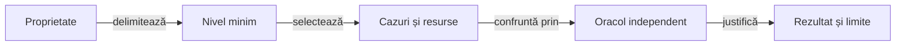

# Testarea Whist Lab

## Pe scurt

Testarea separă corectitudinea unei reguli, colaborarea componentelor, calitatea politicii și interacțiunea Android.
Nivelul exprimă limita verificată, iar colecția selectează cazurile și costul execuției.

## Alegerea verificării

| Întrebare | Ghid |
|---|---|
| Ce verific unitar, ca o componentă, prin integrare sau cap la cap? | [Arhitectură și matrice](ATF_Architecture.md) |
| Ce selecție rulez pentru schimbarea mea? | [Colecții și comenzi](ATF_Collections.md) |
| Cum justific o decizie AI fără mâinile adverse reale? | [Componente și oracole](ATF_AiComponents.md) |
| Cum verific regulile și scorul unei partide? | [Verificarea jocului](ATF_Gameplay.md) |
| Cum pregătesc și controlez dispozitivul? | [Testarea Android](ATF_Android.md) |
| Cum verific geometria, derularea și capturile? | [Profiluri de ecran](ATF_Display.md) |
| Ce pot verifica despre display fără emulator? | [Componente display](ATF_DisplayComponents.md) |

## De la proprietate la rezultat

Legendă: așteptarea precede prezentarea

Testul stabilește așteptarea din regulă, invariant sau implementare independentă. Publicarea păstrează rezultatul capturat și nu repetă jocul ori oracolul.

O modificare de politică adaugă [evaluarea rezervată](../learning/README.md) după regresiile de domeniu. O modificare de publicare cere [auditul rezultatului](../reporting/ATF_Audit.md), iar reorganizarea se verifică prin [guvernanță](../governance/README.md).

Partidele, capturile și rezultatele execuției se păstrează în depozitul extern configurat. Scenariile pe dispozitiv cer aplicație identificată, stare inițială explicită și rezervare exclusivă.
