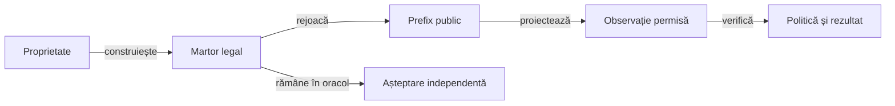

# Proiectarea testelor pentru politici cu informație parțială

## Pe scurt

Testul verifică o proprietate generală în domeniul ei declarat. O partidă observată localizează analiza; rezultatul așteptat al unei decizii trebuie justificat prin reguli, invariant sau oracol independent.

## Construcția unei situații valide

Legendă: martorul și actorul testat

Martorul poate conține distribuția completă pentru a demonstra că situația este posibilă. Politica primește numai proiecția observabilă a actorului, iar comparația păstrează separat rezultatul ulterior.

## Familii de proprietăți

| Familie | Contract |
|---|---|
| Legalitate | Pachet fără duplicate, carte întoarsă neîmpărțită, licitare și fiecare carte jucată legale. |
| Informație | Modificarea mâinilor adverse reale nu poate schimba aceeași observație transmisă politicii. |
| Context | Schimbarea controlată a necesarului sau oportunităților poate schimba alegerea, cu celelalte intrări fixate. |
| Memorie | Cărțile publice și lipsurile demonstrate restrâng corect lumile fezabile. |
| Scor | Punctele, seriile și totalurile se calculează independent de selectorul acțiunii. |
| Certificat | Enumerarea este completă, toate continuările relevante sunt acoperite, iar bugetul epuizat păstrează fallback-ul. |
| Comparație | Acțiunile candidate folosesc aceleași lumi și bugete; politicile sunt comparate pe distribuții și locuri controlate. |

## Nivelul verificării

[Arhitectura testării](../architecture/README.md) definește clasificarea comună. Calculul pur se verifică unitar, API-ul politicii ca o componentă, iar colaborarea motor–politici–oracol prin integrare de domeniu.

Un parcurs Android rămâne E2E numai când execută interacțiuni noi în aplicația instalată. Comparația statistică are protocol propriu și nu înlocuiește aceste contracte.

## Nivelul afirmației

- Testul unei funcții auxiliare verifică acea limită; nu certifică automat întregul API de decizie.
- O medie mai bună într-o lume nu este dominanță în toate lumile.
- Alegerile optimizate separat după cunoașterea lumii pot fi incompatibile cu o singură acțiune publică.
- O căutare completă per lume și un certificat universal au cuantificatori diferiți.
- Reproductibilitatea pe aceeași observație nu implică automat invarianță la schimbarea scorurilor sau simetrie între locuri.
- Un rezultat statistic de politică și corectitudinea unei componente au criterii de calificare distincte.

## Surse de verificare

| Sursă | Responsabilitate |
|---|---|
| [ContextualHonorDiscardTest](../../../whist-lab-app/game-core/src/test/java/ro/whistlab/core/ContextualHonorDiscardTest.java) | Martori legali, necesar și efectul cărților publice. |
| [BlindPolicyObservationTest](../../../whist-lab-app/game-core/src/test/java/ro/whistlab/core/BlindPolicyObservationTest.java) | Separarea mâinii proprii și a informației publice înaintea apelului politicii. |
| [CertifiedContractRegressionTest](../../../whist-lab-app/game-core/src/test/java/ro/whistlab/core/CertifiedContractRegressionTest.java) | Certificat, lipsa garanției și fallback. |
| [HardSalvageObjectiveTest](../../../whist-lab-app/game-core/src/test/java/ro/whistlab/core/HardSalvageObjectiveTest.java) | Ordinea obiectivelor când exactul este imposibil public. |
| [IndependentPlayerModelTest](../../../whist-lab-app/game-core/src/test/java/ro/whistlab/coach/IndependentPlayerModelTest.java) | Fezabilitate și model independent. |

## Organizarea colecțiilor

Regresia implicită păstrează cazuri mici, stabile și cu așteptare independentă. Cercetarea, turneele și diagnosticele care explorează limite nerezolvate sunt colecții explicite, cu buget și scop declarate.

Un caz nou trebuie să aducă o proprietate sau frontieră distinctă. Seturile mari de jocuri și rezultatele lor rămân în corpusul extern, iar [selecția focalizată](../../AI_LEARNING_FOCUS.md) controlează costul analizei.

[Colecții](../collections/README.md) · [Guvernanța schimbărilor](../../ATF_Test_Changes_Baseline.md) · [Modelul deciziei](../../AI_DECISION_MODEL.md)
