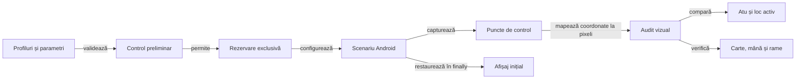

# Verificarea interfeței pe profile de ecran

## Pe scurt

Suita verifică mecanismele de configurare, licitare, joc și reluare pe profile de afișaj declarate. Scopul și numărul de mâini sunt parametri ai scenariului, cu limitele validate de runner.

## Fluxul execuției

Legendă: pregătire și restaurare

Validarea parametrilor și a contractelor componente precede controlul dispozitivului. Runnerul păstrează rezoluția și densitatea inițiale pentru restaurare, inclusiv după eșec.

## Intrări

| Parametru | Contract |
|---|---|
| Profiles | Listă de forme LĂȚIMExÎNĂLȚIME@DPI, portret și fără duplicate, în limitele componentei de profil. |
| HandsPerProfile | Număr explicit de mâini normale pentru fiecare profil; nu se presupune o partidă completă. |
| Serial | Dispozitivul Android rezervat pentru scenariu. |
| AdbServerSocket | Serverul ADB configurat pentru stație sau VM. |
| Director de rezultate | Destinație externă pentru trace-ul și rezultatele execuției. |

[Runnerul](../../../../scripts/run-whist-responsive-sanity.ps1) și componentele sale definesc valorile implicite și limitele efective.
Mărimea mâinii se verifică prin programul profilului; fixture-urile de display au un scop separat de jocul normal.

## Invariante vizuale și de interacțiune

- Meniul păstrează configurarea accesibilă în viewport.
- Mâna este poziționată după spațiul disponibil, cu indicii vizibili și derulare accesibilă când este necesară.
- Licitarea nu acoperă locurile jucătorilor; selecția semantică distinge etichetele duplicate.
- Fiecare acțiune este confruntată cu starea observată după ea.
- Reluarea păstrează registrul scorului și informația cunoscută.
- Captura păstrează ecranul fizic original; rezoluția logică cerută se verifică separat.
- La patru jucători, levatele urmează crucea scaunelor; locul omului este sud, iar cartea lui rămâne centrată acolo. Fața jucată păstrează 104 dp.
- Rama atuului folosește aceeași fabrică de fundal și contur ca locul activ. Comparația de pixeli mapează întâi coordonatele UIAutomator la captura fizică.
- Pe ferestrele care cer derulare, verificarea stilului și verificarea cărții vizibile complet folosesc puncte de control distincte. Testul de intersecții folosește dreptunghiurile reale ale cadrelor accesibile.
- La jocul normal, scenariul derulează până când observă întâi controlul turei și apoi o carte legală clicabilă; acțiunea rămâne verificată în viewport-ul efectiv.
- Simularea unei rezoluții logice nu dovedește proprietățile unui panou fizic de aceeași dimensiune.

## Guvernanța execuției

1. Verificați parametrii, binarele configurate și contractele profilului, driverului și publicatorului.
2. Rezervați dispozitivul și consemnați starea inițială.
3. Executați numai scenariul declarat, capturând relația acțiune–observație–comparație.
4. Restaurați setările de afișaj și eliberați rezervarea.
5. Publicați rezultatul în scopul executat, cu limitele sale.

[Contractul Android](../../../ATF_Android_Report_Contract.md) · [Pregătirea dispozitivului](../README.md) · [Handoff](../../../WHIST_UI_REPORT_HANDOFF.md)
