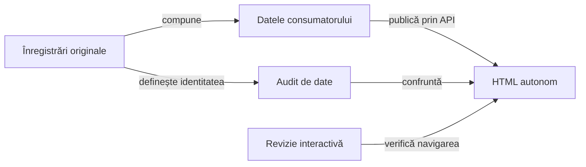

# Contractul verificării publicării

## Pe scurt

Publicarea trebuie să păstreze rezultatul evaluat și relația dintre invocare, comparație și captură. Verificarea urmărește separat inputul tipizat, transformarea către HTML și comportamentul interactiv al prezentării.

## Suprafețe de control

Legendă: același conținut, verificări distincte

Auditul datelor verifică proprietatea și valorile publicate. Revizia interactivă verifică accesul la acele valori, capturi și stări ale prezentării; ea nu execută din nou jocul.

## Invariante

- Identitatea invocării și ordinea checkpoint-urilor rămân stabile.
- Expected, actual, verdictul și cauza originală nu sunt reevaluate de renderer.
- Selecția păstrează invocările întregi și toate rezultatele obligatorii.
- Valorile lungi și fragmentele au ordine și conținut complet verificabile.
- PNG-ul original aparține checkpoint-ului corect și rămâne încorporat în HTML.
- Timpii execuției, capturii și publicării au axe și surse distincte.
- O republicare declară proveniența execuției originale.

## Controale și mutații

| Proprietate | Control negativ |
|---|---|
| Identitatea comparației | Mutarea unei valori sau a unui verdict către alt proprietar este refuzată. |
| Completitudine | Un fragment lipsă, reordonat sau modificat nu trece auditul. |
| Captură | Schimbarea payload-ului ori a referinței PNG este detectată. |
| Timp | Intervalul atribuit altui flow sau faze este respins. |
| Semantica acțiunii | Atribuirea falsă a driverului și confundarea dispatch-ului cu succesul UI sunt refuzate. |
| Navigare | Valorile și imaginile rămân accesibile după deschidere, închidere și schimbarea proprietarului. |

## Limite

Trecerea auditului structural nu demonstrează singură lizibilitatea sau navigarea interactivă. Verificarea publicării nu certifică o nouă execuție Android sau puterea politicii jocului.

[Politica de prezentare](../../ATF_Game_Report_Presentation.md) · [Contractul Android](../../ATF_Android_Report_Contract.md) · [Arhitectura raportării](../../reporting/README.md)
