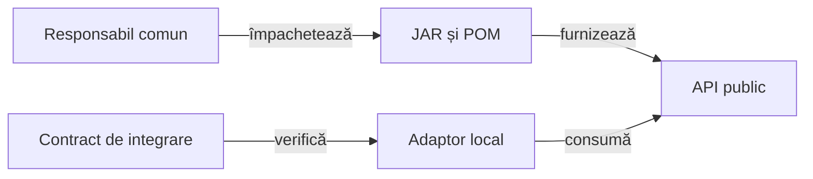

# Bibliotecile comune

## Pe scurt

Core, Reporting, Console și Mock se consumă ca biblioteci binare. [Responsabilul comun](../docs/feedback/README.md) deține implementarea și feedback-ul; proiectul păstrează adaptoarele, configurația și acceptanța domeniului.

## Responsabilități



<details>
<summary>Legendă: implementare și acceptanță</summary>

Producătorul califică implementarea și regresiile comune. Consumatorul verifică livrarea fizică și integrarea cu propriul domeniu, printr-o acceptanță independentă.

</details>

| Bibliotecă | Contract consumat |
|---|---|
| Core | Transporturi, configurație și mecanisme comune. |
| Reporting | Publicarea comparațiilor și a materialelor capturate. |
| Console | Formatarea evenimentelor și integrarea JUnit. |
| Mock | Transport determinist și potrivirea exactă a cererilor. |

## Identitate și guvernanță

- Directorul conține o singură pereche JAR/POM pentru fiecare bibliotecă și acest README.
- [POM-ul](../pom.xml) selectează coordonatele, iar [proveniența](../library-provenance.json) declară proprietatea, amprentele și identitatea producerii.
- `CodeSource` identifică JAR-ul încărcat efectiv; POM-ul încorporat coincide cu perechea publicată.
- Sursele și testele native ale bibliotecilor rămân la producător, iar adaptarea și acceptanța aplicației rămân locale.
- Cerința comună are un singur registru, indicat prin [rutarea feedback-ului](../docs/feedback/README.md).

## Verificare

Dintr-o copie temporară proprie, cu un depozit Maven propriu:

```powershell
mvn -B -ntp -N validate
mvn -B -ntp -pl atf-tests -am -Dtest=PlatformLibraryContractTest,PlatformLibraryIntegrityTest -Dsurefire.failIfNoSpecifiedTests=false test
```

Aceste contracte verifică binarele și refuzurile relevante. Interacțiunea pe dispozitiv are scenariu și criterii separate.

[Consumul bibliotecilor](../docs/platform/README.md) · [Guvernanță](../docs/governance/README.md)
