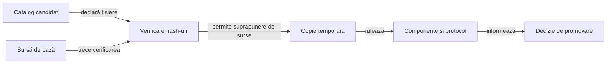

# Experimente izolate pentru modelarea licitațiilor

## Pe scurt

Acest director păstrează implementări alternative și mecanisme de calificare pentru cercetarea AI. Sursele sale sunt excluse din aplicație și din selecția implicită a testelor.

## Aplicarea unei alternative

Legendă și limite

Suprapunerea de surse se aplică exclusiv în copia temporară și numai după verificarea bazei și a fișierelor declarate. Rezultatul evaluării nu activează automat alternativa în aplicație.

[Catalogul candidaților](../../config/whist-research-candidates.json) definește identitatea, fișierele, rolurile și colecțiile permise. [Lansatorul](../../scripts/run-whist-collection.ps1) refuză o bază modificată în loc să actualizeze tacit hash-urile.

## Principii

- Modificați separat modelul licitației, modelul mâinilor ascunse și politica de continuare pentru a putea interpreta cauza progresului.
- Predicția comportamentului observat nu demonstrează o decizie optimă sau o probabilitate calibrată a cărților ascunse.
- Înghețați alternativa și criteriile înaintea lotului rezervat; aplicați aceeași distribuție și același loc în comparațiile pereche.
- Păstrați jocurile, calibrările, rezultatele și registrele de lot în arhiva externă.
- Păstrați în sursă mecanismul și regresiile minime justificate, cu limitele lor explicite.

[Arhitectura învățării](../../docs/AI_LEARNING_ARCHITECTURE.md) și [protocolul](../../docs/AI_TRAINING_PROTOCOL.md) definesc procesul comun.
