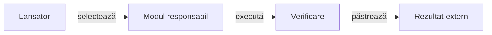

# Lansatoarele proiectului

## Pe scurt

- [Proba unui control testChanges](run-component-suites.ps1) folosește selecția offline declarată și scrie dovada legată de commit. [Contractul probei](../docs/governance/ATF_TestChanges.md#dovada-controlului-verificat)

- [Guvernanța schimbărilor de teste](run-atf-governance.ps1) primește baza Git a revizuirii. [Contractul diff-ului](../docs/governance/ATF_TestChanges.md#verificarea-diff-ului-git) explică perimetrul, expirarea și refuzurile.

- [Inventarul JVM](run-jvm-inventory.ps1) verifică sursele unui checkout selectat. [Contractul CLI](../docs/governance/README.md#inventar-jvm-prin-cli) explică perimetrul, excepțiile și codurile de ieșire.

- [Izolare E2E Android](Invoke-AtfAndroidDisposableUser.ps1) creează, deblochează și elimină un utilizator secundar temporar sub rezervarea activă a dispozitivului. Jurnalul persistent de deținere permite recuperarea pregătirii întrerupte; starea pachetului utilizatorului original este verificată înainte și după curățare. [Acceptanța APK-ului semnat](../atf-test-android/src/test/java/atf/android/e2e/release/README.md) definește frontiera datelor și raportarea.

- [Agregarea componentelor Maven și Gradle](run-component-suites.ps1) compilează într-un staging propriu și execută suitele Maven primare, colecțiile aplicației și selecția JVM distinctă a bibliotecii UI comune. Taskurile Gradle selectate împart o singură lansare. Fiecare selecție păstrează un HTML Extent și receipt proprii. [Contractul auditului](../docs/reporting/ATF_Audit.md#agregarea-componentelor-pe-sursa-live) explică inventarul, refuzurile și separarea de calificarea APK-ului.

- Pentru calificare incrementală, `-SourceRoot` indică snapshot-ul fixat și `-Groups` primește identificatorii selecțiilor care trebuie rulate. Lista omisă selectează toate grupurile. Parametrul -ReuseFrom indică dosarul anterior de componente. Lansatorul rulează grupurile cu intrări afectate sau dovezi invalide. [Regula de reutilizare](../docs/testing/ATF_ReleaseQualification.md#reutilizarea-dovezilor-de-componentă)

- [Exportul AAR al bibliotecii grafice](export-card-table-ui.ps1) construiește coordonata lipsă din intrările modulului și ale uneltelor Gradle. Un export repetat verifică manifestul și hash-urile pachetului existent.

Acest director coordonează operații care traversează modulele: verificări, construirea aplicației și scenarii Android activate explicit. Algoritmii, validatoarele și testele uneltelor aparțin modulelor care dețin comportamentul.

Lansatoarele citesc rădăcina proiectului din propria poziție și pregătesc copii temporare. Rezultatele se păstrează în depozitul extern configurat.

## Responsabilități

Legendă: coordonare și implementare

Un lansator alege modulele, parametrii și resursele. Motorul și laboratorul dețin jocul și evaluarea offline, infrastructura Android deține dispozitivul, iar consumatorul raportării deține datele publicate.

## Alegerea intrării

| Operație | Intrare și contract |
|---|---|
| Reguli și evaluare offline | [run-whist-collection.ps1](run-whist-collection.ps1), cu [colecții și precondiții](../docs/testing/ATF_Collections.md). |
| Partide și perspective controlate | [Laboratorul AI](../whist-lab-app/ai-lab/README.md), cu lansatoarele `run-offline-*`. |
| Calitatea proiectului | [run-atf-governance.ps1](run-atf-governance.ps1), cu [perimetru explicit](../docs/governance/README.md). |
| Calificare Android semnată | [run-whist-signed-e2e.ps1](run-whist-signed-e2e.ps1) verifică dovada per grup și pregătește Maven înaintea rezervării. [Reluare și import](../docs/testing/ATF_ReleaseQualification.md#rularea-și-reluarea-unui-flux-pe-apk-semnat) |
| Scenarii pe dispozitiv | [Ghidul Android](../docs/testing/ATF_Android.md) și [matricea de ecrane](../docs/testing/ATF_Display.md). |

## Unde se află uneltele

- [Laboratorul AI](../whist-lab-app/ai-lab/tools/README.md): corpus, modele, diagnostic și calificarea politicilor.
- [Infrastructura Android](../atf-test-android/tools/README.md): replay-ul și predarea datelor Android capturate.
- [Consumatorul raportării](../atf-tests/tools/README.md): validarea și selecția intrărilor publicate.

PowerShell se verifică sintactic separat de execuția operației. Un scenariu Android cere aplicație identificată și rezervare exclusivă; documentarea comenzii nu reprezintă o execuție pe dispozitiv.

## Precondiții după intrare

Lansatorul componentelor folosește [opțiuni JVM limitate la suită](AtfComponentJvm.ps1). Elimină `JAVA_TOOL_OPTIONS`, `_JAVA_OPTIONS` și `JDK_JAVA_OPTIONS` moștenite înainte de rulare; diagnosticul numește variabila fără să-i afișeze valoarea. Suitele normale și probele testChanges individuale sau în lot împart acest profil, iar JVM-urile copil nu moștenesc proprietățile sale de raportare.

| Intrare | Resurse și date necesare | Ce verifică executarea |
|---|---|---|
| `run-whist-collection.ps1` | JDK selectat prin `JavaHome`, wrapper Gradle și cache JVM; protocol, candidat și corpus când colecția le cere. | Validează colecția și identitățile, pregătește copia și apelează Gradle cu `--offline`; raportează separat codul de ieșire. |
| `run-documentation-governance.ps1` | JDK 21 și cache Maven pentru dependențele Jackson. | [Verificare editorială](../docs/governance/ATF_Documentation.md#cli-pentru-guvernanța-documentației) pentru fișiere selectate sau inventarul complet. |
| `run-atf-governance.ps1` | JDK, `mvn` disponibil, POM-uri și perechi JAR/POM; cache Maven pentru depozitul copiei. | Verifică APK-urile înainte de Maven și confruntă inventarele surselor și ale dosarului de release. [Snapshot](../docs/testing/ATF_ReleaseQualification.md#snapshot-și-preflight-înainte-de-maven) |
| `run-offline-*` | Uneltele și parametrii declarați de fiecare fișier; unele intrări folosesc căi locale explicite. | Execută protocolul acelei intrări; disponibilitatea uneltei nu se deduce din parsarea scriptului. |
| Flux Android | Configurația ADB, binarul aplicației, rezervare și backup verificat. | [Contractul infrastructurii](../atf-test-android/README.md) delimitează transportul, comanda și observația. |

Colecțiile JVM nu cer conectarea emulatorului. Pregătirea Java/Maven/Gradle nu este încă un verificator unic de capabilități; [feedback-ul coordonării](../docs/feedback/ATF_Governance.md#calificarea-afirmațiilor-și-lansatoarelor) deține uniformizarea.

## Identitatea execuției

[Lansatorul colecțiilor](run-whist-collection.ps1) deține validarea bazei și rezervarea evaluării. Uniformizarea precondițiilor și diagnosticului rămâne în [feedback-ul coordonării](../docs/feedback/ATF_Governance.md#calificarea-afirmațiilor-și-lansatoarelor).

- [Contractul bazei candidatului](../docs/testing/ATF_Collections.md#identitatea-completă-a-bazei-candidatului) validează inventarul complet, hash-urile și copia finală, cu migrare explicită a identității. Criteriile și rezultatele rămân distincte, iar configurația generală nu se umple cu identitățile unor experimente încheiate.

- [Registrul comun](../docs/learning/ATF_EvaluationRegistry.md) serializează rezervările și refuză suprapunerile evaluării între corpusuri. Lansatoarele de diagnostic înregistrează reutilizarea pentru învățare; o rulare întreruptă nu eliberează automat distribuțiile.

## Intrări private de semnare

- [O singură politică a surselor](AtfSigningSourcePolicy.ps1) admite numai metadatele publice de semnare și omite intrările private locale înainte de calcularea hash-urilor.
- [Copierea](Copy-AtfSourceInputs.ps1) validează manifestul complet, căile canonice și absența linkurilor în strămoșii sursei și destinației înainte de scriere.
- Intrările private sunt refuzate chiar și într-un manifest vechi. [Ghidul de semnare](../.atf-signing/README.md) definește lista publică permisă și limitele politicii.
