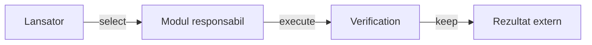

# Project launchers

## Overview

- [Test of a control testChanges](run-component-suites.ps1) uses declared offline selection and writes the proof related to commit. [Contractul probei](../docs/governance/ATF_TestChanges.md#proof-of-verified-control)

- [Governance of changes in tests](run-atf-governance.ps1) receives Git base of review. [The diff contract](../docs/governance/ATF_TestChanges.md#checking-the-git-diff) explains the perimeter, expiration and refusals.

- [Inventarul JVM](run-jvm-inventory.ps1) checks the sources of a selected checkout. [Contractul CLI](../docs/governance/README.md#jvm-inventory-via-cli) explains the perimeter, exceptions and output codes.

- [Isolation E2E Android with temporary user](Invoke-AtfAndroidDisposableUser.ps1) create a new secondary profile, unlock it and prevent the display from being turned off only in that profile, install the candidate only there and remove it at the teardown after checking the same reservation. Quotts keep and check the initial status of the installation of the application in the original profile; contract and reporting are documented in the contract [acceptance of signed APK](../atf-test-android/src/test/java/atf/android/e2e/release/README.md).

- [Aggregation of Maven and Gradle components](run-component-suites.ps1) compiles in its own staging and performs the Maven primary suites, application collections and the distinct JVM selection of the common UI library. The Gradle Task selected share a single launch. Each selection keeps an Extent HTML and Receipt of its own. [Audit contract](../docs/reporting/ATF_Audit.md#aggregation-of-components-on-live-source) explains the inventory, refusals and separation from APK qualification.

- For incremental qualification, `-SourceRoot` indicate the fixed snapshots, and `-Groups` The list omitted selects all groups. ReuseFrom parameter indicates the previous component directory. Launcher runs affected input groups or invalid evidence. [Re-use rule](../docs/testing/ATF_ReleaseQualification.md#re-use-of-component-evidence)

- [Export of the Graphic Library AAR](export-card-table-ui.ps1) builds the missing coordinate from the input of the module and Gradle tools. Repeated export checks the manifest and hashes of the existing package.

This director coordinates operations that cross modules: checks, application building and explicitly activated Android scenarios. Algorithms, validators and tool tests belong to the modules that hold the behavior.

Launchers read the project root from their own position and prepare temporary copies. The results shall be kept in the external warehouse configured.

## Liabilities

Legend: coordination and implementation

A launcher chooses modules, parameters and resources. The engine and the laboratory have the game and the offline evaluation, the Android infrastructure has the device, and the reporting consumer has the published data.

## Choice of entry

| Operation | Entry and contract |
|---|---|
| Rules and offline evaluation | [run-whist-collection.ps1](run-whist-collection.ps1), with [collections and prerequisites](../docs/testing/ATF_Collections.md). |
| Controlled parties and perspectives | [Laboratorul AI](../whist-lab-app/ai-lab/README.md), with launchers `run-offline-*`. |
| Project quality | [run-atf-governance.ps1](run-atf-governance.ps1), with an [explicit scope](../docs/governance/README.md). |
| Signed Android Qualification | [run-whist-signed-e2e.ps1](run-whist-signed-e2e.ps1) checks the proof per group and prepares Maven prior to booking. [Relocation and import](../docs/testing/ATF_ReleaseQualification.md#running-and-restarting-a-feed-on-apk-signed) |
| Screenplay on device | [Ghidul Android](../docs/testing/ATF_Android.md) and [Screen matrix](../docs/testing/ATF_Display.md). |

## Where the tools are

- [Laboratorul AI](../whist-lab-app/ai-lab/tools/README.md): corpus, models, diagnosis and qualification of policies.
- [Infrastructura Android](../atf-test-android/tools/README.md): replicay and surrender of captured Android data.
- [Reporting consumer](../atf-tests/tools/README.md): validation and selection of published entries.

PowerShell shall be checked syntactically separately from the operation. An Android scenario requires identified application and exclusive booking; ordering documentation is not an execution on the device.

## Preconditions after entry

| Intrare | Resources and data required | What checks execution |
|---|---|---|
| `run-whist-collection.ps1` | JDK selected by `JavaHome`, gradle wrapper and jvm cache; protocol, candidate and corpus when the collection requires them. | Validate the collection and identities, prepare the copy and call Gradle with `--offline`; report the output code separately. |
| `run-documentation-governance.ps1` | JDK 21 and Caache Maven for Jackson's dependencies. | [Editorial check](../docs/governance/ATF_Documentation.md#cli-for-governance-of-documentation) for selected files or full inventory. |
| `run-atf-governance.ps1` | JDK, `mvn` available, poms and pairs JAR/POM; cache Maven for copy warehouse. | Check APKs before Maven and face sources inventories and release directory. [Snapshot](../docs/testing/ATF_ReleaseQualification.md#snapshot-and-preflight-before-maven) |
| `run-offline-*` | Tools and parameters declared by each file; some entries use explicit local pathways. | Execute the protocol of that entry; the availability of the tool is not deducted from the parting of the script. |
| Flux Android | ADB configuration, application binar, booking and backup checked. | [Contractul infrastructurii](../atf-test-android/README.md) delimits transport, command and observation. |

JVM collections do not require connection of emulator. Java/Maven/Gradle is not yet a unique capability verifier; [coordination feedback](../docs/feedback/ATF_Governance.md#qualification-of-claims-and-launchers) holds the uniformity.

## Identity of execution

[Collections Launcher](run-whist-collection.ps1) holds the validation of the base and reservation of the evaluation. Uniforming the preconditions and diagnosis remain in [coordination feedback](../docs/feedback/ATF_Governance.md#qualification-of-claims-and-launchers).

- [Contract of the candidate's basis](../docs/testing/ATF_Collections.md#full-identity-of-candidate-base) validates the complete inventory, the hashes and the final copy, with explicit identity migration. The criteria and results remain distinct and the overall configuration is not filled with the identities of completed experiments.

- [Registrul comun](../docs/learning/ATF_EvaluationRegistry.md) serializes reservations and refuses to duplicate the assessment between the bodies. Diagnostic launchers record re-use for learning; a run-off does not automatically release distributions.
