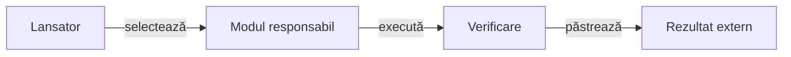

# Lansatoarele proiectului

## Pe scurt

Acest director coordonează operații care traversează modulele: verificări, construirea aplicației și scenarii Android activate explicit. Algoritmii, validatoarele și testele uneltelor aparțin modulelor care dețin comportamentul.

Lansatoarele citesc rădăcina proiectului din propria poziție și pregătesc copii temporare. Rezultatele se păstrează în depozitul extern configurat.

## Responsabilități

Legendă: coordonare și implementare

Un lansator alege modulele, parametrii și resursele. Motorul și laboratorul dețin jocul și evaluarea offline, infrastructura Android deține dispozitivul, iar consumatorul raportării deține datele publicate.

## Alegerea intrării

| Operație | Intrare și contract |
|---|---|
| Reguli și evaluare offline | [run-whist-collection.ps1](run-whist-collection.ps1), cu [colecții și precondiții](../docs/testing/ATF_Collections.md). |
| Partide și perspective controlate | [Laboratorul AI](../whist-lab-app/ai-lab/README.md), cu lansatoarele `run-offline-*`. |
| Calitatea proiectului | [run-atf-governance.ps1](run-atf-governance.ps1), cu [perimetru explicit](../docs/governance/README.md). |
| Scenarii pe dispozitiv | [Ghidul Android](../docs/testing/ATF_Android.md) și [matricea de ecrane](../docs/testing/ATF_Display.md). |

## Unde se află uneltele

- [Laboratorul AI](../whist-lab-app/ai-lab/tools/README.md): corpus, modele, diagnostic și calificarea politicilor.
- [Infrastructura Android](../atf-test-android/tools/README.md): replay-ul și predarea datelor Android capturate.
- [Consumatorul raportării](../atf-tests/tools/README.md): validarea și selecția intrărilor publicate.

PowerShell se verifică sintactic separat de execuția operației. Un scenariu Android cere aplicație identificată și rezervare exclusivă; documentarea comenzii nu reprezintă o execuție pe dispozitiv.

## Îmbunătățiri prioritare ale lansatoarelor

Responsabilul coordonării trebuie să închidă blocajele de calificare înaintea extinderii catalogului de experimente. [Lansatorul colecțiilor](run-whist-collection.ps1) deține validarea bazei și rezervarea evaluării; [registrul AI](../docs/feedback/ATF_Ai.md#coordonarea-evaluării-și-delimitarea-mecanismelor) păstrează criteriile comune.

| Prioritate | Cerință | Criteriu de închidere |
|---|---|---|
| P1 | Rezervați evaluarea într-un registru canonic. | Intervalele parțial suprapuse, copierea corpusului și doi solicitanți concurenți au probe de refuz; simpla schimbare a numelui lotului păstrează expunerea. |
| P2 | Uniformizați precondițiile și diagnosticul lansatoarelor. | Java, Maven, Gradle, Node și Python au versiuni și capabilități verificate pentru intrarea aleasă; lipsa lor este raportată înaintea execuției costisitoare, iar rezultatul identifică sursele și comanda efectivă. |

[Contractul bazei candidatului](../docs/testing/ATF_Collections.md#identitatea-completă-a-bazei-candidatului) validează inventarul complet, hash-urile și copia finală, cu migrare explicită a identității. Criteriile și rezultatele rămân distincte, iar configurația generală nu se umple cu identitățile unor experimente încheiate.
