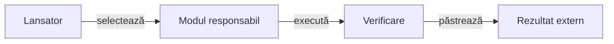

# Lansatoarele proiectului

## Pe scurt

- [Agregarea componentelor Maven](run-component-suites.ps1) compilează într-un staging propriu și execută suitele primare, cu un HTML canonic per modul. [Contractul auditului](../docs/reporting/ATF_Audit.md#agregarea-componentelor-pe-sursa-live) explică inventarul, refuzurile și separarea de calificarea APK-ului.

Acest director coordonează operații care traversează modulele: verificări, construirea aplicației și scenarii Android activate explicit. Algoritmii, validatoarele și testele uneltelor aparțin modulelor care dețin comportamentul.

Lansatoarele citesc rădăcina proiectului din propria poziție și pregătesc copii temporare. Rezultatele se păstrează în depozitul extern configurat.

## Responsabilități

Legendă: coordonare și implementare

Un lansator alege modulele, parametrii și resursele. Motorul și laboratorul dețin jocul și evaluarea offline, infrastructura Android deține dispozitivul, iar consumatorul raportării deține datele publicate.

## Alegerea intrării

| Operație | Intrare și contract |
|---|---|
| Reguli și evaluare offline | [run-whist-collection.ps1](run-whist-collection.ps1), cu [colecții și precondiții](../docs/testing/ATF_Collections.md). |
| Partide și perspective controlate | [Laboratorul AI](../whist-lab-app/ai-lab/README.md), cu lansatoarele `run-offline-*`. |
| Calitatea proiectului | [run-atf-governance.ps1](run-atf-governance.ps1), cu [perimetru explicit](../docs/governance/README.md). |
| Scenarii pe dispozitiv | [Ghidul Android](../docs/testing/ATF_Android.md) și [matricea de ecrane](../docs/testing/ATF_Display.md). |

## Unde se află uneltele

- [Laboratorul AI](../whist-lab-app/ai-lab/tools/README.md): corpus, modele, diagnostic și calificarea politicilor.
- [Infrastructura Android](../atf-test-android/tools/README.md): replay-ul și predarea datelor Android capturate.
- [Consumatorul raportării](../atf-tests/tools/README.md): validarea și selecția intrărilor publicate.

PowerShell se verifică sintactic separat de execuția operației. Un scenariu Android cere aplicație identificată și rezervare exclusivă; documentarea comenzii nu reprezintă o execuție pe dispozitiv.

## Precondiții după intrare

| Intrare | Resurse și date necesare | Ce verifică executarea |
|---|---|---|
| `run-whist-collection.ps1` | JDK selectat prin `JavaHome`, wrapper Gradle și cache JVM; protocol, candidat și corpus când colecția le cere. | Validează colecția și identitățile, pregătește copia și apelează Gradle cu `--offline`; raportează separat codul de ieșire. |
| `run-atf-governance.ps1` | JDK, `mvn` disponibil, POM-uri și perechi JAR/POM; cache Maven pentru depozitul copiei. | Compară inventarul înainte/după, păstrează rezultatul Maven și refuză certificarea unei surse schimbate. |
| `run-offline-*` | Uneltele și parametrii declarați de fiecare fișier; unele intrări folosesc căi locale explicite. | Execută protocolul acelei intrări; disponibilitatea uneltei nu se deduce din parsarea scriptului. |
| Flux Android | Configurația ADB, binarul aplicației, rezervare și backup verificat. | [Contractul infrastructurii](../atf-test-android/README.md) delimitează transportul, comanda și observația. |

Colecțiile JVM nu cer conectarea emulatorului. Pregătirea Java/Maven/Gradle nu este încă un verificator unic de capabilități; [feedback-ul coordonării](../docs/feedback/ATF_Governance.md#calificarea-afirmațiilor-și-lansatoarelor) deține uniformizarea.

## Identitatea execuției

[Lansatorul colecțiilor](run-whist-collection.ps1) deține validarea bazei și rezervarea evaluării. Uniformizarea precondițiilor și diagnosticului rămâne în [feedback-ul coordonării](../docs/feedback/ATF_Governance.md#calificarea-afirmațiilor-și-lansatoarelor).

- [Contractul bazei candidatului](../docs/testing/ATF_Collections.md#identitatea-completă-a-bazei-candidatului) validează inventarul complet, hash-urile și copia finală, cu migrare explicită a identității. Criteriile și rezultatele rămân distincte, iar configurația generală nu se umple cu identitățile unor experimente încheiate.

- [Registrul comun](../docs/learning/ATF_EvaluationRegistry.md) serializează rezervările și refuză suprapunerile evaluării între corpusuri. Lansatoarele de diagnostic înregistrează reutilizarea pentru învățare; o rulare întreruptă nu eliberează automat distribuțiile.
