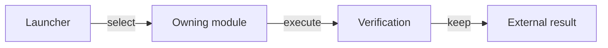

# Project launchers

## Overview

- [Test-change control proofs](run-component-suites.ps1) run the declared offline selection and bind the proof to its commit. [Control evidence contract](../docs/governance/ATF_TestChanges.md#proof-of-verified-control)

- [Test-change governance](run-atf-governance.ps1) takes an explicit Git review base. [Diff contract](../docs/governance/ATF_TestChanges.md#checking-the-git-diff) defines coverage, expiry and rejection rules.

- [JVM inventory](run-jvm-inventory.ps1) checks a selected checkout. [CLI contract](../docs/governance/README.md#jvm-inventory-via-cli) defines the scope, exceptions and exit codes.

- [Android E2E isolation](Invoke-AtfAndroidDisposableUser.ps1) creates, unlocks and removes a temporary secondary user under the active device lease. A durable ownership journal supports interrupted preparation and recovery; the original user's package state is checked before and after cleanup. [Signed-APK acceptance](../atf-test-android/src/test/java/atf/android/e2e/release/README.md) defines the data boundary and reporting.

- [Maven and Gradle component aggregation](run-component-suites.ps1) compiles in isolated staging and runs the primary Maven suites, application collections and shared-UI JVM suite. Selected Gradle tasks share one launch; each selection keeps its own Extent HTML and receipt. [Audit contract](../docs/reporting/ATF_Audit.md#aggregation-of-components-on-live-source) defines inventory, rejection rules and the boundary with APK qualification.

- For incremental qualification, `-SourceRoot` identifies the pinned snapshot and `-Groups` selects groups; omitting it selects all groups. `-ReuseFrom` points to prior component evidence. The launcher runs only affected groups or groups without valid evidence. [Reuse rule](../docs/testing/ATF_ReleaseQualification.md#re-use-of-component-evidence)

- [Shared-UI AAR export](export-card-table-ui.ps1) builds a missing version from module inputs and Gradle tooling. A repeated export verifies the existing package manifest and hashes.

This directory coordinates operations across modules: checks, application builds and explicitly enabled Android scenarios. Algorithms, validators and tool tests remain in their owning modules.

Launchers locate the project from their script path and prepare isolated working copies. Results stay in the configured external evidence directory.

## Responsibilities

Legend: coordination and implementation

A launcher selects modules, parameters and resources. The engine owns game rules, the laboratory owns offline evaluation, Android infrastructure owns device interaction, and the reporting consumer owns delivered evidence.

## Choice of entry

| Operation | Entry and contract |
|---|---|
| Rules and offline evaluation | [run-whist-collection.ps1](run-whist-collection.ps1), with [collections and prerequisites](../docs/testing/ATF_Collections.md). |
| Controlled games and perspectives | [AI lab](../whist-lab-app/ai-lab/README.md), with launchers `run-offline-*`. |
| Project quality | [run-atf-governance.ps1](run-atf-governance.ps1), with an [explicit scope](../docs/governance/README.md). |
| Signed Android qualification | [run-whist-signed-e2e.ps1](run-whist-signed-e2e.ps1) checks evidence per group and prepares Maven before acquiring the device lease. [Resume and import](../docs/testing/ATF_ReleaseQualification.md#starting-and-resuming-a-game-on-the-signed-apk) |
| Device scenarios | [Android guide](../docs/testing/ATF_Android.md) and [display matrix](../docs/testing/ATF_Display.md). |

## Where the tools are

- [AI lab](../whist-lab-app/ai-lab/tools/README.md): corpus, models, diagnosis and qualification of policies.
- [Android infrastructure](../atf-test-android/tools/README.md): replay and handoff of captured Android data.
- [Reporting consumer](../atf-tests/tools/README.md): validation and selection of published entries.

Check PowerShell syntax separately from execution. A device scenario requires an identified application and an exclusive lease; documenting its command does not prove device execution.

## Preconditions after entry

The component launcher uses [suite-local JVM options](AtfComponentJvm.ps1). Remove inherited `JAVA_TOOL_OPTIONS`, `_JAVA_OPTIONS` and `JDK_JAVA_OPTIONS` before running it; the diagnostic names the variable without printing its value. Normal suites and single or batched test-change proofs share this profile, and child JVMs do not inherit its reporting properties.

| Entry point | Resources and data required | What checks execution |
|---|---|---|
| `run-whist-collection.ps1` | Selected JDK, Gradle wrapper and JVM cache; protocol, candidate and corpus when required by the collection. | Validates the collection and identities, prepares the copy and calls Gradle with `--offline`; reports the exit code separately. |
| `run-documentation-governance.ps1` | JDK 21 and a Maven cache containing Jackson dependencies. | [Editorial checks](../docs/governance/ATF_Documentation.md#documentation-governance-cli) for selected files or the full inventory. |
| `run-atf-governance.ps1` | JDK, executable Maven, POM files and JAR/POM pairs; Maven cache available for isolated copying. | Checks APKs before Maven and compares source and release inventories. [Snapshot contract](../docs/testing/ATF_ReleaseQualification.md#snapshot-and-preflight-before-maven) |
| `run-offline-*` | Tools and parameters declared by each script; some entries require explicit local paths. | Executes the selected protocol; script existence does not prove tool availability. |
| Android flow | ADB configuration, identified APK, lease and verified data isolation. | [Infrastructure contract](../atf-test-android/README.md) separates transport, commands and observations. |

JVM collections do not require an emulator connection. Java, Maven and Gradle do not yet share one capability verifier; [coordination feedback](../docs/feedback/ATF_Governance.md#qualification-of-claims-and-launchers) tracks that gap.

## Identity of execution

[Collection launcher](run-whist-collection.ps1) validates the candidate base and reserves the evaluation. [Coordination feedback](../docs/feedback/ATF_Governance.md#qualification-of-claims-and-launchers) tracks remaining precondition and diagnostic differences.

- [Candidate-base contract](../docs/testing/ATF_Collections.md#full-identity-of-candidate-base) validates the complete inventory, hashes and final copy, with explicit identity migration. Criteria stay separate from results; shared configuration does not accumulate completed experiment identities.

- [Shared registry](../docs/learning/ATF_EvaluationRegistry.md) serializes reservations and prevents duplicate evaluations across processes. Diagnostic launchers record learning reuse; a learning run does not qualify a release automatically.

## Private signing inputs

- [One source policy](AtfSigningSourcePolicy.ps1) admits only public signing metadata and skips private local entries before hashing.
- [Copying](Copy-AtfSourceInputs.ps1) validates the complete manifest, canonical paths and link-free source and destination ancestors before writing.
- Private entries are refused even in an old manifest. The [signing guide](../.atf-signing/README.md) defines the public allowlist and policy limits.
