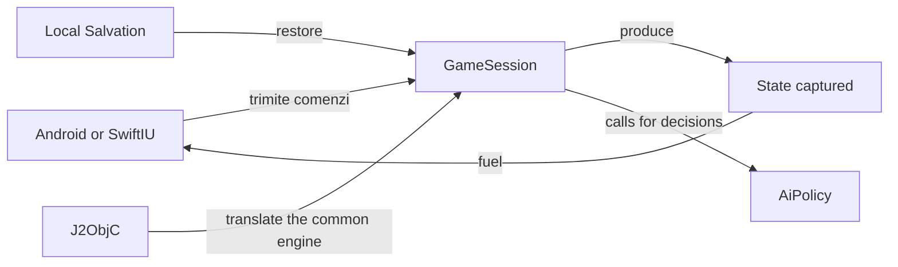

# Whist Lab - Android and iOS

## Overview

Android Whist Lab is running locally with Java joint engine and AI opponents.
The native project iOS is in qualification; SwiftIU interface and integration of the same
The engine is in the `../ios` directory.

## Folosire

The configuration allows the choice of variant, a table of 3–6 players and Normal level or Hard.

In the Romanian configuration, Hard is labeled `Dificil` in Romanian. The language EN/RO is changed from the interface selector and is kept between the starting points. The rules and the hands schedule are available from `Rules & schedule` / `Reguli și program`.

The available variants are defined in the catalogue of rules.

A rescue with a withdrawn variant remains on the device until the user starts a new game. The types of rules are defined in [GameMode](game-core/src/main/java/ro/whistlab/core/rules/GameMode.java), and actual texts and labels in [WhistUiText](app/src/main/java/ro/whistlab/app/localization/WhistUiText.java). The displayed rules are built in [HowToPlay](game-core/src/main/java/ro/whistlab/core/rules/HowToPlay.java) for the variant, language and number of players selected.

- [Rules of the game](../docs/game/README.md) has the hands, the touch, the score and the series for each profile.
- The history opens up from `Meniu joc → Scorul partidei → Istoricul scorului`. [History contract](../docs/game/ATF_ScoreHistory.md) explains the bid, the total of each player, the markings and the adaptation to the window.

## Aided bidding

At the player's turn, the Hard engine estimates and pre-selects a legal bid from visible information. The choice may be changed and must be confirmed by `Licitează` / `Place bid`; the recommendation does not submit the contract. Normal level or Difficult selected for the match continues to control the opponents.

- The calculation runs in the background and uses his own hand, the known card and the known card, the public bids and the engine score context.
- Hand choice takes priority; a delayed result does not replace selection and does not apply to any other hand or party.
- If the estimate is not available, any legal value can be chosen manually. [Contextual selection](app/src/main/java/ro/whistlab/app/bidding/HumanBidSelection.java) keeps this condition separate from the contracts submitted.

## Play the current hand automatically

- On Android, tick `Auto play` / `Automat` temporary take over the bid and the card game. [Documentation of Android activity](app/src/main/java/ro/whistlab/app/README.md#autogame-for-active-hand) describes the flow coordination.
- The check is on the right side of the title when it fits. With the text enlarged, it can occupy its own row in the header, above the edge. The number of hands and the summary of bids appear below.
- While automation is active, `Game menu` / `Meniu joc` offers `Stop auto-play` / `Oprește jocul automat`.
- The app uses Normal level or Hard chosen for its opponents and controls the human place temporarily as well. On the screen the automation stops, and the next hand returns to manual control.

Automation only affects the bidding shift and active hand game shifts. It doesn't change the AI level, the rules, the score or the game's salvation. Opening a dialogue, switching the application into background and returning suspended and retaking decisions through the existing AI coordinator.

## Flow and responsibilities



<details>
<summary>Legend and limits</summary>

GameSession validates the controls prior to the change of status; UIU returns the captured status. Persistence only restores the information available in the rescue scheme.

</details>

## Organizare

| Component | Responsibility |
|---|---|
| [game-core](game-core/README.md) | Rules, session, score, rescue and application AI policy; JVM tests. |
| [atf-card-table-ui](atf-card-table-ui/README.md) | Reusable Android Core: meniu/profil, widgets, cards, theme and hand geometry; without game engine or ATF libraries. |
| [card-table-names](card-table-names/README.md) | Java's common policy for the distribution of names in place and validation of human name. |
| [app](app/src/main/java/ro/whistlab/app/) | Android activity, table configuration, game presentation and local persistence. |
| [ai-lab](ai-lab/README.md) | JVM module of independent player, tools and experiments offline; consumed only on testing. |
| [test-audit](test-audit/README.md) | JVM fixtures for component capture and verification; excluded from application runtimeter. |
| [algorithm-build](algorithm-build/README.md) | JVM exclusive Gradle input without configuration of Android application. |
| [iOS](../ios/README.md) | SwiftIU project, joint engine translation and Apple simulator qualification. |
| [atf-test-android](../atf-test-android/README.md) | Android verification components and scenarios explicitly activated. |

The application version, the SDKs and package identifier have as source
[Gradle configuration of application](app/build.gradle). An APK built from current sources and a
APK previously installed have distinct origins; source version does not prove
[Android Acceptance Contract](../docs/testing/ATF_Android.md) defines the check of the identified binary.

## Construction and verification

| Purpose | Intrare | Resurse |
|---|---|---|
| Rapid JVM Regression | `:game-core:quickRegressionTest` prin `algorithm-build` | JDK and cache Gradle/JVM; without Android device. |
| APK Development | `:app:assembleDebug` | JDK, SDK Android and building dependencies. |
| Collection with identity and external result | [run-whist-collection.ps1](../scripts/run-whist-collection.ps1) | Configuration and preconditions [collection](../docs/testing/ATF_Collections.md). |

Execute compilers in your own `%TEMP%` work copy. From that copy
Director `whist-lab-app`:

```powershell
.\gradlew.bat -p algorithm-build :game-core:quickRegressionTest --offline --no-daemon
.\gradlew.bat :app:assembleDebug --offline --no-daemon
```

The first command requires JDK and locally available JVM dependencies. The second asks and
Android SDK declared in configuration; APK is produced in `app/build/outputs/apk`
`--offline` refuses addictions that are not already in cache.

From the root of the project, [Collections launcher](../scripts/run-whist-collection.ps1)
create his own temporary copy and accept explicit selections such as `quick`,
`regression`, `context` and `documentation`:

```powershell
.\scripts\run-whist-collection.ps1 -Collection quick
```

Component tests, offline tournaments and Android scenarios are selections
Distinguishing number of the country which has granted authorisation. External experimental candidates do not change the active application by
Their mere existence. Access to a device and installation of an APK are steps
Separate, activate explicitly.

Current contracts and mechanisms are in [Documentation](../docs/).

## Integration contracts

[Coordonarea Android](app/src/main/java/ro/whistlab/app/README.md#coordination-of-automatic-shifts) separates the calculation of AI from the main thread and makes it conditional on the application of the identity of the game and the captured status. The components shall verify the cancellation and single application; persistence, reactivity and interaction shall qualify separately for the identified binary.

| Surface | Input |
|---|---|
| New profile and compatible rescue | The configuration, score, restoration, AI projections and aid RO/EN use the same rules identity; the historical profile explicitly retains its values. |
| Guide and interface | Labels and access to the history of all places follow the current texts and commands; the complete procedures belong to the responsible guides. |

[Rules and score](../docs/game/README.md) holds the contract of the product and [Android qualifications](../docs/feedback/ATF_Android.md) keeps the criteria still open.
