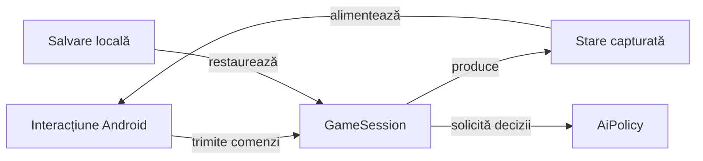

# Whist Lab

## Pe scurt

Aplicație Android locală de Whist, cu motor Java separat și adversari AI.
Identificatorul pachetului și configurația de construire sunt definite în Gradle.

## Folosire

Configurarea permite alegerea variantei, a unei mese de 3–6 jucători și a nivelului Normal sau Hard.

În română, Hard este afișat ca „Dificil”. Limba EN/RO se schimbă din selectorul interfeței și se păstrează între porniri. Regulile și programul mâinilor sunt disponibile din `Rules & schedule` / `Reguli și program`.

Variantele disponibile sunt definite în catalogul de reguli.

O salvare cu o variantă retrasă rămâne pe dispozitiv până când utilizatorul pornește o partidă nouă. Tipurile de reguli sunt definite în [GameMode](game-core/src/main/java/ro/whistlab/core/rules/GameMode.java), iar textele și etichetele efective în [WhistUiText](app/src/main/java/ro/whistlab/app/localization/WhistUiText.java). Regulile afișate se construiesc în [HowToPlay](game-core/src/main/java/ro/whistlab/core/rules/HowToPlay.java) pentru varianta, limba și numărul de jucători selectate.

În Whistul românesc se urmează culoarea cerută; dacă lipsește și există atu, tăierea este obligatorie.

- La opt cărți nu există atu.
- Contractul exact valorează `5 + levate`, iar ratarea scade diferența absolută.
- Configurarea unei partide noi aplică aceeași valoare de 5 sau 10 pentru bonusul și penalizarea după cinci mâini eligibile; profilurile istorice își păstrează configurația la restaurare.
- [Motorul de reguli](game-core/README.md) descrie domeniul și diferențele față de celelalte variante.

`Game menu → Score sheet → Score history` / `Meniu joc → Scorul partidei → Istoricul scorului` afișează cronologic două coloane pentru fiecare jucător: licitația cunoscută și punctele mâinii. Bonusul sau penalizarea de serie subliniază punctele rândului respectiv; totalurile rămân în registru și în descrierea accesibilă.

Registrul păstrează totalurile după mâinile încheiate și derivă punctele fiecărei mâini din diferența lor, inclusiv seriile. O salvare veche păstrează soldul cunoscut; mâinile lipsă nu sunt inventate. Contractele sunt în [ScoreHistory](game-core/src/main/java/ro/whistlab/core/session/ScoreHistory.java) și [GameSessionStore](app/src/main/java/ro/whistlab/app/persistence/GameSessionStore.java).

## Flux și responsabilități



<details>
<summary>Legendă și limite</summary>

GameSession validează comenzile înaintea schimbării stării; UI-ul redă starea capturată. Persistența restaurează numai informația disponibilă în schema salvării.

</details>

## Organizare

| Componentă | Responsabilitate |
|---|---|
| [game-core](game-core/README.md) | Reguli, sesiune, scor, salvare și politica AI a aplicației; teste JVM. |
| [app](app/src/main/java/ro/whistlab/app/) | Activitatea Android, configurarea mesei, prezentarea jocului și persistența locală. |
| [ai-lab](ai-lab/README.md) | Modul JVM al jucătorului independent, uneltelor și experimentelor offline; consumat numai la testare. |
| [algorithm-build](algorithm-build/README.md) | Intrare Gradle exclusiv JVM, fără configurarea aplicației Android. |
| [atf-test-android](../atf-test-android/README.md) | Componente de verificare și scenarii Android activate explicit. |

Versiunea aplicației, SDK-urile și identificatorul pachetului au ca sursă
[configurația Gradle a aplicației](app/build.gradle). Un APK construit din sursele curente și un
APK instalat anterior au proveniențe distincte; versiunea sursei nu dovedește
ce binar rulează pe dispozitiv. [Contractul acceptanței Android](../docs/testing/ATF_Android.md) definește verificarea binarului identificat.

## Construire și verificare

| Scop | Intrare | Resurse |
|---|---|---|
| Regresie JVM rapidă | `:game-core:quickRegressionTest` prin `algorithm-build` | JDK și cache Gradle/JVM; fără dispozitiv Android. |
| APK de dezvoltare | `:app:assembleDebug` | JDK, SDK Android și dependențele construirii. |
| Colecție cu identitate și rezultat extern | [run-whist-collection.ps1](../scripts/run-whist-collection.ps1) | Configurația și precondițiile [colecției](../docs/testing/ATF_Collections.md). |

Executați compilările într-o copie de lucru proprie din `%TEMP%`. Din acea copie
a directorului `whist-lab-app`:

```powershell
.\gradlew.bat -p algorithm-build :game-core:quickRegressionTest --offline --no-daemon
.\gradlew.bat :app:assembleDebug --offline --no-daemon
```

Prima comandă necesită JDK și dependențele JVM disponibile local. A doua cere și
SDK-ul Android declarat în configurație; APK-ul este produs în `app/build/outputs/apk`
din copia de lucru. `--offline` refuză dependențele care nu sunt deja în cache.

Din rădăcina proiectului, [lansatorul colecțiilor](../scripts/run-whist-collection.ps1)
creează propria copie temporară și acceptă selecții explicite precum `quick`,
`regression`, `context` și `documentation`:

```powershell
.\scripts\run-whist-collection.ps1 -Collection quick
```

Testele componente, turneele offline și scenariile Android sunt selecții
distincte. Candidații experimentali externi nu schimbă aplicația activă prin
simpla lor existență. Accesul la un dispozitiv și instalarea unui APK sunt pași
separați, activați explicit.

Contractele și mecanismele curente sunt în [documentație](../docs/).

## Contracte de integrare

[Coordonarea Android](app/src/main/java/ro/whistlab/app/README.md#coordonarea-turelor-automate) separă calculul AI de firul principal și condiționează aplicarea de identitatea partidei și a stării capturate. Componentele verifică anularea și aplicarea unică; persistența, reactivitatea și interacțiunea se califică separat pe binarul identificat.

| Suprafață | Invariantă |
|---|---|
| Profil nou și salvări compatibile | Configurarea, scorul, restaurarea, proiecțiile AI și ajutorul RO/EN folosesc aceeași identitate a regulilor; profilul istoric își păstrează explicit valorile. |
| Ghid și interfață | Etichetele și accesul la istoricul tuturor locurilor urmează textele și comenzile curente; procedurile complete aparțin ghidurilor responsabile. |

[Regulile și scorul](../docs/game/README.md) dețin contractul produsului, iar [calificările Android](../docs/feedback/ATF_Android.md) păstrează criteriile încă deschise.
