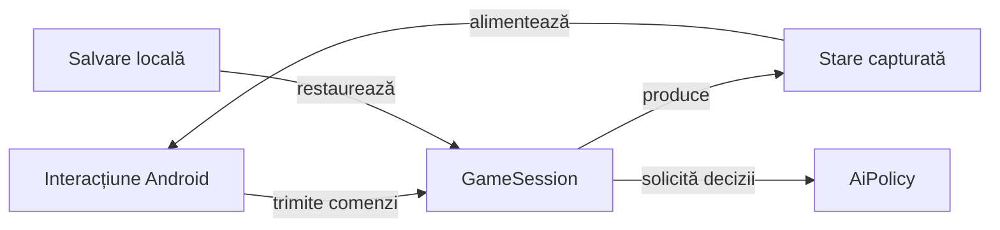

# Whist Lab

## Pe scurt

Aplicație Android locală de Whist, cu motor Java separat și adversari AI.
Identificatorul pachetului și configurația de construire sunt definite în Gradle.

## Folosire

Configurarea permite alegerea variantei, a unei mese de 3–6 jucători și a nivelului Normal sau Hard.

În română, Hard este afișat ca „Dificil”. Limba EN/RO se schimbă din selectorul interfeței și se păstrează între porniri. Regulile și programul mâinilor sunt disponibile din `Rules & schedule` / `Reguli și program`.

Variantele disponibile sunt definite în catalogul de reguli.

O salvare cu o variantă retrasă rămâne pe dispozitiv până când utilizatorul pornește o partidă nouă. Tipurile de reguli sunt definite în [GameMode](game-core/src/main/java/ro/whistlab/core/GameMode.java), iar textele și etichetele efective în [WhistUiText](app/src/main/java/ro/whistlab/app/WhistUiText.java). Regulile afișate se construiesc în [HowToPlay](game-core/src/main/java/ro/whistlab/core/HowToPlay.java) pentru varianta, limba și numărul de jucători selectate.

În Whistul românesc se urmează culoarea cerută; dacă lipsește și există atu, tăierea este obligatorie.

- La opt cărți nu există atu.
- Contractul exact valorează `5 + levate`, iar ratarea scade diferența absolută.
- Configurarea seriilor permite bonus pozitiv de 5 sau 10 după cinci contracte exacte eligibile; cinci ratări scad 5.
- [Motorul de reguli](game-core/README.md) descrie domeniul și diferențele față de celelalte variante.

`Game menu → Score sheet → Score history` / `Meniu joc → Scorul partidei → Istoricul scorului` afișează licitația, punctele și totalul fiecărei mâini pentru jucătorul ales.

Registrul păstrează totalurile după mâinile încheiate și derivă punctele fiecărei mâini din diferența lor, inclusiv seriile. O salvare veche păstrează soldul cunoscut; mâinile lipsă nu sunt inventate. Contractele sunt în [ScoreHistory](game-core/src/main/java/ro/whistlab/core/ScoreHistory.java) și [GameSessionStore](app/src/main/java/ro/whistlab/app/GameSessionStore.java).

## Flux și responsabilități



<details>
<summary>Legendă și limite</summary>

GameSession validează comenzile înaintea schimbării stării; UI-ul redă starea capturată. Persistența restaurează numai informația disponibilă în schema salvării.

</details>

## Organizare

| Componentă | Responsabilitate |
|---|---|
| [game-core](game-core/README.md) | Reguli, sesiune, scor, salvare și politica AI a aplicației; teste JVM. |
| [app](app/src/main/java/ro/whistlab/app/) | Activitatea Android, configurarea mesei, prezentarea jocului și persistența locală. |
| [ai-lab](ai-lab/README.md) | Jucător independent pentru teste; nu este inclus în APK. |
| [algorithm-build](algorithm-build/README.md) | Intrare Gradle exclusiv JVM, fără configurarea aplicației Android. |
| [atf-test-android](../atf-test-android/README.md) | Componente de verificare și scenarii Android activate explicit. |

Versiunea aplicației, SDK-urile și identificatorul pachetului au ca sursă
[configurația Gradle a aplicației](app/build.gradle). Un APK construit din sursele curente și un
APK instalat anterior au proveniențe distincte; versiunea sursei nu dovedește
ce binar rulează pe dispozitiv. [Contractul acceptanței Android](../docs/testing/android/README.md)

## Construire și verificare

Executați compilările într-o copie de lucru proprie din `%TEMP%`. Din acea copie
a directorului `whist-lab-app`:

```powershell
.\gradlew.bat -p algorithm-build :game-core:quickRegressionTest --offline --no-daemon
.\gradlew.bat :app:assembleDebug --offline --no-daemon
```

Prima comandă necesită JDK și dependențele JVM disponibile local. A doua cere și
SDK-ul Android declarat în configurație; APK-ul este produs în `app/build/outputs/apk`
din copia de lucru. `--offline` refuză dependențele care nu sunt deja în cache.

Din rădăcina proiectului, [lansatorul colecțiilor](../scripts/run-whist-collection.ps1)
creează propria copie temporară și acceptă selecții explicite precum `quick`,
`regression`, `context` și `documentation`:

```powershell
.\scripts\run-whist-collection.ps1 -Collection quick
```

Testele componente, turneele offline și scenariile Android sunt selecții
distincte. Candidații experimentali externi nu schimbă aplicația activă prin
simpla lor existență. Accesul la un dispozitiv și instalarea unui APK sunt pași
separați, activați explicit.

Contractele și mecanismele curente sunt în [documentație](../docs/).
