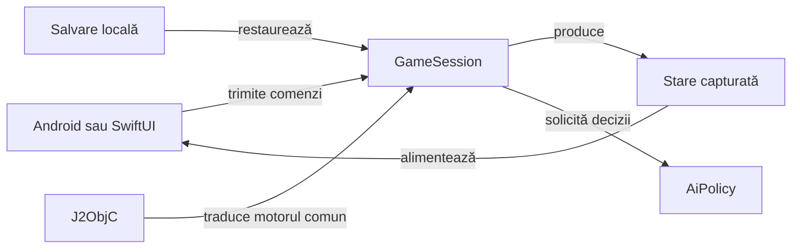

# Whist Lab — Android și iOS

## Pe scurt

Aplicația Android Whist Lab rulează local cu motorul Java comun și adversari AI.
Proiectul nativ iOS este în calificare; interfața SwiftUI și integrarea aceluiași
motor se află în directorul `../ios`.

## Folosire

Configurarea permite alegerea variantei, a unei mese de 3–6 jucători și a nivelului Normal sau Hard.

În română, Hard este afișat ca „Dificil”. Limba EN/RO se schimbă din selectorul interfeței și se păstrează între porniri. Regulile și programul mâinilor sunt disponibile din `Rules & schedule` / `Reguli și program`.

Variantele disponibile sunt definite în catalogul de reguli.

O salvare cu o variantă retrasă rămâne pe dispozitiv până când utilizatorul pornește o partidă nouă. Tipurile de reguli sunt definite în [GameMode](game-core/src/main/java/ro/whistlab/core/rules/GameMode.java), iar textele și etichetele efective în [WhistUiText](app/src/main/java/ro/whistlab/app/localization/WhistUiText.java). Regulile afișate se construiesc în [HowToPlay](game-core/src/main/java/ro/whistlab/core/rules/HowToPlay.java) pentru varianta, limba și numărul de jucători selectate.

În Whistul românesc se urmează culoarea cerută; dacă lipsește și există atu, tăierea este obligatorie.

- La opt cărți nu există atu.
- Contractul exact valorează `5 + levate`, iar ratarea scade diferența absolută.
- Configurarea unei partide noi aplică aceeași valoare de 5 sau 10 pentru bonusul și penalizarea după cinci mâini eligibile; profilurile istorice își păstrează configurația la restaurare.
- [Motorul de reguli](game-core/README.md) descrie domeniul și diferențele față de celelalte variante.

| Istoricul scorului | Folosire și comportament |
|---|---|
| Acces | `Game menu → Score sheet → Score history` / `Meniu joc → Scorul partidei → Istoricul scorului`. |
| Coloane | Fiecare jucător are licitația cunoscută și totalul după mâna respectivă. Dreptunghiul seriei apare numai în `P`, pe rândul plății; diferența mâinii rămâne în registru și în descrierea accesibilă. |
| Date păstrate | Totalurile încheiate determină punctele mâinii, inclusiv seriile; datele lipsă nu sunt inventate. [ScoreHistory](game-core/src/main/java/ro/whistlab/core/session/ScoreHistory.java) și [GameSessionStore](app/src/main/java/ro/whistlab/app/persistence/GameSessionStore.java) dețin registrul și restaurarea. |
| Adaptare | Dialogul distribuie fereastra disponibilă, cu margini proporționate și scara textului păstrată. Coloanele late se derulează orizontal; o fereastră prea scundă permite derularea conținutului integral. |
| Licitație ratată | Diagonală roșie proprie, distinctă de dreptunghiul seriei; [contractul istoricului](../docs/game/ATF_ScoreHistory.md#adaptarea-la-fereastră) explică geometria și adaptarea. |

## Licitarea asistată

La tura jucătorului, motorul Hard estimează și preselectează o licitație legală din informația vizibilă. Alegerea se poate schimba și trebuie confirmată prin `Licitează` / `Place bid`; recomandarea nu depune contractul. Nivelul Normal sau Dificil selectat pentru partidă continuă să controleze adversarii.

- Calculul rulează în fundal și folosește mâna proprie, atuul și cartea întoarsă cunoscută, licitațiile publice și contextul de scor al motorului.
- Alegerea manuală are prioritate; un rezultat întârziat nu înlocuiește selecția și nu se aplică altei mâini ori partide.
- Dacă estimarea nu este disponibilă, se poate alege manual orice valoare legală. [Selecția contextuală](app/src/main/java/ro/whistlab/app/bidding/HumanBidSelection.java) păstrează această stare separat de contractele depuse.

## Flux și responsabilități



<details>
<summary>Legendă și limite</summary>

GameSession validează comenzile înaintea schimbării stării; UI-ul redă starea capturată. Persistența restaurează numai informația disponibilă în schema salvării.

</details>

## Organizare

| Componentă | Responsabilitate |
|---|---|
| [game-core](game-core/README.md) | Reguli, sesiune, scor, salvare și politica AI a aplicației; teste JVM. |
| [card-table-ui](card-table-ui/README.md) | Nucleu Android reutilizabil: meniu/profil, widgeturi, cărți, temă și geometria mâinii; fără motorul jocului sau biblioteci ATF. |
| [card-table-names](card-table-names/README.md) | Politica Java comună pentru repartizarea numelor pe locuri și validarea numelui uman. |
| [app](app/src/main/java/ro/whistlab/app/) | Activitatea Android, configurarea mesei, prezentarea jocului și persistența locală. |
| [ai-lab](ai-lab/README.md) | Modul JVM al jucătorului independent, uneltelor și experimentelor offline; consumat numai la testare. |
| [test-audit](test-audit/README.md) | Fixture-uri JVM pentru captura și verificarea componentelor; exclus din runtime-ul aplicației. |
| [algorithm-build](algorithm-build/README.md) | Intrare Gradle exclusiv JVM, fără configurarea aplicației Android. |
| [iOS](../ios/README.md) | Proiect SwiftUI, traducerea motorului comun și calificarea pe simulator Apple. |
| [atf-test-android](../atf-test-android/README.md) | Componente de verificare și scenarii Android activate explicit. |

Versiunea aplicației, SDK-urile și identificatorul pachetului au ca sursă
[configurația Gradle a aplicației](app/build.gradle). Un APK construit din sursele curente și un
APK instalat anterior au proveniențe distincte; versiunea sursei nu dovedește
ce binar rulează pe dispozitiv. [Contractul acceptanței Android](../docs/testing/ATF_Android.md) definește verificarea binarului identificat.

## Construire și verificare

| Scop | Intrare | Resurse |
|---|---|---|
| Regresie JVM rapidă | `:game-core:quickRegressionTest` prin `algorithm-build` | JDK și cache Gradle/JVM; fără dispozitiv Android. |
| APK de dezvoltare | `:app:assembleDebug` | JDK, SDK Android și dependențele construirii. |
| Colecție cu identitate și rezultat extern | [run-whist-collection.ps1](../scripts/run-whist-collection.ps1) | Configurația și precondițiile [colecției](../docs/testing/ATF_Collections.md). |

Executați compilările într-o copie de lucru proprie din `%TEMP%`. Din acea copie
a directorului `whist-lab-app`:

```powershell
.\gradlew.bat -p algorithm-build :game-core:quickRegressionTest --offline --no-daemon
.\gradlew.bat :app:assembleDebug --offline --no-daemon
```

Prima comandă necesită JDK și dependențele JVM disponibile local. A doua cere și
SDK-ul Android declarat în configurație; APK-ul este produs în `app/build/outputs/apk`
din copia de lucru. `--offline` refuză dependențele care nu sunt deja în cache.

Din rădăcina proiectului, [lansatorul colecțiilor](../scripts/run-whist-collection.ps1)
creează propria copie temporară și acceptă selecții explicite precum `quick`,
`regression`, `context` și `documentation`:

```powershell
.\scripts\run-whist-collection.ps1 -Collection quick
```

Testele componente, turneele offline și scenariile Android sunt selecții
distincte. Candidații experimentali externi nu schimbă aplicația activă prin
simpla lor existență. Accesul la un dispozitiv și instalarea unui APK sunt pași
separați, activați explicit.

Contractele și mecanismele curente sunt în [documentație](../docs/).

## Contracte de integrare

[Coordonarea Android](app/src/main/java/ro/whistlab/app/README.md#coordonarea-turelor-automate) separă calculul AI de firul principal și condiționează aplicarea de identitatea partidei și a stării capturate. Componentele verifică anularea și aplicarea unică; persistența, reactivitatea și interacțiunea se califică separat pe binarul identificat.

| Suprafață | Invariantă |
|---|---|
| Profil nou și salvări compatibile | Configurarea, scorul, restaurarea, proiecțiile AI și ajutorul RO/EN folosesc aceeași identitate a regulilor; profilul istoric își păstrează explicit valorile. |
| Ghid și interfață | Etichetele și accesul la istoricul tuturor locurilor urmează textele și comenzile curente; procedurile complete aparțin ghidurilor responsabile. |

[Regulile și scorul](../docs/game/README.md) dețin contractul produsului, iar [calificările Android](../docs/feedback/ATF_Android.md) păstrează criteriile încă deschise.
