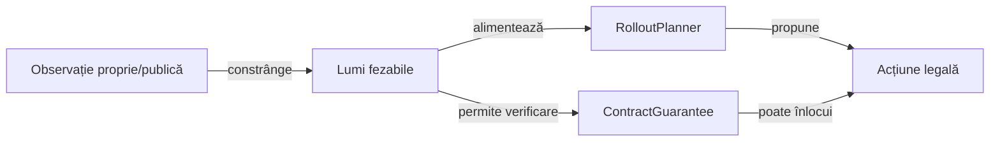

# Jucătorul independent pentru teste

## Pe scurt

Acest director este suport de test, fără importuri din motorul aplicației.
[game-core/build.gradle](../game-core/build.gradle) îl include în sursele JVM de
test; [POM-ul testelor Android](../../atf-test-android/pom.xml) îl include prin
`generate-test-sources`. Nu este modul Android și nu este inclus în APK.

## Intrare și informație disponibilă

[IndependentPlayer.Position](src/main/java/ro/whistlab/coach/IndependentPlayer.java) conține mâna proprie și fapte publice: numărul de cărți rămase, contractele, levatele, totalurile, seriile, cărțile jucate, levata curentă și cartea întoarsă.

Nu există câmp pentru mâinile reale ale adversarilor sau valoarea de inițializare a împărțirii. Adaptoarele trebuie să construiască această proiecție înainte de a apela AI-ul. În testele Android, această limită este aplicată de [WhistChallenger](../../atf-test-android/src/test/java/atf/android/e2e/player/WhistChallenger.java).

Cărțile numerice folosesc `13 × suit + rank - 2`, cu ordinea culorilor pică,
cupă, treflă, caro. Regula de urmărire a culorii, atuul obligatoriu, câștigătorul
și scorul sunt implementate separat de `game-core`.

## Flux și responsabilități



<details>
<summary>Legendă și limite</summary>

Lumile sunt ipoteze compatibile cu informația publică. Certificarea poate înlocui propunerea numai în domeniul complet enumerat; epuizarea bugetului păstrează varianta de rezervă. Jucătorul independent rămâne suport de test separat de politica aplicației.

</details>

## Politica din sursele active

Licitarea compară punctele contractelor pe aceleași lumi ipotetice; jocul
compară punctele cărților legale, cu punctele celui mai puternic adversar drept
criteriu de departajare. Bugetele și excepția pentru posteriorul de o carte se
citesc din metodele `bid` și `card` ale sursei active. Aceasta este utilitate în
puncte, nu un certificat că licitația aleasă va fi realizată.

Generatorul de distribuții folosește cărțile publice, cartea întoarsă și culorile demonstrate ca
epuizate. Dacă respingerea aleatoare nu găsește o distribuție, varianta de rezervă
fezabilă respectă necesarul și restricțiile publice. Reproductibilitatea privește
aceeași intrare completă; invarianta față de schimbarea comună a scorurilor nu
este presupusă.

[ContractGuarantee](src/main/java/ro/whistlab/coach/ContractGuarantee.java) poate înlocui o propunere numai pe baza universului complet și a continuărilor legale din domeniul finit permis de cod.

O enumerare incompletă sau un buget epuizat păstrează propunerea inițială. Lumile ipotetice folosite intern și mâinile reale de după partidă au roluri diferite; ultimele nu intră în API-ul deciziei.

[RolloutPlanner](src/main/java/ro/whistlab/coach/RolloutPlanner.java) este un model de continuare. Politicile de referință înghețate sunt separate în [sursele de test ale motorului](../game-core/src/test/java/ro/whistlab/coach/baseline), fără a intra în sursele active ale jucătorului independent.

Niciuna dintre acestea nu înseamnă un jucător perfect.

## Verificare și experimente

Dintr-o copie temporară proprie a `whist-lab-app`:

```powershell
.\gradlew.bat -p algorithm-build :game-core:test --tests ro.whistlab.coach.IndependentPlayerModelTest --tests ro.whistlab.core.ai.engine.CertifiedContractRegressionTest --offline --no-daemon
```

[IndependentPlayerModelTest](../game-core/src/test/java/ro/whistlab/coach/IndependentPlayerModelTest.java)
verifică generatorul de distribuții, proprietatea cărților și modelele finite.
[CertifiedContractRegressionTest](../game-core/src/test/java/ro/whistlab/core/ai/engine/CertifiedContractRegressionTest.java)
separă un certificat valid de lipsa garanției și de varianta de rezervă.

Turneele se rulează numai prin colecțiile și protocoalele explicite din [lansator](../../scripts/run-whist-collection.ps1).

Păstrați separat cazurile de învățare, regresiile mici, sursa candidatului și partidele noi de evaluare. Corectitudinea unei componente sau un câștig într-o lume ipotetică nu reprezintă singure un progres al forței de joc. Alternativele externe nu schimbă sursele active și nu se promovează prin simpla trecere a unui test local.
