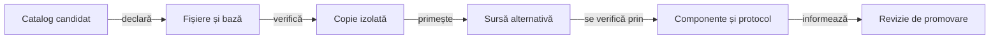

# Experimente izolate pentru modelarea licitațiilor

## Pe scurt

Acest director păstrează alternative de sursă pentru estimarea licitațiilor și interpretarea ofertelor deja observate. Catalogul le marchează pentru cercetare; sursele sunt excluse din aplicația activă și se aplică explicit unei copii temporare.

Lansatorul deține aplicarea alternativei, iar [protocolul de învățare](../../../../docs/learning/README.md) deține calificarea. O alternativă devine utilizabilă numai dacă fișierele, baza și scopul ei coincid cu manifestul declarat.

## Aplicarea unei alternative



<details>
<summary>Legendă: identitate înaintea execuției</summary>

[Catalogul](../../../../config/whist-research-candidates.json) declară fișierele comune, fișierele candidatului, hash-urile, baza și colecțiile permise. [Lansatorul](../../../../scripts/run-whist-collection.ps1) verifică sursele și apoi conținutul copiat; o bază schimbată cere reîncadrare și calificare explicită.

</details>

## Alegerea mecanismului

| Mecanism | Precondiție și limită |
|---|---|
| `-ResearchCandidate` | Identitate unică din catalog; permite numai colecțiile declarate `regression` sau `learning`. |
| `-CandidateOverlay` | Manifest extern de candidat înghețat, cu propria bază verificată; are contract separat în lansator. |
| `-Collection research` | Componentele de cercetare deja declarate în Gradle; nu aplică implicit sursele acestui director. |

Cele două moduri de suprapunere sunt mutual exclusive. Verificarea regresiei și comparația pe partide noi răspund unor întrebări distincte, chiar când folosesc aceeași alternativă.

## Pornirea unei verificări

Din rădăcina proiectului, înlocuiți identificatorul cu unul din catalog și folosiți dependențele Gradle disponibile local:

```powershell
.\scripts\run-whist-collection.ps1 -Collection regression -ResearchCandidate '<identificator-din-catalog>'
```

O bază incompatibilă este refuzată înaintea calificării. Pentru `learning` sunt necesare suplimentar identitatea candidatului, corpusul extern, protocolul compatibil și faza declarată, conform [ghidului colecțiilor](../../../../docs/testing/ATF_Collections.md).

## Principii de interpretare

- Separați modelul licitației, modelul mâinilor ascunse și continuarea jocului pentru a putea atribui efectul observat.
- Tratați lipsa unei culori dedusă legal ca restricție certă și licitația adversă ca indiciu dependent de model.
- Verificați componentele prin așteptări independente; o predicție apropiată de oferta observată nu dovedește contractul optim.
- Înghețați sursele și criteriile înaintea lotului rezervat; distribuiți aceleași cărți și rotiți locurile în comparațiile pereche.
- Păstrați extern jocurile, calibrările produse și registrele de evaluare; codul și parametrii versionați identifică alternativa reproductibilă.

[Reguli și configurare](../../../../docs/ai/ATF_RulesConfiguration.md) · [Componente și oracole](../../../../docs/testing/ATF_AiComponents.md)
