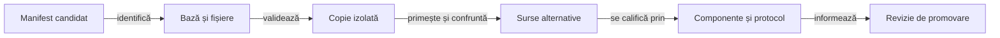

# Experimente izolate pentru modelarea licitațiilor

## Pe scurt

Alternativele de aici modifică un mecanism declarat al licitării sau al interpretării ofertelor. [Catalogul cercetării](../../../../config/whist-research-candidates.json) identifică fișierele, baza și colecțiile permise; prezența sursei nu o activează în aplicație.

## Ce mecanism se schimbă?

| Mecanism | Intrare și efect | Limită de verificare |
|---|---|---|
| Plauzibilitatea unei oferte observate | Mână ipotetică inițială și prefixul disponibil atunci; poate pondera lumile estimate. | Testul distribuției sau al helperului nu califică întregul API al licitării. |
| Oferte încă necunoscute | Estimarea ordonată a actorilor viitori din prefixul continuării simulate. | Predicția rămâne ipoteză, fără a deveni fapt public observat. |
| Licitarea ori cartea proprie | Selectarea unei alternative după utilitatea și filtrele politicii. | Cere controale ale API-ului complet și comparație separată pe partide noi. |

[Contractul YAML și al modelelor](../../../../docs/ai/ATF_RulesConfiguration.md) deține definițiile și stările. Declarați separat ponderarea, continuarea și obiectivul pentru a putea atribui efectul schimbării.

## Aplicarea unei alternative



<details>
<summary>Legendă: identitatea precede execuția</summary>

[Lansatorul](../../../../scripts/run-whist-collection.ps1) verifică baza, aplică sursele numai în copia temporară și confruntă fișierele copiate cu manifestul. O bază incompatibilă produce refuz; schimbarea hash-urilor pentru a trece controlul nu constituie migrare calificată.

</details>

## Alegerea intrării

Verificați mai întâi mecanismul schimbat, apoi integrarea candidatului. Probele de mai jos aparțin surselor alternative; execuția lor cere suprapunerea declarată în catalog, cu o bază compatibilă.

| Întrebarea experimentului | Probă din sursă | Ce rămâne separat |
|---|---|---|
| Cum se interpretează oferta observată? | [LearnedBidEvidenceTest](shared/game-core/src/test/java/ro/whistlab/core/LearnedBidEvidenceTest.java) | Decizia completă de licitare și progresul strategic. |
| Cum se estimează prefixul viitor? | [ConditionedBidForecastTest](r16-bid-forecast/game-core/src/test/java/ro/whistlab/core/ConditionedBidForecastTest.java) | Observațiile reale și efectul asupra partidei complete. |
| Cum se schimbă alegerea politicii? | [LargeHandStrategyTest](r15-bid-and-card/game-core/src/test/java/ro/whistlab/core/LargeHandStrategyTest.java) și [regresia certificată](r15-bid-and-card/game-core/src/test/java/ro/whistlab/core/CertifiedContractRegressionTest.java) | Evaluarea rezervată și calificarea costului. |

Lansatorul aplică numai fișierele candidatului ales. O selecție Gradle care nu conține acea probă sau o bază refuzată nu reprezintă executarea testului prin simpla prezență a sursei.

| Intrare | Utilizare |
|---|---|
| `-ResearchCandidate` | Identitate unică din catalog, în colecția permisă acelui candidat. |
| `-CandidateOverlay` | Manifest extern înghețat, cu contractul [inventarului complet al bazei](../../../../docs/testing/ATF_Collections.md#identitatea-completă-a-bazei-candidatului). |
| `-Collection research` | Componentele de cercetare declarate în Gradle; nu aplică automat sursele din acest director. |

Cele două moduri de suprapunere sunt mutual exclusive. Din rădăcina proiectului, pentru un identificator ales din catalog:

```powershell
.\scripts\run-whist-collection.ps1 -Collection regression -ResearchCandidate '<identificator-din-catalog>'
```

Colecția `learning` cere și candidatul, corpusul extern, protocolul compatibil și faza din [ghidul colecțiilor](../../../../docs/testing/ATF_Collections.md). Sursele se îngheață înaintea evaluării rezervate; o verificare de dezvoltare nu reface statutul unui lot deja expus.

## Cum se citește rezultatul

- **Identitate:** comparația folosește sursele și configurația copiei executate; modificarea live nu o recalifică retrospectiv.
- **Legalitate:** lipsa unei culori dedusă legal restrânge lumile certe; licitația voluntară este indiciu prin modelul declarat.
- **Domeniul probei:** [testele modelului de ofertă](shared/game-core/src/test/java/ro/whistlab/core/LearnedBidEvidenceTest.java) verifică și helperi de plauzibilitate; controlul ofertelor viitoare al acelui helper nu dovedește singur comportamentul `chooseBid`.
- **Progres:** regresia, costul și comparația pe partide noi au criterii distincte; statutul de cercetare al manifestului rămâne explicit până la promovare.
- **Retenție:** jocurile, calibrările produse și rezultatele rămân externe. Parametrii versionați identifică implementarea, fără a deveni scoruri istorice în ghid.

[Protocolul promovării](../../../../docs/learning/README.md) · [Componente și oracole](../../../../docs/testing/ATF_AiComponents.md) · [Modelul deciziei](../../../../docs/ai/ATF_DecisionModel.md)
