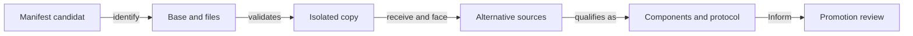

# Isolated experiments for bid modelling

## Overview

The alternatives here modify a declared mechanism of bidding or interpreting offers. [Research catalogue](../../../../config/whist-research-candidates.json) identifies the files, base and allowed collections; the presence of the source does not activate it in the application.

## What mechanism changes?

| Mechanism | Entry and effect | Verification limit |
|---|---|---|
| Plausibility of an observed offer | The initial hypothetical hand and prefix available then; can weighting the estimated worlds. | The distribution or helper test does not qualify the entire API for the bidding. |
| Offers still unknown | The orderly estimation of future actors in the prefix of the simulated continuation. | Prediction remains a hypothesis, without becoming a public fact observed. |
| Bidding or own card | Selection of an alternative after the utility and filters of policy. | Ask for full API checks and separate comparison on new games. |

[YAML contract and models](../../../../docs/ai/ATF_RulesConfiguration.md) has definitions and states. Declare weighting, continuation and objective separately to be able to attribute the effect of the change.

## Application of an alternative



<details>
<summary>Legend: identity precedes execution</summary>

[Lansatorul](../../../../scripts/run-whist-collection.ps1) checks the base, applies the sources only in temporary copy and confronts the files copied with the manifest. An incompatible basis produces refusal; changing hashes to pass control does not constitute qualified migration.

</details>

## Choice of entry

Check the changed mechanism first, then integration of the candidate. The samples below belong to alternative sources; their execution requires the overlap declared in the catalogue, with a compatible basis.

| Question of the experiment | Source sample | What remains separate |
|---|---|---|
| How do you interpret the offer you've observed? | [LearnedBidEvidenceTest](shared/game-core/src/test/java/ro/whistlab/core/LearnedBidEvidenceTest.java) | Full bidding decision and strategic progress. |
| How do you estimate the future prefix? | [ConditionedBidForecastTest](r16-bid-forecast/game-core/src/test/java/ro/whistlab/core/ConditionedBidForecastTest.java) | Real observations and effect on the full match. |
| How does policy choice change? | [LargeHandStrategyTest](r15-bid-and-card/game-core/src/test/java/ro/whistlab/core/LargeHandStrategyTest.java) and [certified regression](r15-bid-and-card/game-core/src/test/java/ro/whistlab/core/CertifiedContractRegressionTest.java) | The reserved assessment and cost qualification. |

The launcher shall apply only the files of the candidate-elect. A Gradle selection which does not contain that sample or a basis refused is not the execution of the test by simple presence of the source.

| Intrare | Usage |
|---|---|
| `-ResearchCandidate` | Unique identity in the catalogue, in the collection allowed for that candidate. |
| `-CandidateOverlay` | Frozen external manifest with contract [full base inventory](../../../../docs/testing/ATF_Collections.md#full-identity-of-candidate-base). |
| `-Collection research` | Research components declared in Gradle; do not automatically apply the sources in this directory. |

The two ways of overlapping are mutually exclusive. From the project root, for an identifier chosen from the catalogue:

```powershell
.\scripts\run-whist-collection.ps1 -Collection regression -ResearchCandidate '<identificator-din-catalog>'
```

Collection `learning` ask also candidate, external corpus, compatible protocol and phase of [Collections Guide](../../../../docs/testing/ATF_Collections.md). Sources shall be frozen prior to the reserved assessment; a development check shall not restore the status of an already exposed batch.

## How to read the result

- **Identity: ** The comparison uses the sources and configuration of the copy executed; live modification does not recalibrate it retrospectively.
- **Legality: ** lack of a legally deduced colour limits the certain worlds; voluntary bid is a clue by the stated model.
- **Probe domain:** [tests of the tender model](shared/game-core/src/test/java/ro/whistlab/core/LearnedBidEvidenceTest.java) checks also plausible helpers; controlling the future offers of that helper does not prove the behaviour alone `chooseBid`.
- **Progress: ** regression, cost and comparison on new games have distinct criteria; the research status of the manifest remains explicit until promotion.
- **Retention: ** games, product calibrations and results remain external. Versified parameters identify implementation without becoming historical scores in the guide.

[Promotion protocol](../../../../docs/learning/README.md) · [Parts and oracles](../../../../docs/testing/ATF_AiComponents.md) · [Modelul deciziei](../../../../docs/ai/ATF_DecisionModel.md)
