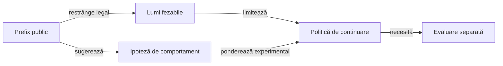

# Cercetarea modelelor de informație publică

## Pe scurt

Această zonă descrie experimente cu activare explicită privind interpretarea licitațiilor și a cărților jucate. Existența unui experiment sau a unui caz de componentă nu activează modelul în aplicație.

## Separarea ipotezelor

Legendă și limite

Constrângerile din regulile jocului sunt certe; intenția estimată a unui adversar rămâne dependentă de model. Lumile complete folosite de oracol nu devin informație privată disponibilă politicii.

Regresiile cu activare explicită verifică ipoteze mici și limitele lor. Comparațiile între politici folosesc surse înghețate, iar un lot rezervat deja deschis rămâne consumat în registrul extern.

[Sarcina Gradle de cercetare](../../../game-core/build.gradle) selectează componentele explicite; directorul acesta este un punct de orientare, fără surse proprii pentru execuția aplicației.

[Arhitectura învățării](../../../../docs/AI_LEARNING_ARCHITECTURE.md) definește fluxul de la ipoteză la promovare.
