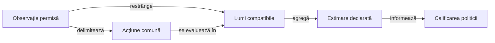

# Cercetarea deciziilor din informație publică

## Pe scurt

Această zonă explică cercetarea continuărilor de joc și a licitării din observația permisă actorului. Implementările și componentele sunt în sursele de test ale motorului; acest director este punctul lor de orientare și nu adaugă cod în aplicație.

Proprietatea urmărită este coerența informației: o alegere disponibilă în aceeași observație se evaluează consecvent în lumile ipotetice compatibile. Un rezultat local al modelului necesită separat calificarea politicii pe distribuții noi.

## De la observație la evaluare



<details>
<summary>Legendă: aceeași informație, aceeași alegere disponibilă</summary>

Mâna proprie, licitațiile și istoricul public delimitează observația. O lume ipotetică ajută calculul consecințelor; alegerea unei alte acțiuni după consultarea fiecărei lumi ar folosi informație indisponibilă actorului. Ponderarea lumilor și utilitatea comparată trebuie declarate separat.

</details>

## Componente și limite

| Proprietate cercetată | Sursa verificării |
|---|---|
| Continuări coerente, legalitate și păstrarea intrărilor | [PublicTailInformationTest](../../../game-core/src/test/java/ro/whistlab/core/ai/information/PublicTailInformationTest.java). |
| Agregarea aceleiași deschideri, obiective pe rol și refuzul lipsei de mostre | [OpeningBidEvidenceTest](../../../game-core/src/test/java/ro/whistlab/core/ai/information/OpeningBidEvidenceTest.java). |

Testele construiesc domenii finite și așteptări explicite. Ele verifică mecanismul modelului cercetat; probabilitățile unor exemple construite nu estimează automat distribuția reală a cărților adverse.

## Verificare cu activare explicită

Din rădăcina proiectului, cu Java și dependențele Gradle disponibile local:

```powershell
.\scripts\run-whist-collection.ps1 -Collection research
```

[Catalogul](../../../../config/test-collections.json) și [configurația Gradle](../../../game-core/build.gradle) definesc populația efectivă a colecției. Aceasta include și alte ipoteze de cercetare; testele menționate sunt excluse din sarcina implicită `test`.

Lansatorul pregătește copia temporară și păstrează rezultatele extern. Pentru o schimbare a politicii, [protocolul de învățare](../../../../docs/learning/README.md) cere surse înghețate, criterii declarate și un lot rezervat nefolosit la ajustare.

[Modelul deciziei](../../../../docs/ai/ATF_DecisionModel.md) · [Componente și oracole](../../../../docs/testing/ATF_AiComponents.md)
