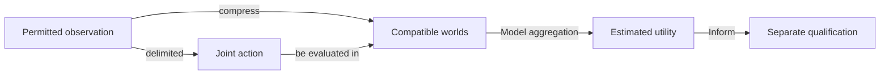

# Decisions consistent with the information available

## Overview

Research checks whether a choice uses only the information available to the actor. The implementation and components are in the engine test sources; this directory directs them without adding a policy to the application.

## Observation invariance



<details>
<summary>Legend: action depends on observation</summary>

Two hidden worlds compatible with the same observation cannot authorize different public choices just because the simulator knows them. After a new public card observations may become different and policy may react differently; the invariant does not impose a single card in all future states.

</details>

| Mechanism | Liability and limit |
|---|---|
| Observation | Own hand, contracts, public cards and the need available to that decision. |
| Hypothetical world | It allows for the assessment of consequences; its hidden cards do not become parameters of public choice. |
| Aggregation | Compare the same alternative on the worlds and weights declared. |
| The policy resulting | It needs its own qualification; the consistency of information does not demonstrate the optimal contract alone or strategic progress. |

## Order of optimization

```text
actor choice = argmax_action sum_world p(world) × U(action, world)
value with extra information = sum_world p(world) × max_action U(action, world)
```

Separate maximisation after consultation of each world can produce a value which is not accessible to a single public election. Utility, weights and continuation are distinct assumptions; the formula does not state that a rollout is calibrated or a search is complete.

## Execution and controls

| Property | Source and verification |
|---|---|
| Continuation from public information | [PublicTailPlanner](../../../game-core/src/test/java/ro/whistlab/coach/research/publictail/PublicTailPlanner.java) and [PublicTailInformationTest](../../../game-core/src/test/java/ro/whistlab/core/ai/information/PublicTailInformationTest.java): joint observation, legality and retention of entries. |
| Aggregation of an opening | [OpeningBidEvidence](../../../game-core/src/test/java/ro/whistlab/core/research/bidding/OpeningBidEvidence.java) and [OpeningBidEvidenceTest](../../../game-core/src/test/java/ro/whistlab/core/ai/information/OpeningBidEvidenceTest.java): same opening before average, stated objective and refusal of lack of samples. |

The components build finite areas with independent expectations. They qualify the mechanism of the model under scrutiny; the built samples do not automatically estimate the actual distribution of the adverse cards.

## Choice of verification

| Mechanism modified | JUnit load filter `informationResearchTest` |
|---|---|
| Observation and public follow-up | `ro.whistlab.core.ai.information.PublicTailInformationTest` |
| Aggregation of opening before average | `ro.whistlab.core.ai.information.OpeningBidEvidenceTest` |

From the `whist-lab-app` directory of a full temporary copy, with Java and locally available Gradle dependencies:

```powershell
.\gradlew.bat -p algorithm-build :game-core:informationResearchTest --offline --no-daemon
```

[Gradle](../../../game-core/build.gradle) define the exact selection, including the component of the contract pressure in the same task. Add `--tests '<filtrul-din-tabel>'` for the mechanism concerned; the two information tests are excluded from the default load `test`and collection `research` of [catalog](../../../../config/test-collections.json) is a wider selection.

To modify a policy, identify separately the observation, generator, continuation and aggregation exchanged. [Protocol offline](../../../../docs/learning/README.md) requires independent components, frozen candidate and reserved evaluation prior to promotion; concrete data and results remain external.

[Decision model](../../../../docs/ai/ATF_DecisionModel.md) · [Design of components](../../../../docs/testing/ATF_AiComponents.md)
