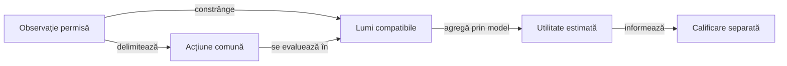

# Decizii coerente cu informația disponibilă

## Pe scurt

Cercetarea verifică dacă o alegere folosește numai informația disponibilă actorului. Implementările și componentele sunt în sursele de test ale motorului; acest director le orientează, fără a adăuga o politică în aplicație.

## Invarianta observației



<details>
<summary>Legendă: acțiunea depinde de observație</summary>

Două lumi ascunse compatibile cu aceeași observație nu pot autoriza alegeri publice diferite doar pentru că simulatorul le cunoaște. După o carte publică nouă observațiile pot deveni diferite, iar politica poate reacționa diferit; invarianta nu impune o singură carte în toate stările viitoare.

</details>

| Mecanism | Responsabilitate și limită |
|---|---|
| Observația | Mâna proprie, contracte, cărți publice și necesarul disponibil la acea decizie. |
| Lumea ipotetică | Permite evaluarea consecințelor; cărțile ei ascunse nu devin parametri ai alegerii publice. |
| Agregarea | Compară aceeași alternativă pe lumile și ponderile declarate. |
| Politica rezultată | Are nevoie de calificare proprie; coerența informației nu demonstrează singură contract optim sau progres strategic. |

## Ordinea optimizării

```text
alegere disponibilă actorului = argmax_acțiune sumă_lume p(lume) × U(acțiune, lume)
valoare cu informație în plus = sumă_lume p(lume) × max_acțiune U(acțiune, lume)
```

Maximizarea separată după consultarea fiecărei lumi poate produce o valoare inaccesibilă unei singure alegeri publice. Utilitatea, ponderile și continuarea sunt ipoteze distincte; formula nu afirmă că un rollout este calibrat ori o căutare este completă.

## Implementări și controale

| Proprietate | Sursă și verificare |
|---|---|
| Continuare din informație publică | [PublicTailPlanner](../../../game-core/src/test/java/ro/whistlab/coach/research/publictail/PublicTailPlanner.java) și [PublicTailInformationTest](../../../game-core/src/test/java/ro/whistlab/core/ai/information/PublicTailInformationTest.java): observație comună, legalitate și păstrarea intrărilor. |
| Agregarea unei deschideri | [OpeningBidEvidence](../../../game-core/src/test/java/ro/whistlab/core/research/bidding/OpeningBidEvidence.java) și [OpeningBidEvidenceTest](../../../game-core/src/test/java/ro/whistlab/core/ai/information/OpeningBidEvidenceTest.java): aceeași deschidere înaintea mediei, obiectiv declarat și refuzul lipsei de mostre. |

Componentele construiesc domenii finite cu așteptări independente. Ele califică mecanismul modelului cercetat; mostrele construite nu estimează automat distribuția reală a cărților adverse.

## Alegerea verificării

| Mecanism modificat | Filtru JUnit al sarcinii `informationResearchTest` |
|---|---|
| Observația și continuarea publică | `ro.whistlab.core.ai.information.PublicTailInformationTest` |
| Agregarea deschiderii înaintea mediei | `ro.whistlab.core.ai.information.OpeningBidEvidenceTest` |

Din directorul `whist-lab-app` al unei copii temporare complete, cu Java și dependențele Gradle disponibile local:

```powershell
.\gradlew.bat -p algorithm-build :game-core:informationResearchTest --offline --no-daemon
```

[Gradle](../../../game-core/build.gradle) definește selecția exactă, inclusiv componenta presiunii contractului în aceeași sarcină. Adăugați `--tests '<filtrul-din-tabel>'` pentru mecanismul vizat; cele două teste de informație sunt excluse din sarcina implicită `test`, iar colecția `research` din [catalog](../../../../config/test-collections.json) este o selecție mai largă.

Pentru a modifica o politică, identificați separat observația, generatorul, continuarea și agregarea schimbate. [Protocolul offline](../../../../docs/learning/README.md) cere componente independente, candidat înghețat și evaluare rezervată înaintea promovării; datele și rezultatele concrete rămân externe.

[Modelul deciziei](../../../../docs/ai/ATF_DecisionModel.md) · [Proiectarea componentelor](../../../../docs/testing/ATF_AiComponents.md)
