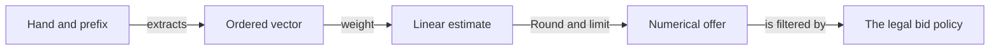

# Experimental model for the estimation of bids

## Overview

Prototype estimates the offer of an opponent from a hypothetical hand and the prefix of the bid. The two implementations keep the same numerical scheme; integration into the current engine is an explicit work separate from the existence of these sources.

- For the inspection of the artifact: [numerical verification](#compatibility-of-sources), without engine or archive.
- For integration: [Adaptation of sources and qualification](#controlled-reuse), in an identified copy.

## Model contract



<details>
<summary>Legend: prediction precedes legal decision</summary>

`predict` calculates the scalar product, applies `Math.round` and limits the result between zero and the number of cards. The filter of the last bid belongs to the future consumer; the prototype does not apply it and does not provide an exact contract probability.

</details>

| Entry or exit | Meaning |
|---|---|
| Hypothetical Hand | Books compatible with actor's observation without consulting the actual side-hand. |
| Acetum and position | Color or no trump, plus position in bidding order. |
| Prefix | The amount of tenders already submitted; future tenders are not observed entries. |
| Features | Order and normalisation of `features` ed [metadata](calibration.json), kept together with the coefficients. |
| Result | A whole of the range of his hand; complete legality checks out in the policy that consumes him. |

## Compatibility of sources

The artifact verification is available separately, without engine, Android or game archive. From the root of the project, with Node.js:

```powershell
node --test whist-lab-app/ai-lab/tools/bidding/whist-prototype-contract.test.mjs
```

[Executable contract](../../tools/bidding/whist-prototype-contract.test.mjs) checks the order of characteristics, finite coefficients, the numerical identity of the two sources and the refusal of modified metadata. It is a sample of the preserved artifact; the execution of Predictor Java and integration into current policy have distinct qualifications.

Sources of `experiments` are excluded from the default compilation of [lab](../../build.gradle). Copying them into another package changes the identity of the candidate and requires the qualification of that child.

<details>
<summary>Types, access and scalings to be confronted with integration</summary>

| Source | Preserved form | What needs to be resolved before integration |
|---|---|---|
| [Engine variant](engine/EstimatedBidPrior.java) | Class and method with package access in `ro.whistlab.core`; simple references to `Card` and `Trump`. | The current types are in [core.model](../../../game-core/src/main/java/ro/whistlab/core/model/). Set package, imports and access from the consumer; the form retained is not ready to copy in active policy. |
| [Independent variant](independent/EstimatedBidPrior.java) | `ro.whistlab.coach`, cards `13 × suit + rank − 2`, no imports from the engine. | Keep the order drop-cup-treflam-diamonds and code without the trump; check the equivalence of the extraction without joining the two models. |

Metadata shall identify the vocabulary, coefficients and provenance of the model. Calibration metrics are given to that artifact; they do not certify integration or the strength of current policy and do not copy into the guide.

The scaling is fixed in the prototype, including `size/8` and `position/3`. Expansion to another domain requires validation of inputs and qualification; the signature of the method does not declare compatibility with any table on its own.

</details>

## Controlled reuse

1. Define the consumer: the prediction of the offer observed, the estimation of the still unknown offers or the choice of the contract has different objectives.
2. Prepare an isolated copy and adapt the types and access; keep base inventory and identified alternative sources.
3. Build components for range, lack of edge, coding of cards and parity of vectors and predictions between implementation.
4. Check separately the last player's bid and the full API's permitted observation; the predictor's test does not qualify the public decision alone.
5. Enter integration into the candidate manifest and apply [protocol offline](../../../../docs/learning/README.md) prior to promotion.

This director does not declare his own integration suite. [Research Collection](../../../../docs/testing/ATF_Collections.md) performs only the cases declared in the catalogue and Gradle; it does not automatically adapt or include this prototype.

[Source-isolated alternatives](../bid-models/README.md) · [Model semantics and YAMLs](../../../../docs/ai/ATF_RulesConfiguration.md)
