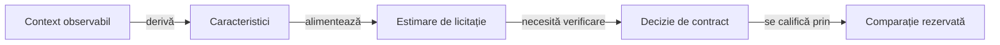

# Estimare inițială experimentală pentru licitare

## Pe scurt

Directorul păstrează un model experimental de licitare și suportul său de cercetare, exclus din sursele active ale aplicației. Predicția licitațiilor observate este o ipoteză de model, nu o etichetă de licitație optimă.

## Mecanism și activare

Legendă și limite

Calibrarea estimează comportamentul din datele de dezvoltare. Folosirea estimării într-o politică necesită o alternativă izolată și o evaluare separată a rezultatelor de joc.

O modificare a acestui mecanism cere regresii pentru datele publice, o bază înghețată și comparații pereche pe loturi noi. Seturile de antrenare, parametrii rezultați dintr-o rulare și rezultatele evaluării se gestionează în corpusul extern.

Contractele pentru [motor](engine/EstimatedBidPrior.java) și [jucătorul independent](independent/EstimatedBidPrior.java) se păstrează separat pentru a controla influența asupra fiecărei politici.

[Protocolul de învățare](../../../../docs/AI_TRAINING_PROTOCOL.md) definește criteriile de promovare.
