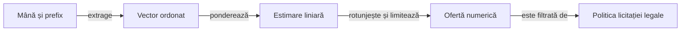

# Model experimental pentru estimarea licitațiilor

## Pe scurt

Prototipul estimează oferta unui adversar dintr-o mână ipotetică și prefixul licitației. Cele două implementări păstrează aceeași schemă numerică; integrarea în motorul curent este o lucrare explicită, separată de existența acestor surse.

- Pentru inspectarea artefactului: [verificarea numerică](#compatibilitatea-surselor), fără motor sau arhivă.
- Pentru o integrare: [adaptarea surselor și calificarea](#reutilizare-controlată), într-o copie identificată.

## Contractul modelului



<details>
<summary>Legendă: predicția precede decizia legală</summary>

`predict` calculează produsul scalar, aplică `Math.round` și limitează rezultatul între zero și numărul cărților. Filtrul ultimei licitații aparține viitorului consumator; prototipul nu îl aplică și nu furnizează o probabilitate a contractului exact.

</details>

| Intrare sau ieșire | Semnificație |
|---|---|
| Mâna ipotetică | Cărți compatibile cu observația actorului, fără consultarea mâinii reale adverse. |
| Atu și poziție | Culoare sau fără atu, plus poziția în ordinea licitării. |
| Prefix | Suma ofertelor deja depuse; ofertele viitoare nu sunt intrări observate. |
| Caracteristici | Ordinea și normalizarea din `features` al [metadatelor](calibration.json), păstrate împreună cu coeficienții. |
| Rezultat | Un întreg din intervalul mâinii; legalitatea completă se verifică în politica ce îl consumă. |

## Compatibilitatea surselor

Verificarea artefactului este disponibilă separat, fără motor, Android sau arhiva partidelor. Din rădăcina proiectului, cu Node.js:

```powershell
node --test whist-lab-app/ai-lab/tools/bidding/whist-prototype-contract.test.mjs
```

[Contractul executabil](../../tools/bidding/whist-prototype-contract.test.mjs) verifică ordinea caracteristicilor, coeficienții finiți, identitatea numerică a celor două surse și refuzul metadatelor modificate. Este o probă a artefactului păstrat; execuția predictorului Java și integrarea în politica actuală au calificări distincte.

Sursele din `experiments` sunt excluse din compilarea implicită a [laboratorului](../../build.gradle). Copierea lor într-un alt pachet schimbă identitatea candidatului și cere calificarea acelei copii.

<details>
<summary>Tipuri, acces și scalări care trebuie confruntate la integrare</summary>

| Sursă | Formă păstrată | Ce trebuie rezolvat înaintea integrării |
|---|---|---|
| [Varianta motorului](engine/EstimatedBidPrior.java) | Clasă și metodă cu acces de pachet în `ro.whistlab.core`; referințe simple la `Card` și `Trump`. | Tipurile curente sunt în [core.model](../../../game-core/src/main/java/ro/whistlab/core/model/). Stabiliți pachetul, importurile și accesul din consumator; forma păstrată nu este gata de copiat în politica activă. |
| [Varianta independentă](independent/EstimatedBidPrior.java) | `ro.whistlab.coach`, cărți `13 × suit + rank − 2`, fără importuri din motor. | Păstrați ordinea pică–cupă–treflă–caro și codul fără atu; verificați echivalența extragerii fără a uni cele două modele. |

Metadatele identifică vocabularul, coeficienții și proveniența modelului. Metricile calibrării sunt date ale acelui artefact; nu certifică integrarea ori forța politicii curente și nu se copiază în ghid.

Scalările sunt fixe în prototip, inclusiv `size/8` și `position/3`. Extinderea la alt domeniu cere validarea intrărilor și calificare; semnătura metodei nu declară singură compatibilitatea cu orice masă.

</details>

## Reutilizare controlată

1. Definiți consumatorul: predicția ofertei observate, estimarea ofertelor încă necunoscute sau alegerea contractului propriu au obiective diferite.
2. Pregătiți o copie izolată și adaptați tipurile și accesul; păstrați inventarul bazei și sursele alternative identificate.
3. Construiți componente pentru interval, lipsa atuului, codificarea cărților și paritatea vectorilor și predicțiilor între implementări.
4. Verificați separat oferta interzisă a ultimului jucător și observația permisă a API-ului complet; testul predictorului nu califică singur decizia publică.
5. Introduceți integrarea în manifestul candidatului și aplicați [protocolul offline](../../../../docs/learning/README.md) înaintea promovării.

Acest director nu declară o suită proprie de integrare. [Colecția research](../../../../docs/testing/ATF_Collections.md) execută numai cazurile declarate în catalog și Gradle; ea nu adaptează sau include automat acest prototip.

[Alternative izolate de sursă](../bid-models/README.md) · [Semantica modelelor și YAML-urilor](../../../../docs/ai/ATF_RulesConfiguration.md)
