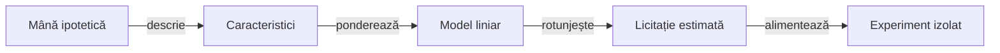

# Model experimental pentru estimarea licitațiilor

## Pe scurt

Acest director păstrează două implementări ale unui model liniar care estimează licitația unei mâini ipotetice. Modelul aparține cercetării și este exclus din sursele active ale aplicației și ale jucătorului independent.

Coeficienții versionați identifică prototipul; folosirea lui într-o politică cere integrare izolată, componente proprii și calificare pe partide noi. Predicția unei licitații observate și alegerea contractului propriu au criterii de corectitudine diferite.

## Transformarea intrării

Legendă: predicție și decizie

Caracteristicile descriu mărimea mâinii, atuul, rangurile, distribuția culorilor, poziția și suma licitațiilor anterioare. Rezultatul liniar este rotunjit și limitat la intervalul de la zero la numărul de cărți; modelul nu aplică restricția ultimei licitații și nu produce o probabilitate a contractului.

## Surse și responsabilități

| Intrare | Contract |
|---|---|
| [Implementarea pentru motor](engine/EstimatedBidPrior.java) | Extrage caracteristici din tipurile de cărți ale prototipului motorului. |
| [Implementarea independentă](independent/EstimatedBidPrior.java) | Extrage separat aceleași caracteristici din cărți numerice, fără importuri din motor. |
| [Metadatele calibrării](calibration.json) | Identifică vocabularul caracteristicilor și parametrii experimentali; valorile unei calibrări rămân date ale modelului. |

Sursele păstrează pachetele prototipului. Compatibilitatea cu tipurile și pachetele motorului curent se verifică înaintea oricărei reutilizări într-o copie izolată.

## Condiții pentru reutilizare

- Reconstruiți numai contextul disponibil actorului; mâinile ipotetice nu autorizează accesul politicii la cărțile reale adverse.
- Păstrați aceeași ordine și normalizare a caracteristicilor pentru coeficienții identificați.
- Verificați prin componente independente intervalul rezultatului, codificarea culorilor și rangurilor, lipsa atuului și echivalența celor două extrageri.
- Aplicați legalitatea licitației în politica ce consumă predicția; intervalul numeric singur nu asigură oferta legală.
- Calificați separat efectul asupra punctelor și contractelor, prin [protocolul de învățare](../../../../docs/learning/README.md).

API-ul de predicție și limitele numerice se verifică în sursele indicate. Acest director nu declară o suită proprie care să certifice integrarea în politica activă; selectarea [colecției de cercetare](../../../../docs/testing/ATF_Collections.md) nu include automat orice prototip păstrat aici.

Corpusul de antrenare și rezultatele execuțiilor se păstrează extern. [Regulile și configurarea AI](../../../../docs/ai/ATF_RulesConfiguration.md) explică diferența dintre parametrii identificați și un consumator runtime calificat.
