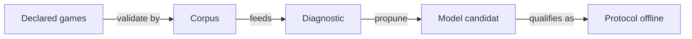

# AI laboratory tools

## Overview

The Node.js tools belong to JVM `ai-lab` module and check offline learning data or mechanisms. They keep the actor's observation, complete data of the oracle and evaluation results separately.

The implementation and tests of each mechanism shall be together, grouped in responsibility. Gradle `:ai-lab:testTools`'s pregnancy runs local tests; experiments on external corpus are activated separately.

## Data flow



<details>
<summary>Legend: Analysis and promotion</summary>

The validator shall verify the rules and the score before interpreting the results. The diagnosis motivates a rule or candidate; promotion requires independent components and reserved evaluation from protocol.

</details>

## Organization

| Director | Responsibility |
|---|---|
| [corpus](corpus/) | Party scheme, curator, active body analysis and examples extraction. |
| [patterns](patterns/) | Description of the fees and descriptive calibrations on development data. |
| [bidding](bidding/) | Features, bidding models, controlled generation and Java pattern identified. |
| [learning](learning/) | Composition of the lots and evaluation of protocols or arena. |
| [diagnostics](diagnostics/) | Divergence, contextual pressure and finite responses. |
| [qualification](qualification/) | Explicit criteria for local corrections and candidate characteristics. |
| [testing](testing/) | A determinist builder of legal games for components, without reading the archive. |

[Validator of candidate base](qualification/WhistCandidateSource.psm1) retains the complete inventory of sources and the final copy verification. [The contract of the manifest](../../../docs/testing/ATF_Collections.md#full-identity-of-candidate-base) holds migration, canonical hash and the boundary between base and candidate; its components use temporary directories built without archived games.

[Registrul expunerii](qualification/whist-evaluation-registry.mjs) coordinates the batches between the corpuss and restores the resumption as known exposure. [Register contract](../../../docs/learning/ATF_EvaluationRegistry.md) defines identity, import of history, blocking and recovery after interruption.

- **Generic mechanism:** [intersection of the intervals](qualification/half-open-interval.mjs) is pure and receives full semi-open intervals.
- **Field Adapter:** Whist keeps distribution space, seedness validation and persistence; [transferable lessons](../../../docs/learning/ATF_PolicyEvolution.md#lessons-to-other-games-and-products) explain this border.

## Verification

From the `whist-lab-app` directory of a full temporary copy of the project, with Java, Node.js and the locally available Gradle dependencies:

```powershell
.\gradlew.bat -p algorithm-build :ai-lab:testTools --offline --no-daemon
```

- **Solving: ** Gradle executes Node from the root of the project copy. The imports and resources of the tools shall be resolved against the file which holds them; the entries of the CLL and external destinations shall be declared by the caller.
- **Local data:** tests [corpus](corpus/whist-corpus.test.mjs) and [curator](corpus/whist-active-corpus.test.mjs) use [partide construite](testing/legal-game-fixture.mjs), with distribution, bids, legal game and score calculated separately from the validator. Temporary files belong to the test. `--offline` ask for separate available Gradle dependencies.
- **Reproduction: ** Semantic identities of the records shall be kept when physically moving the source. The old catches shall be reproduced from their identified copy and the external directories shall not be rewritten by this organization.

[Modulul AI](../README.md) · [Protocolul](../../../docs/learning/README.md) · [Collections](../../../docs/testing/ATF_Collections.md)

## Limits and qualification

The built data qualify his mechanism and refusals; there are no new games to demonstrate strategic progress. The archive's playbook uses separate entry from the [contract of the body](../../../docs/learning/ATF_Corpus.md#usage), with file and SHA-256 declared. No archive shall be selected by default in the components.

Qualification of gear by volume and interruption remains monitored in [Laboratory feedback](../../../docs/feedback/ATF_Ai.md#autonomous-laboratory-verification).

[Protocolul](../../../docs/learning/README.md) holds the display of lots and promotion. The notes and results of an assessment shall remain external; the exposure register shall not automatically certify the other tools.
