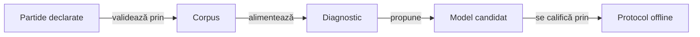

# Uneltele laboratorului AI

## Pe scurt

Uneltele Node.js aparțin modulului JVM `ai-lab` și verifică datele sau mecanismele de învățare offline. Ele păstrează separat observația actorului, datele complete ale oracolului și rezultatele evaluării.

Implementarea și testele fiecărui mecanism stau împreună, grupate pe responsabilitate. Sarcina Gradle `:ai-lab:testTools` rulează testele locale; experimentele pe corpusuri externe se activează separat.

## Fluxul datelor



<details>
<summary>Legendă: analiză și promovare</summary>

Validatorul verifică regulile și scorul înaintea interpretării rezultatelor. Diagnosticul motivează o regulă sau un candidat; promovarea cere componente independente și evaluarea rezervată din protocol.

</details>

## Organizare

| Director | Responsabilitate |
|---|---|
| [corpus](corpus/) | Schema partidelor, curatorul, analiza corpusului activ și extragerea exemplelor. |
| [patterns](patterns/) | Descrierea onorurilor și calibrări descriptive pe date de dezvoltare. |
| [bidding](bidding/) | Caracteristici, modele de licitare, generare controlată și șablonul Java identificat. |
| [learning](learning/) | Compoziția loturilor și evaluarea protocoalelor ori arenei. |
| [diagnostics](diagnostics/) | Divergențe, presiune contextuală și răspunsuri finite. |
| [qualification](qualification/) | Criterii explicite pentru corecții locale și caracteristici candidate. |
| [testing](testing/) | Constructor determinist de partide legale pentru componente, fără citirea arhivei. |

[Validatorul bazei candidatului](qualification/WhistCandidateSource.psm1) păstrează inventarul complet al surselor și verificarea copiei finale. [Contractul manifestului](../../../docs/testing/ATF_Collections.md#identitatea-completă-a-bazei-candidatului) deține migrarea, hash-ul canonic și delimitarea dintre bază și candidat; componentele sale folosesc directoare temporare construite, fără partide arhivate.

[Registrul expunerii](qualification/whist-evaluation-registry.mjs) coordonează loturile între corpusuri și păstrează reluarea ca expunere cunoscută. [Contractul registrului](../../../docs/learning/ATF_EvaluationRegistry.md) definește identitatea, importul istoricului, blocarea și recuperarea după întrerupere.

- **Mecanism generic:** [intersecția intervalelor](qualification/half-open-interval.mjs) este pură și primește intervale întregi semi-deschise.
- **Adaptor de domeniu:** Whist păstrează spațiul distribuțiilor, validarea seed-urilor și persistența; [lecțiile transferabile](../../../docs/learning/ATF_PolicyEvolution.md#lecții-transferabile-către-alte-jocuri-și-produse) explică această graniță.

## Verificare

Din directorul `whist-lab-app` al unei copii temporare complete a proiectului, cu Java, Node.js și dependențele Gradle disponibile local:

```powershell
.\gradlew.bat -p algorithm-build :ai-lab:testTools --offline --no-daemon
```

- **Rezolvare:** Gradle execută Node din rădăcina copiei proiectului. Importurile și resursele uneltelor se rezolvă față de fișierul care le deține; intrările CLI și destinațiile externe sunt declarate de apelant.
- **Date locale:** testele de [corpus](corpus/whist-corpus.test.mjs) și de [curator](corpus/whist-active-corpus.test.mjs) folosesc [partide construite](testing/legal-game-fixture.mjs), cu distribuire, licitații, joc legal și scor calculate separat de validator. Fișierele temporare aparțin testului. `--offline` cere separat dependențe Gradle disponibile local.
- **Reproductibilitate:** identitățile semantice ale înregistrărilor se păstrează la mutarea fizică a sursei. Capturile vechi se reproduc din copia lor identificată, iar directoarele externe nu sunt rescrise prin această organizare.

[Modulul AI](../README.md) · [Protocolul](../../../docs/learning/README.md) · [Colecții](../../../docs/testing/ATF_Collections.md)

## Limite și calificare

Datele construite califică mecanismul și refuzurile sale; nu sunt partide noi pentru demonstrarea progresului strategic. Replay-ul arhivei folosește intrarea separată din [contractul corpusului](../../../docs/learning/ATF_Corpus.md#utilizare), cu fișier și SHA-256 declarate. Nicio arhivă nu se selectează implicit în componente.

Calificarea uneltelor pe volume și întreruperi rămâne urmărită în [feedback-ul laboratorului](../../../docs/feedback/ATF_Ai.md#verificarea-autonomă-a-laboratorului).

[Protocolul](../../../docs/learning/README.md) deține expunerea loturilor și promovarea. Notele și rezultatele unei evaluări rămân externe; registrul expunerii nu certifică automat celelalte unelte.
