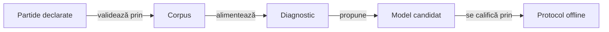

# Uneltele laboratorului AI

## Pe scurt

Uneltele Node.js aparțin modulului JVM `ai-lab` și verifică datele sau mecanismele de învățare offline. Ele păstrează separat observația actorului, datele complete ale oracolului și rezultatele evaluării.

Implementarea și testele fiecărui mecanism stau împreună, grupate pe responsabilitate. Sarcina Gradle `:ai-lab:testTools` rulează testele locale; experimentele pe corpusuri externe se activează separat.

## Fluxul datelor



<details>
<summary>Legendă: analiză și promovare</summary>

Validatorul verifică regulile și scorul înaintea interpretării rezultatelor. Diagnosticul motivează o regulă sau un candidat; promovarea cere componente independente și evaluarea rezervată din protocol.

</details>

## Organizare

| Director | Responsabilitate |
|---|---|
| [corpus](corpus/) | Schema partidelor, curatorul, analiza corpusului activ și extragerea exemplelor. |
| [patterns](patterns/) | Descrierea onorurilor și calibrări descriptive pe date de dezvoltare. |
| [bidding](bidding/) | Caracteristici, modele de licitare, generare controlată și șablonul Java identificat. |
| [learning](learning/) | Compoziția loturilor și evaluarea protocoalelor ori arenei. |
| [diagnostics](diagnostics/) | Divergențe, presiune contextuală și răspunsuri finite. |
| [qualification](qualification/) | Criterii explicite pentru corecții locale și caracteristici candidate. |

[Validatorul bazei candidatului](qualification/WhistCandidateSource.psm1) păstrează inventarul complet al surselor și verificarea copiei finale. [Contractul manifestului](../../../docs/testing/ATF_Collections.md#identitatea-completă-a-bazei-candidatului) deține migrarea, hash-ul canonic și delimitarea dintre bază și candidat; componentele sale folosesc directoare temporare construite, fără partide arhivate.

## Verificare

Din directorul `whist-lab-app` al unei copii temporare complete a proiectului, cu Java, Node.js și dependențele Gradle disponibile local:

```powershell
.\gradlew.bat -p algorithm-build :ai-lab:testTools --offline --no-daemon
```

- **Rezolvare:** Gradle execută Node din rădăcina copiei proiectului. Importurile și resursele uneltelor se rezolvă față de fișierul care le deține; intrările CLI și destinațiile externe sunt declarate de apelant.
- **Date necesare:** testele de [corpus](corpus/whist-corpus.test.mjs) și de [curator](corpus/whist-active-corpus.test.mjs) citesc o partidă de referință externă, cu așteptări fixe. Copia de execuție trebuie să aibă acces la acel fixture; `--offline` controlează rezolvarea dependențelor Gradle și nu furnizează datele de test.
- **Reproductibilitate:** identitățile semantice ale înregistrărilor se păstrează la mutarea fizică a sursei. Capturile vechi se reproduc din copia lor identificată, iar directoarele externe nu sunt rescrise prin această organizare.

[Modulul AI](../README.md) · [Protocolul](../../../docs/learning/README.md) · [Colecții](../../../docs/testing/ATF_Collections.md)

## Îmbunătățiri prioritare ale verificării offline

Testele corpusului și curatorului citesc implicit o partidă arhivată dintr-o locație externă fixată. Această dependență trebuie scoasă din selecția implicită de componente pentru ca verificarea unui checkout nou să aibă intrări disponibile și identificabile.

| Prioritate | Cerință | Criteriu de închidere |
|---|---|---|
| P1 | Generați fixture-uri legale mici pentru componente. | Testele implicite trec cu arhiva absentă și folosesc numai date construite în directoare temporare; controalele negative corup deliberat cartea, licitația, levata și scorul. |
| P1 | Separați verificarea de arhivă. | O intrare explicită cere fixture și hash, refuză datele lipsă sau schimbate și păstrează scopul de replay; seturile de antrenare rămân în afara proiectului. |
| P2 | Calificați uneltele pe volume și întreruperi controlate. | Criteriile de corpus, selecție și compoziție includ intrări duplicate, fișiere incomplete, scriere concurentă și cost măsurat; bugetele păstrează proveniența și cazurile cu eșec. |

[Protocolul](../../../docs/learning/README.md) deține expunerea loturilor și promovarea. Notele și rezultatele unei evaluări rămân externe; un README explică mecanismul și criteriul de închidere.
