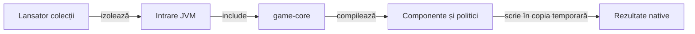

# Construire JVM pentru reguli și algoritmi

## Pe scurt

Această intrare Gradle include proiectul existent `game-core`, fără configurarea
aplicației sau a extensiei Android pentru Gradle. Relația este definită în
[settings.gradle](settings.gradle); sursele și sarcinile Gradle rămân în
[game-core/build.gradle](../game-core/build.gradle).

Sunt necesare JDK 17 sau mai nou, lansatorul Gradle inclus în proiect și dependențele JVM ale
testelor. `ANDROID_HOME` nu este necesar aici. `--offline` folosește dependențele păstrate
local și eșuează explicit dacă lipsește una.

## Flux și responsabilități



<details>
<summary>Legendă și limite</summary>

Aceasta este o intrare de construire, nu o copie a motorului. Sursele și selecțiile rămân în game-core; lansatorul asigură copia temporară și destinația externă a rezultatelor.

</details>

Dintr-o copie proprie din `%TEMP%` a `whist-lab-app`:

```powershell
.\gradlew.bat -p algorithm-build :game-core:quickRegressionTest --offline --no-daemon
.\gradlew.bat -p algorithm-build :game-core:regressionTest --offline --no-daemon
.\gradlew.bat -p algorithm-build :game-core:contextRegressionTest --offline --no-daemon
.\gradlew.bat -p algorithm-build :game-core:tasks --all --offline --no-daemon
```

`game-core` adaugă sursele jucătorului independent numai în calea de clase a testelor.
Sarcina Gradle implicită exclude turneele, analiza erorilor și cercetările cu activare explicită conform
configurației Gradle curente. `contextRegressionTest` selectează componentele contextuale;
nu joacă un turneu complet.

[Lansatorul colecțiilor](../../scripts/run-whist-collection.ps1) citește [catalogul](../../config/test-collections.json), creează o copie temporară și alege sarcina Gradle după colecție și protocol.

Pentru `learning` sunt obligatorii candidatul, corpusul extern și protocolul explicit. Reluarea parțială declară exact cazurile lipsă și păstrează aceeași sursă; evaluarea neatinsă cere înghețarea surselor și rezervare înainte de deschidere. Sarcinile Gradle istorice nu sunt alegeri implicite pentru un experiment nou.

XML-ul nativ și fișierele de construire apar în `game-core/build` din copia temporară.

Pentru capturarea componentelor se poate furniza un director extern nou prin `whist.componentEvidence`; ID-urile capturilor nu se suprascriu. Nu rulați simultan cele două intrări Gradle în aceeași copie, deoarece folosesc aceleași directoare de ieșire.

Această intrare nu construiește, instalează sau controlează o aplicație Android.

Verificarea modelului, puterea statistică pe partide noi și acceptanța interfeței au criterii diferite.
