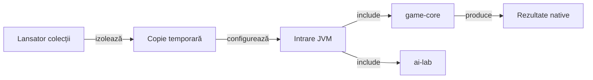

# Construire JVM pentru reguli și algoritmi

## Pe scurt

Această intrare Gradle construiește modulele JVM fără configurarea aplicației Android. [settings.gradle](settings.gradle) include `game-core` și `ai-lab`; fiecare modul deține sursele, dependențele și verificările sale.

Sunt necesare JDK 17 sau mai nou, lansatorul Gradle al proiectului și dependențele JVM în cache. Opțiunea `--offline` refuză dependențele lipsă; SDK-ul Android nu este necesar acestei intrări.

## Flux și responsabilități



<details>
<summary>Legendă: o singură sursă a motorului</summary>

Intrarea JVM folosește proiectele vecine. `game-core` consumă `ai-lab` numai prin dependența de test; sursele independente se compilează în modulul lor, iar lansatorul colecțiilor pregătește izolarea și arhivarea rezultatelor.

</details>

## Verificarea uzuală

Din rădăcina proiectului, [lansatorul colecțiilor](../../scripts/run-whist-collection.ps1) creează propria copie temporară:

```powershell
.\scripts\run-whist-collection.ps1 -Collection quick
```

[Catalogul colecțiilor](../../config/test-collections.json) leagă intenția de sarcina Gradle. [Ghidul selecțiilor](../../docs/testing/ATF_Collections.md) explică precondițiile cercetării, turneelor și evaluării rezervate.

## Folosirea directă a Gradle

Din directorul `whist-lab-app` al unei copii temporare complete a proiectului:

```powershell
.\gradlew.bat -p algorithm-build :game-core:quickRegressionTest --offline --no-daemon
```

Sarcina aleasă determină limita verificării:

| Sarcină din game-core | Contract |
|---|---|
| `quickRegressionTest` | Selecție focalizată de reguli și contexte, definită în Gradle. |
| `regressionTest` | Deleagă sarcina `test`, cu excluderile sale explicite. |
| `contextRegressionTest` | Regresii contextuale cu martori legali independenți. |
| `documentationTest` | Contractul ajutorului de joc și al textelor regulilor. |
| `tasks --all` | Inventarul sarcinilor configurate; nu execută verificările jocului. |

[game-core/build.gradle](../game-core/build.gradle) este sursa selecțiilor efective. Turneele, mineritul erorilor și componentele de cercetare au sarcini distincte și activare explicită.

## Ieșiri și concurență

- XML-ul nativ și fișierele de construire apar în `game-core/build` al copiei temporare.
- `whist.componentEvidence` poate selecta un director extern pentru capturi de componentă; identitățile capturilor se păstrează fără suprascriere.
- Cele două intrări Gradle ale aplicației folosesc aceleași directoare ale proiectului inclus; execuțiile concurente au nevoie de copii distincte.
- Rezultatul identifică sursele și selecția executată; acceptanța Android și calificarea forței de joc au criterii separate.

[Motorul](../game-core/README.md) · [Testarea](../../docs/testing/README.md) · [Învățarea offline](../../docs/learning/README.md)
