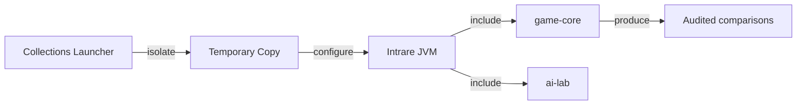

# JVM building for rules and algorithms

## Overview

This Gradle input builds JVM modules without configuration of Android application. [settings.gradle](settings.gradle) includes `game-core`, `ai-lab` and fixtures `test-audit`; each module has its sources, dependencies and checks.

The audited testing requires JDK 21, the Gradle project launcher and the JVM dependencies in cache. The engine keeps Java target declared in mode; test libraries do not enter the Android runtime. Option `--offline` refuses missing dependencies; Android SDK is not required for this entry.

## Flow and responsibilities



<details>
<summary>Legend: one engine source</summary>

JVM input uses neighbouring projects. `game-core` consumes `ai-lab` only through test dependence; independent sources compile in their module, and the collector of collections prepares isolation and archiving results.

</details>

## Normal verification

From the project root, [Collections launcher](../../scripts/run-whist-collection.ps1) creates its own temporary copy:

```powershell
.\scripts\run-whist-collection.ps1 -Collection quick
```

[Catalogue of collections](../../config/test-collections.json) links the intention to task Gradle [Select guide](../../docs/testing/ATF_Collections.md) explains the preconditions of the research, tournaments and evaluation reserved.

## Direct use of Gradle

From the `whist-lab-app` directory of a full temporary copy of the project:

```powershell
.\gradlew.bat -p algorithm-build :game-core:quickRegressionTest --offline --no-daemon
```

The chosen task shall determine the limit of verification:

| Gum-core load | Contract |
|---|---|
| `quickRegressionTest` | Focused selection of rules and contexts, defined in Gradle. |
| `regressionTest` | Delegation task `test`, with its explicit exclusions. |
| `contextRegressionTest` | Contextual regressions with independent legal witnesses. |
| `documentationTest` | The contract of game aid and the texts of the rules. |
| `tasks --all` | Facts inventory configured; does not perform game checks. |

[game-core/build.gradle](../game-core/build.gradle) is the source of actual selections. Tournaments, error mining and research components have distinct tasks and explicit activation.

## Outputs and concurrency

- The native XMLs and construction files appear in `game-core/build` of the temporary copy.
- [Component audit](../../docs/testing/ATF_GradleComponents.md) produces a canonical HTML per selection and temporarily confronts the claims with XMLs without counting them twice.
- `whist.componentEvidence` may select an external directory for catches of component; the identity of the catches shall be kept without overwriting.
- The two Gradle entries of the application use the same project directories included; competing executions require separate copies.
- The result identifies the sources and the execution selection; Android acceptance and skill of the game force have separate criteria.

[Motorul](../game-core/README.md) · [Testarea](../../docs/testing/README.md) · [Learning offline](../../docs/learning/README.md)
