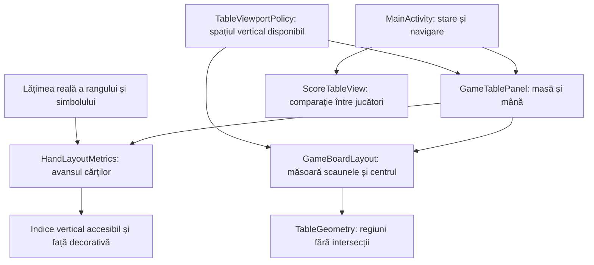

# Interfața Whist — atlas de orientare

Acest pachet compune interfața Android dintr-un `GameSession.Snapshot`.
Regulile, licitațiile legale și scorurile aparțin `game-core`; geometria nu
modifică distribuția sau rezultatele ca să facă un ecran să pară corect.

## Traseul unei randări

| Intrare | Responsabilitate și invariantă |
|---|---|
| `MainActivity` | Tranziții, persistență, meniu, limbă, pauza levatei; nu calculează coordonatele scaunelor. |
| `GameBoardLayout` | Măsoară copiii înainte de poziționare; deține împreună scaunele și centrul, evitând layere independente care se acoperă. |
| `TableGeometry` | Produce dreptunghiuri verificabile; omul rămâne în sud. Centrul lat repoziționează flancurile după dimensiuni, fără prag special pentru nouă licitații. |
| `TableViewportPolicy` | Recuperează spațiu decorativ pe ferestre scunde; nu reduce țintele de 48 dp sau înălțimea fețelor de 98 dp. |
| `HandLayoutMetrics` | Păstrează un rând și un avans cel puțin egal cu banda măsurată a indicelui; textul mărit poate necesita derulare orizontală. |
| `CardFaceBackground` | Desenează simbolul central și colțul inversat. Semantica și indicele principal rămân în view-ul accesibil. |
| `DropdownBackground` | Chevron vizibil pe selectorul Android nativ; nu înlocuiește interacțiunile, focusul sau semantica acestuia. |
| `DisplayFixtureDeals` | Date deterministe pentru intent-uri protejate de `BuildConfig.DEBUG`; cele patru culori de 10 apar fără cărți duplicate. Nu sunt distribuții ale pilotului normal. |
| `WhistUiText` | Localizarea EN/RO; engleza este implicită la prima instalare. |

## Principii de layout

- Pâslă continuă, fără oval decorativ; tabla și decizia curentă sunt dominante.
- Nume, licitat și levate formează un grup compact. Valoarea este aliniată
  separat de etichetă; indicatorul turei folosește și text, nu numai culoare.
- Mâna omului stă jos. O singură carte este centrată; treisprezece cărți au
  indici verticali expuși. Cartea selectată se ridică în spațiul rezervat și
  rămâne în spatele vecinelor; selectarea nu mută scaunul omului.
- Atuul este în antet, cu rang și culoare când există o carte întoarsă.
  Centrul mesei este al licitației sau al levatei.
- Selectorul limbii este dropdown. Configurarea păstrează opțiunile relevante,
  iar regulile și programul complet se consultă la cerere.
- Scorul precedă explicațiile. Navigarea secundară nu concurează cu acțiunea
  de continuare; foaia din timpul jocului nu confirmă licitația.
- Dacă dimensiunile sau textul mărit nu încap, păstrăm derularea accesibilă.
  Nu confundăm existența nodurilor XML cu absența crop-ului din captură.

## Cum verificăm

`GameTableLayoutComponentTest` verifică intersecțiile regiunilor, iar
`TableViewportPolicyTest` verifică ferestrele scunde și rotunjirea dp–pixeli.
`DisplayFixtureDealsTest` verifică unicitatea și diversitatea indicilor.

În `atf-test-android`, `WhistDenseLayoutE2eTest` compară banda expusă, pixelii
rangului și simbolului, înălțimea feței și hitbox-urile. `HandIndexAudit` are
negative pentru simbol lipsă, indice acoperit și margine tăiată. Capturile sunt
revizuite și vizual; oracolul raster verifică lizibilitatea de bază, nu poate
certifica singur frumusețea interfeței sau identitatea optică a fiecărui simbol.

`WhistMenuLayoutE2eTest` parcurge meniurile normale în EN/RO. Pilotul românesc
joacă mâini reale și verifică scorul independent; nu folosește fixture-urile
de display. Build-urile și dovezile rămân în TMP. Feedback-ul UX și acceptanța
versiunii din `docs` păstrează rezultatele măsurate și limitele lor.
