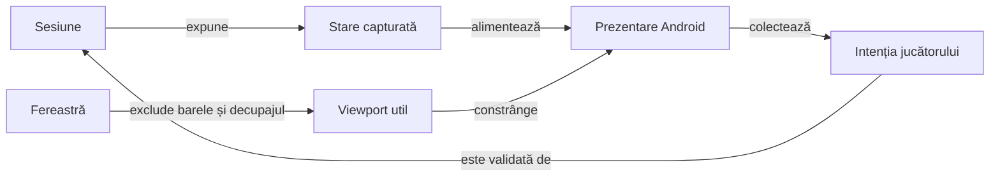
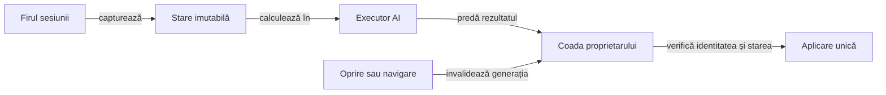

# Interfața Whist — atlas de orientare

## Pe scurt

Acest pachet compune interfața Android și transmite intențiile utilizatorului către `GameSession`. Motorul deține legalitatea și scorul; prezentarea deține geometria, textele, navigarea și accesibilitatea.

`MainActivity` coordonează sesiunea, persistența și ciclul Android. Componentele specializate măsoară și redau starea, iar verificările separă modelele geometrice de aspectul observat pe dispozitiv.

## Flux și responsabilități



<details>
<summary>Legendă: prezentarea consumă domeniul</summary>

[MainActivity](MainActivity.java) leagă comenzile de sesiune și recompune ecranele. [GameTablePanel](table/GameTablePanel.java) construiește masa, iar componentele de geometrie delimitează regiunile; modificarea spațiului disponibil păstrează cărțile și rezultatul calculate de motor.

Fereastra exclude barele sistemului și decupajul înaintea aranjării. Această protecție și măsurarea viewport-ului util aparțin [WindowContent](window/WindowContent.java).

</details>

## Traseul unei randări

| Zonă | Responsabilitate și sursă |
|---|---|
| Fereastră Android | [WindowContent](window/WindowContent.java) aplică protecția nativă și măsoară spațiul util; [WindowPadding](window/WindowPadding.java) păstrează baza imuabilă. |
| Masă și licitare | [GameBoardLayout](table/GameBoardLayout.java), [TableGeometry](table/TableGeometry.java) și [BidGridMetrics](bidding/BidGridMetrics.java) măsoară locurile și regiunea centrală. |
| Mână | [HandLayoutMetrics](hand/HandLayoutMetrics.java) calculează evantaiul; [CenteredHandView](hand/CenteredHandView.java) gestionează poziția inițială a derulării. |
| Levată și atu | [TrickCardMetrics](table/TrickCardMetrics.java) ancorează cărțile după loc; [TrumpIndicatorView](table/TrumpIndicatorView.java) afișează informația despre atu. |
| Scor | [ScoreHistoryTable](score/ScoreHistoryTable.java) proiectează programul complet pentru toate locurile; [ScoreHistoryView](score/ScoreHistoryView.java) îl afișează cu descrieri accesibile. |
| Salvare și ciclu Android | [GameSessionStore](persistence/GameSessionStore.java) deține schema salvării; [CompletedTrickPause](lifecycle/CompletedTrickPause.java) delimitează pauza levatei. |
| Texte și stil | [WhistUiText](localization/WhistUiText.java) deține EN/RO; [WhistUiPalette](theme/WhistUiPalette.java) furnizează stilurile comune. |

Dimensiunile, pragurile și coeficienții de aranjare au sursa în componentele indicate. Atlasul păstrează relațiile și invariantele, astfel încât modificarea unui profil de ecran să poată fi urmărită din cod spre verificare.

## Principii de aranjare

- Locul omului rămâne sud; poziția cărții jucate depinde de locul actorului și de ordinea levatei.
- Licitarea și levata folosesc regiunea centrală; [TableViewportPolicy](table/TableViewportPolicy.java) adaptează spațiul decorativ și înălțimea fețelor pentru ferestre scunde.
- Masa folosește o fereastră cu înălțime măsurată, fără scroll vertical. Profilul compact decalează crucea levatei, integrează indicatorul turei lângă nume și păstrează mâna, levata și toate chenarele simultan vizibile.
- Evantaiul ține cont de lățime, densitate, scara textului și banda măsurată a indicelui; o mână mai lată păstrează accesul orizontal. Masa nu recuperează prin scroll vertical o regiune tăiată.
- Selecția unei cărți rezervă spațiul ridicării și păstrează locul omului; decorul cărții aparține [CardFaceBackground](cards/CardFaceBackground.java).
- Indicatorul de atu și locul activ folosesc stilurile comune; textul și descrierile accesibile completează diferențierea vizuală.
- Istoricul are toate locurile în același tabel cronologic, cu antete fixe la derularea verticală și deplasare orizontală comună.

## Istoricul scorului

Tabelul conține toate mâinile programate, iar fiecare loc are licitația cunoscută, punctele și totalul după încheiere. O licitație necunoscută are marcaj explicit, iar o salvare veche păstrează soldul de deschidere disponibil.

Punctele sunt derivate de domeniu din soldurile istoricului. Schema curentă nu stochează separat levatele câștigate pentru fiecare mână încheiată; [contractul istoricului](../../../../../../../../docs/game/ATF_ScoreHistory.md) descrie limita și evoluția ei.

## Profil și clasamente

[PlayerPreferences](profile/PlayerPreferences.java) păstrează numele preferat și limita de afișare. [HighScoreRepository](highscores/HighScoreRepository.java) actualizează topul local la încheiere, iar [contractul înregistrărilor](../../../../../../../../docs/game/ATF_PlayerRecords.md) definește partiționarea, exemplele marcate și prevenirea dublurilor.

## Cum verificăm

| Nivel | Proprietatea verificată |
|---|---|
| Componente ale ferestrei | [WindowPaddingComponentTest](../../../../../test/java/ro/whistlab/app/window/WindowPaddingComponentTest.java) verifică insets repetate, decupaj, tastatură și bugetul ferestrei compacte. |
| Componente JVM | [Aranjarea mesei](../../../../../test/java/ro/whistlab/app/table/GameTableLayoutComponentTest.java), [ancorele levatei](../../../../../test/java/ro/whistlab/app/table/TrickCardMetricsComponentTest.java) și [ferestrele compacte](../../../../../test/java/ro/whistlab/app/table/TableViewportPolicyTest.java) verifică modelele geometrice. |
| Componente ale scorului | [ScoreHistoryCheckpointTest](../../../../../test/java/ro/whistlab/app/score/ScoreHistoryCheckpointTest.java) verifică valorile și proiecția istoricului. |
| Android E2E | [Matricea vizuală](../../../../../../../../docs/testing/ATF_Display.md) verifică nodurile, interacțiunile și rasterul PNG pe profiluri explicite. |

Dintr-o copie temporară proprie a `whist-lab-app`, cu JDK, SDK Android și dependențele disponibile local:

```powershell
.\gradlew.bat :app:testDebugUnitTest --offline --no-daemon
```

Componentele geometrice verifică relații calculate. Captura fizică și interacțiunea cer acceptanța separată pe dispozitiv; oracolul raster are propriul domeniu și nu certifică singur calitatea estetică.

- Fixture-urile verifică separat mâna maximă de 13 cărți și o levată completă cu 12 cărți rămase. Fiecare verificare cere toate chenarele în același viewport; [matricea de ecrane](../../../../../../../../docs/testing/ATF_Display.md) deține criteriile.
- [DisplayFixtureDeals](fixtures/DisplayFixtureDeals.java) furnizează date deterministe, activate prin căile protejate de `BuildConfig.DEBUG` din activitate. Aceste stări servesc acceptanței și se disting de distribuțiile unei partide normale.

[Aplicația](../../../../../../../README.md) · [Testarea Android](../../../../../../../../docs/testing/ATF_Android.md) · [Regulile jocului](../../../../../../../../docs/game/README.md)

## Coordonarea turelor automate

Calculul politicii rulează într-un executor separat, iar aplicarea mutării revine pe firul principal. [AiTurnRequest](lifecycle/AiTurnRequest.java) capturează starea imutabilă înaintea calculului și verifică identitatea partidei și egalitatea stării înaintea aplicării.



<details>
<summary>Legendă: calcul separat și aplicare condiționată</summary>

[AiTurnCoordinator](lifecycle/AiTurnCoordinator.java) deține executorul și o singură cerere activă. Anularea întrerupe lucrul și invalidează inclusiv o predare deja pusă în coadă; reluarea capturează o cerere nouă. [SearchCancellation](../../../../../../../game-core/src/main/java/ro/whistlab/core/ai/simulation/SearchCancellation.java) verifică întreruperea la frontierele căutării, păstrând fluxul aleator când calculul continuă normal.

</details>

Oprirea, revenirea la meniu și deschiderea dialogurilor suspendă automatizarea. Replay-ul determinist păstrează propria cale de aplicare; salvarea și avansarea sesiunii rămân la proprietarul stării.

- [Componentele coordonatorului](../../../../../test/java/ro/whistlab/app/lifecycle/AiTurnCoordinatorComponentTest.java) verifică firul calculului, predarea, anularea, dublurile și cauza eșecului.
- [Componentele cererii](../../../../../test/java/ro/whistlab/app/lifecycle/AiTurnRequestComponentTest.java) verifică ambele niveluri, starea neschimbată în calcul și refuzul rezultatelor depășite ori destinate altei partide.

## Limite și calificare

Reactivitatea pe dispozitiv și costul politicii au calificare distinctă de corectitudinea predării între executori. Persistența și navigarea păstrează următoarele criterii deschise.

Lucrările privind stocarea controlată și separarea navigării sunt centralizate în [feedback-ul coordonării Android](../../../../../../../../docs/feedback/ATF_Android.md#persistență-și-coordonare). Reactivitatea și costul deciziei se măsoară separat pe mărimea mâinii și profilul dispozitivului, fără a deduce acceptanța APK-ului din componentele executorului.
