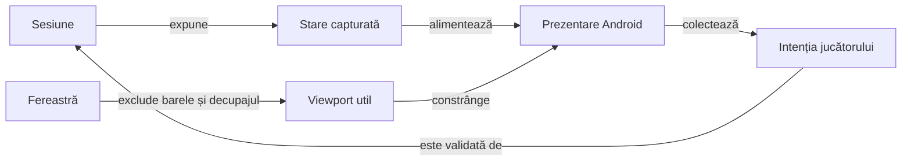
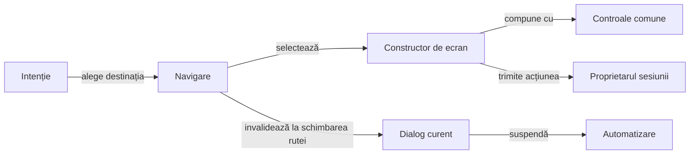
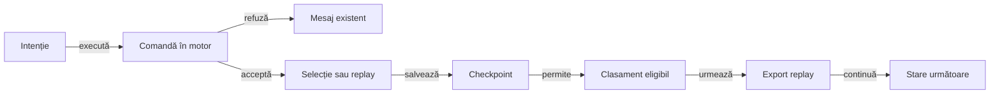
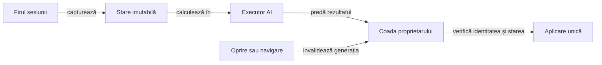

# Interfața Whist — atlas de orientare

## Pe scurt

Acest pachet compune interfața Android și transmite intențiile utilizatorului către `GameSession`. Motorul deține legalitatea și scorul; prezentarea deține geometria, textele, navigarea și accesibilitatea.

`MainActivity` leagă intențiile, serviciile sesiunii și ciclul Android. Clasele din `screens` compun ecranele, iar `AppNavigation` păstrează ruta și identitatea dialogurilor; componentele de geometrie și persistență au contracte distincte.

## Nucleul vizual comun

[Biblioteca card-table-ui](../../../../../../../card-table-ui/README.md) deține widgeturile, meniul de pornire, dialogul numelui, tema, desenul cărții și geometria mâinii. `WhistMenuContent` și `WhistCardFace` proiectează datele jocului; fațadele existente păstrează apelanții și identitatea componentelor Whist.

Masa completă și `GameTablePanel` păstrează compoziția Whist, iar `WindowContent` rămâne politica de fereastră injectată în constructorii comuni. Configurarea jocului, regulile numelui, preferințele, istoricul și serviciile sesiunii rămân la proprietarii lor.

## Flux și responsabilități



<details>
<summary>Legendă: prezentarea consumă domeniul</summary>

[MainActivity](MainActivity.java) leagă comenzile de sesiune și recompune ecranele. [GameTablePanel](table/GameTablePanel.java) construiește masa, iar componentele de geometrie delimitează regiunile; modificarea spațiului disponibil păstrează cărțile și rezultatul calculate de motor.

Fereastra exclude barele sistemului și decupajul înaintea aranjării. Această protecție și măsurarea viewport-ului util aparțin [WindowContent](window/WindowContent.java).

</details>

## Traseul unei randări

| Zonă | Responsabilitate și sursă |
|---|---|
| Rute și ecrane | [AppNavigation](navigation/AppNavigation.java) gestionează ruta și dialogurile curente; [screens](screens/) compune paginile, iar [ScreenViews](screens/ScreenViews.java) construiește widgeturile comune. |
| Schimbarea ferestrei | [PresentationRefresh](presentation/PresentationRefresh.java) grupează cererile de refacere și invalidează callback-urile unei prezentări înlocuite; coordonatorul citește geometria curentă la livrare. |
| Fereastră Android | [WindowContent](window/WindowContent.java) aplică protecția nativă și măsoară spațiul util; [WindowPadding](window/WindowPadding.java) păstrează baza imuabilă. |
| Masă și licitare | [GameBoardLayout](table/GameBoardLayout.java), [TableGeometry](table/TableGeometry.java) și [BidGridMetrics](bidding/BidGridMetrics.java) măsoară locurile și regiunea centrală. |
| Licitația propusă omului | [HumanBidSelection](bidding/HumanBidSelection.java) păstrează recomandarea Hard, selecția manuală și identitatea contextului. Activitatea transmite evaluarea coordonatorului asincron; numai confirmarea depune licitația în sesiune. |
| Nume și tură | [PlayerSeatView](seat/PlayerSeatView.java) măsoară textul acțiunii deasupra chenarului; [PlayerSeatMetrics](seat/PlayerSeatMetrics.java) rezervă regiunile fără suprapuneri. |
| Mână | [HandLayoutMetrics](hand/HandLayoutMetrics.java) calculează evantaiul; [CenteredHandView](hand/CenteredHandView.java) gestionează poziția inițială a derulării. |
| Levată și atu | [TrickCardMetrics](table/TrickCardMetrics.java) ancorează cărțile după loc; [TrumpIndicatorView](table/TrumpIndicatorView.java) afișează informația despre atu. |
| Colectarea levatei | [TrickCollectionMotion](animation/TrickCollectionMotion.java) calculează cadrul și timpul; [TrickCollectionAnimator](animation/TrickCollectionAnimator.java) aplică animația pe vederile Android. |
| Scor | [ScoreHistoryTable](score/ScoreHistoryTable.java) proiectează programul complet pentru toate locurile; [ScoreHistoryView](score/ScoreHistoryView.java) îl afișează cu descrieri accesibile. |
| Comenzi și salvare | [GameCommandFlow](lifecycle/GameCommandFlow.java) delimitează refuzul comenzii; [GamePersistence](persistence/GamePersistence.java) ordonează checkpoint-ul, clasamentul și exportul. |
| Stocare și ciclu Android | [GameSessionStore](persistence/GameSessionStore.java) deține schema salvării; [CompletedTrickPause](lifecycle/CompletedTrickPause.java) delimitează pauza levatei. |
| Texte și stil | [WhistUiText](localization/WhistUiText.java) deține EN/RO; [WhistUiPalette](theme/WhistUiPalette.java) și [GameHeaderTypography](theme/GameHeaderTypography.java) furnizează culorile și rolurile tipografice. |

Dimensiunile, pragurile și coeficienții de aranjare au sursa în componentele indicate. Atlasul păstrează relațiile și invariantele, astfel încât modificarea unui profil de ecran să poată fi urmărită din cod spre verificare.

## Principii de aranjare

Geometria păstrează separat locurile, țintele tactile, cărțile și textul. Criteriile detaliate și sursele lor sunt grupate mai jos; [componentele și acceptanța nativă](#cum-verificăm) califică niveluri diferite.

<details>
<summary>Invariantele mesei, mâinii, atuului și istoricului</summary>

- Locul omului rămâne sud; poziția cărții jucate depinde de locul actorului și de ordinea levatei.
- [CardFaceMetrics](cards/CardFaceMetrics.java) păstrează proporția comună 5:7, scalată după rol; mâna schimbă suprapunerea, iar numărul jucătorilor schimbă pozițiile. [TableSeatLayout](table/TableSeatLayout.java) urmează ordinea circulară a motorului; la patru locuri adversarii ocupă un arc superior, fără îngustarea cărților jucate.
- Licitarea și levata folosesc regiunea centrală; [TableViewportPolicy](table/TableViewportPolicy.java) adaptează spațiul decorativ și înălțimea fețelor pentru ferestre scunde.
- Bugetul decorativ ține cont de înălțimea utilă și de scara fontului. Aranjarea compactă poate fi necesară și pe un ecran înalt cu text mărit; dimensiunea cărților din mână și a țintelor tactile rămâne constantă.
- Fiecare tură de licitare este randată înaintea calculului automat. Controalele omului sunt inactive cât licitează un adversar; eticheta de acțiune rămâne asociată locului care deține tura.
- Masa folosește o fereastră cu înălțime măsurată, fără scroll vertical. Profilul compact decalează crucea levatei; acțiunea turei are o regiune proprie deasupra numelui, cu înălțimea integrală a textului și spațiu rezervat între ture.
- Evantaiul ține cont de lățime, densitate, scara textului și banda măsurată a indicelui; o mână mai lată păstrează accesul orizontal. Masa nu recuperează prin scroll vertical o regiune tăiată.
- Selecția unei cărți rezervă spațiul ridicării și păstrează locul omului; decorul cărții aparține [CardFaceBackground](cards/CardFaceBackground.java).
- Indicatorul de atu și locul activ folosesc stilurile comune. Atuul are două regiuni, titlu și valoare, iar dimensiunile sunt independente de modul jocului și de tipul valorii. Măsurarea comună a fontului păstrează înălțimea completă; descrierea accesibilă păstrează identitatea cărții sau a culorii.
- Istoricul are toate locurile în același tabel cronologic, cu antete fixe în spațiu suficient și deplasare orizontală comună. Ferestrele prea scunde permit derularea conținutului integral, păstrând accesul la rânduri și legendă.
- Prima coloană a istoricului arată numărul de cărți; ordinea mâinii rămâne în model și în descrierile accesibile. [ScoreHistoryGridMetrics](score/ScoreHistoryGridMetrics.java) aliniază separatoarele și grupurile jucătorilor la densități fracționare.

</details>

## Istoricul scorului

Tabelul conține toate mâinile programate, iar fiecare loc are două coloane vizibile: licitația cunoscută și punctajul total după mâna respectivă. Punctele câștigate sau pierdute în acea mână rămân în registru și în descrierea accesibilă. O licitație necunoscută are marcaj explicit, iar o salvare veche afișează numai soldul de deschidere cunoscut.

Punctele mâinii sunt derivate de domeniu din soldurile istoricului. Levatele și licitațiile cunoscute determină separat rezultatul contractului; o ratare primește tăietură oblică peste licitație. Bonusul ori penalizarea de serie încadrează totalul într-un dreptunghi numai pe rândul plății, în celula `P` a locului respectiv.

[Contractul istoricului](../../../../../../../../docs/game/ATF_ScoreHistory.md) descrie migrarea prefixului necunoscut, conservarea levatelor și măsurarea coloanelor compacte.

- [ScoreHistoryMeasure](score/ScoreHistoryMeasure.java) agregă lățimile folosind furnizori de măsurători injectați; vederea Android deține fonturile și randarea.
- [SeriesPointsFrame](score/award/SeriesPointsFrame.java) rezervă spațiul pentru numărul complet și font; [SeriesPointsView](score/award/SeriesPointsView.java) măsoară și desenează dreptunghiul în interiorul propriei celule, separat de licitație și de vecini.
- [HistoryViewport](score/layout/HistoryViewport.java) rezervă antetele și legenda măsurate înaintea rândurilor. `ScoreHistoryView` păstrează coloanele și legenda în regiuni distincte; [HistoryContentScroll](score/layout/HistoryContentScroll.java) permite derularea integrală atunci când nu mai încape un rând complet.
- Legenda folosește aceleași retrageri laterale ca tabelul. Spațiul pentru rânduri se recalculează din măsurătorile curente, fără o înălțime memorată din profilul anterior.
- Componenta verifică politica asupra tuturor celulelor, iar [ScoreHistoryGridMetrics](score/ScoreHistoryGridMetrics.java) aplică minimele și protecția împotriva depășirilor numerice.

## Profil și clasamente

[PlayerPreferences](profile/PlayerPreferences.java) păstrează numele preferat și limita de afișare. [HighScoreRepository](highscores/HighScoreRepository.java) actualizează topul local la încheiere, iar [contractul înregistrărilor](../../../../../../../../docs/game/ATF_PlayerRecords.md) definește partiționarea, exemplele marcate și prevenirea dublurilor.

## Cum verificăm

| Nivel | Proprietatea verificată |
|---|---|
| Rute și mișcare pură | [AppNavigationComponentTest](../../../../../test/java/ro/whistlab/app/navigation/AppNavigationComponentTest.java) verifică dialogurile curente; [TrickCollectionMotionComponentTest](../../../../../test/java/ro/whistlab/app/animation/TrickCollectionMotionComponentTest.java) verifică timpii și transformarea, fără randare Android. |
| Componente ale ferestrei | [WindowPaddingComponentTest](../../../../../test/java/ro/whistlab/app/window/WindowPaddingComponentTest.java) verifică insets repetate, decupaj, tastatură și bugetul ferestrei compacte. |
| Componente JVM | [Aranjarea mesei](../../../../../test/java/ro/whistlab/app/table/GameTableLayoutComponentTest.java), [ancorele levatei](../../../../../test/java/ro/whistlab/app/table/TrickCardMetricsComponentTest.java) și [ferestrele compacte](../../../../../test/java/ro/whistlab/app/table/TableViewportPolicyTest.java) verifică modelele geometrice. |
| Acțiune și nume | [PlayerSeatMetricsComponentTest](../../../../../test/java/ro/whistlab/app/seat/PlayerSeatMetricsComponentTest.java) injectează măsurători pentru RO/EN, rezoluții uzuale și text mărit; verifică spațiul integral deasupra chenarului și egalizarea locurilor. |
| Componente ale scorului | [ScoreHistoryCheckpointTest](../../../../../test/java/ro/whistlab/app/score/ScoreHistoryCheckpointTest.java) verifică valorile și proiecția istoricului. |
| Android E2E | [Matricea vizuală](../../../../../../../../docs/testing/ATF_Display.md) verifică nodurile, interacțiunile și rasterul PNG pe profiluri explicite. |

Dintr-o copie temporară proprie a `whist-lab-app`, cu JDK, SDK Android și dependențele disponibile local:

```powershell
.\gradlew.bat :app:testDebugUnitTest --offline --no-daemon
```

Componentele geometrice verifică relații calculate. Captura fizică și interacțiunea cer acceptanța separată pe dispozitiv; oracolul raster are propriul domeniu și nu certifică singur calitatea estetică.

- Fixture-urile verifică separat mâna maximă de 13 cărți și o levată completă cu 12 cărți rămase. Fiecare verificare cere toate chenarele în același viewport; [matricea de ecrane](../../../../../../../../docs/testing/ATF_Display.md) deține criteriile.
- [DisplayFixtureDeals](fixtures/DisplayFixtureDeals.java) furnizează date deterministe, activate prin căile protejate de `BuildConfig.DEBUG` din activitate. Aceste stări servesc acceptanței și se disting de distribuțiile unei partide normale.
- `debug_hold_ai_bids` oprește calculul licitației după randare; `debug_hold_ai_turns` oprește avansarea cărților AI. Ambele controale sunt disponibile numai în build-ul debug și păstrează fazele distincte ale acceptanței.

[Aplicația](../../../../../../../README.md) · [Testarea Android](../../../../../../../../docs/testing/ATF_Android.md) · [Regulile jocului](../../../../../../../../docs/game/README.md)

## Destinații și dialoguri

Constructorii ecranelor primesc observații și acțiuni explicite, fără proprietatea sesiunii sau a executorului AI. [MatchSetup](screens/MatchSetup.java) păstrează alegerile configurării fără să modifice o partidă începută.



<details>
<summary>Legendă: prezentare fără proprietatea partidei</summary>

[AppNavigation](navigation/AppNavigation.java) identifică fiecare dialog prin proprietar și generația rutei. Dialogurile suprapuse păstrează suspendarea până la ultima închidere; o notificare repetată, străină sau întârziată nu reia jocul și nu închide dialogul unei alte rute.

- **Suspendare:** schimbarea rutei și deschiderea unui dialog invocă portul comun.
- **Reluare:** închiderea ultimului dialog curent solicită prezentarea inclusiv la tura omului.
- **Suprapuneri:** meniul mesei folosește același contract, iar revenirea din fundal respectă dialogurile încă deschise.

[ScreenViews](screens/ScreenViews.java) păstrează textele, dimensiunile, stilurile și etichetele controalelor. Stocarea, deciziile și aplicarea cărților rămân în coordonatorii lor.

</details>

- [Componentele navigării](../../../../../test/java/ro/whistlab/app/navigation/AppNavigationComponentTest.java) verifică destinațiile, dialogurile suprapuse și notificările depășite.
- [Componentele configurării](../../../../../test/java/ro/whistlab/app/screens/MatchSetupComponentTest.java) verifică păstrarea alegerilor și independența configurației deja capturate.

## Colectarea levatei câștigate

Motorul stabilește câștigătorul și scorul înaintea efectului vizual. Pauza levatei folosește 1,5 secunde de timp vizibil, iar ultimele 500 ms deplasează și micșorează cărțile spre centrul măsurat al locului câștigătorului.

| Componentă | Contract |
|---|---|
| [TrickCollectionRequest](animation/TrickCollectionRequest.java) | Acceptă numai levata publică completă, cu toate locurile distincte, câștigătorul motorului și aceleași cărți la sfârșitul istoricului. O observație parțială ori depășită nu pornește colectarea. |
| [CompletedTrickPause](lifecycle/CompletedTrickPause.java) | Fereastră unică per levată și sesiune; suspendarea conservă timpul rămas, fără reluarea unei levate expirate. Reluarea precedă inclusiv pagina scorului ultimei levate din partidă. |
| [TrickCollectionMotion](animation/TrickCollectionMotion.java) | Model pur pentru întârziere, durată, translație, micșorare și transparență. Întârzierea layout-ului consumă timpul disponibil; nu extinde pauza. |
| [TrickCollectionRun](animation/TrickCollectionRun.java) | Deține observarea, pornirea unică și curățarea scenei prin porturi. Cadrele depășite nu se aplică după anulare; erorile curățării nu înlocuiesc cauza inițială. |
| [TrickCollectionAnimator](animation/TrickCollectionAnimator.java) | Leagă coordonatorul testabil de adaptorul Android al măsurării și animației. Detașarea sau schimbarea geometriei anulează scena; anularea restaurează transformările și regulile de clipping capturate. |
| [GameScreen](screens/GameScreen.java) | Înlocuirea ecranului anulează efectul anterior; interacțiunea cu mâna rămâne suspendată până la expirarea pauzei. Fixture-urile statice păstrează afișarea fără animație. |

- [Componentele mișcării](../../../../../test/java/ro/whistlab/app/animation/TrickCollectionMotionComponentTest.java) confruntă capetele traiectoriei pentru toate locurile la 3–6 jucători, progresul și timpul rămas.
- [Componentele proprietarului levatei](../../../../../test/java/ro/whistlab/app/lifecycle/CompletedTrickOwnershipComponentTest.java) folosesc câștigătorul calculat de motor și verifică lipsa mutațiilor, fereastra finală și o sesiune nouă cu stare egală.
- [Componentele reluării](../../../../../test/java/ro/whistlab/app/lifecycle/CompletedTrickPauseResumeComponentTest.java) verifică bugetul de timp vizibil, suspendări repetate și ultima levată a unor partide legale încheiate.
- [Componentele coordonatorului](../../../../../test/java/ro/whistlab/app/animation/TrickCollectionRunComponentTest.java) folosesc evenimente controlate pentru layout întârziat, finalizare sincronă și callback-uri livrate după anulare. [Compoziția fluxului](../../../../../test/java/ro/whistlab/app/animation/TrickCollectionFlowComponentTest.java) conectează navigarea, timpul, scena și motorul real fără interfață.
- Timpul suspendat de `onPause`, navigare sau dialoguri nu consumă bugetul vizibil. La reluare, scena se reconstruiește din timpul rămas; un dialog închis în fundal nu pornește animația înaintea revenirii în prim-plan.
- Schimbarea geometriei anulează scena măsurată înaintea refacerii. [PresentationRefresh](presentation/PresentationRefresh.java) grupează notificările consecutive, conservă bugetul suspendat și permite randarea numai pe ruta jocului, în prim-plan și fără dialoguri deschise. Navigarea sau o reluare explicită invalidează cererile vechi din coadă.
- [Componentele redimensionării](../../../../../test/java/ro/whistlab/app/animation/TrickCollectionResizeComponentTest.java) combină motorul, timpul și navigarea reale cu viewport-uri și evenimente controlate: 3–6 locuri, fiecare câștigător, măsurare întârziată, dialoguri suprapuse și ultima levată. [Componentele refacerii](../../../../../test/java/ro/whistlab/app/presentation/PresentationRefreshComponentTest.java) verifică gruparea, reentrările și cauzele erorilor fără ceas sau coadă Android.
- Activitatea tratează notificările `orientation` și `screenSize`, păstrând politica portret din manifest. Geometria peisaj din componente califică refacerea și ordinea evenimentelor; nu declară acceptanță nativă pentru un mod de orientare nou.
- Dacă animațiile sunt dezactivate pe API 26+, cărțile păstrează afișarea statică în pauză. Modelul de componentă nu califică randarea, clipping-ul sau preferințele sistemului pe dispozitiv.

## Comenzi, salvare și erori

Comanda modifică domeniul o singură dată. Salvarea și continuarea consumă mutația acceptată; un eșec ulterior nu o transformă în licitație sau carte invalidă.



<details>
<summary>Legendă: ordinea efectelor și limita refuzului</summary>

[GameCommandFlow](lifecycle/GameCommandFlow.java) tratează `IllegalArgumentException` și `IllegalStateException` numai în apelul comenzii. Actualizarea selecției, salvarea și continuarea au frontiere distincte; defectele lor se propagă cu aceeași cauză, fără refuz sau reluare implicită a mutației.

[GamePersistence](persistence/GamePersistence.java) primește stocarea, clasamentul, ceasul și diagnosticul prin porturi. Toate etapele rămân sincrone pe proprietarul sesiunii; modelul califică ordinea, fără să mute I/O pe un executor ori să certifice latența Android.

</details>

| Etapă | Contract la eșec |
|---|---|
| Checkpoint | `GameSessionStore.save` declară `IOException` pentru scriere sau codificare eșuată. Diagnosticul folosește mesajul existent de stocare; clasamentul și exportul acelei încercări nu rulează. |
| Mutație acceptată | Un diagnostic I/O nu anulează mutația din memorie; fluxul poate continua. O salvare ulterioară reîncearcă stocarea stării curente, fără repetarea comenzii. |
| Clasament | Numai o partidă eligibilă, încheiată, ajunge la repository după checkpoint. Eșecul I/O păstrează exportul replay-ului; deduplicarea folosește identitatea stabilă a partidei la o salvare ulterioară, inclusiv după reluare. |
| Randare | Afișarea scorului nu înregistrează clasamentul. Reafișarea nu ocolește checkpoint-ul și nu scrie rezultate suplimentare. |
| Reluare | Citirea și validarea salvării au bloc propriu. Salvarea ulterioară se execută în afara tratării datelor invalide, astfel încât eșecul ei nu șterge checkpoint-ul citit. |

[SavedNumbers](persistence/SavedNumbers.java) refuză fracțiile, depășirile, șirurile și valorile nule înaintea conversiei câmpurilor întregi. Seed-ul păstrează exact domeniul semnat pe 64 de biți; valorile opționale folosesc implicitul numai când câmpul lipsește, apoi domeniul validează starea restaurată.

- [Componentele comenzilor](../../../../../test/java/ro/whistlab/app/lifecycle/GameCommandFlowComponentTest.java) verifică mutația reală și refuzul, plus defecte injectate după acceptare.
- [Componentele persistenței](../../../../../test/java/ro/whistlab/app/persistence/GamePersistenceComponentTest.java) verifică ordinea și oprirea etapelor prin porturi controlate; blocarea folosește handshake, fără prag de performanță.
- [Componentele codec-ului numeric](../../../../../test/java/ro/whistlab/app/persistence/GameSessionNumbersComponentTest.java) confruntă salvarea reală, vecinul valid, limitele seed-ului și refuzul pierderii de precizie, cu aceeași cauză localizată pe câmp.
- [Componentele clasamentului](../../../../../test/java/ro/whistlab/app/persistence/GamePersistenceRankingComponentTest.java) confruntă reîncercarea cu repository-ul real și o sesiune restaurată, fără puncte sau locuri duplicate.
- Recuperarea stocării Android și latența I/O pe dispozitiv păstrează [calificarea proprie](../../../../../../../../docs/feedback/ATF_Android.md#persistență-și-coordonare).

## Coordonarea turelor automate

Calculul politicii rulează într-un executor separat, iar aplicarea mutării revine pe firul principal. [AiTurnRequest](lifecycle/AiTurnRequest.java) capturează starea imutabilă înaintea calculului și verifică identitatea partidei și egalitatea stării înaintea aplicării.

Pentru om, [HumanBidSelection](bidding/HumanBidSelection.java) primește numai observația proprie și publică a motorului Hard. Evaluarea propune o selecție legală; sesiunea primește contractul numai prin confirmarea utilizatorului.

| Continuitatea licitației | Comportament |
|---|---|
| Suspendare și reluare în aceeași sesiune | Alegerea deja făcută se păstrează. Calculul în curs este invalidat; în lipsa unei alegeri, reluarea poate solicita o estimare nouă. |
| Restaurare din checkpoint JSON | Mâna, cartea întoarsă, licitațiile confirmate, scorurile și seriile se restaurează prin codec. Selecția neconfirmată rămâne stare de prezentare și se estimează din nou. |
| Alegere manuală | Invalidează recomandarea în curs. Un succes sau un eșec întârziat nu o înlocuiește și nu o transformă în contract. |
| Contract deja confirmat | Rămâne parte a partidei salvate; recomandarea omului nu mai rulează în tura altui loc ori în jocul cărților. |

[Matricea licitației](../../../../../test/java/ro/whistlab/app/bidding/HumanBidMatrixComponentTest.java) verifică 1–8 cărți, 3–6 jucători și fiecare poziție în ordinea licitării. [Componentele reluării](../../../../../test/java/ro/whistlab/app/bidding/HumanBidResumeComponentTest.java) folosesc codec-ul JSON real și evenimente controlate; nu califică stocarea Android, recrearea activității sau interacțiunea nativă.



<details>
<summary>Legendă: calcul separat și aplicare condiționată</summary>

[AiTurnCoordinator](lifecycle/AiTurnCoordinator.java) deține executorul și o singură cerere activă. Anularea întrerupe lucrul și invalidează inclusiv o predare deja pusă în coadă; reluarea capturează o cerere nouă. [SearchCancellation](../../../../../../../game-core/src/main/java/ro/whistlab/core/ai/simulation/SearchCancellation.java) verifică întreruperea la frontierele căutării, păstrând fluxul aleator când calculul continuă normal.

</details>

Oprirea, revenirea la meniu și deschiderea dialogurilor suspendă automatizarea. Replay-ul determinist păstrează propria cale de aplicare; salvarea și avansarea sesiunii rămân la proprietarul stării.

- [Componentele coordonatorului](../../../../../test/java/ro/whistlab/app/lifecycle/AiTurnCoordinatorComponentTest.java) verifică firul calculului, predarea, anularea, dublurile și cauza eșecului.
- [Componentele cererii](../../../../../test/java/ro/whistlab/app/lifecycle/AiTurnRequestComponentTest.java) verifică ambele niveluri, starea neschimbată în calcul și refuzul rezultatelor depășite ori destinate altei partide.

## Limite și calificare

Reactivitatea pe dispozitiv și costul politicii au calificare distinctă de corectitudinea predării între executori. Randarea efectului de colectare și recuperarea stocării native cer calificarea binarului efectiv instalat.

Calificările rămase sunt centralizate în [feedback-ul Android](../../../../../../../../docs/feedback/ATF_Android.md). Reactivitatea și costul deciziei se măsoară separat pe mărimea mâinii și profilul dispozitivului, fără a deduce acceptanța APK-ului din componentele executorului.

## Catalogul testelor

[Intrările și responsabilitățile testelor](../../../../../test/README.md) explică selecțiile, precondițiile și interpretarea rezultatului, prin aceeași strategie comună pentru toate livrările.

## Proiecția mesei către biblioteca comună

[WhistTableContent](table/content/WhistTableContent.java) traduce numai datele vizibile ale snapshot-ului în `SeatContent`, `HandCard` și `PlayedCardContent`. [GameTablePanel](table/GameTablePanel.java) păstrează licitația, legalitatea transmisă, levata vizibilă și colectarea; biblioteca desenează și măsoară fără motor Whist.

- Chenarele păstrează ordinea licitat/levate, textele și actorul real; rendererul primește fapte etichetate, fără calculul scorului.
- Selecția întoarce identitatea cărții din snapshot-ul afișat; adaptorul o rezolvă la obiectul original înaintea callback-ului existent.
- Testele de reguli și integrare cu sesiunea rămân în aplicația Whist; modelele comune au componente fără importuri ale jocurilor.
