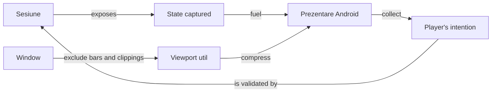
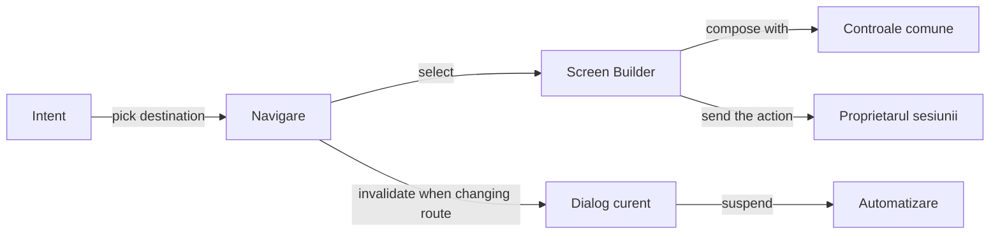
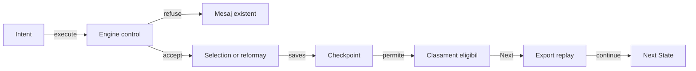
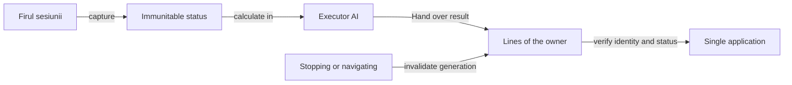

# Whist interface - orientation atlas

## Overview

This package composes the Android interface and transmits the user's intentions to `GameSession`. The engine holds the legality and score; the presentation holds geometry, texts, navigation and accessibility.

`MainActivity` links the intentions, services of the session and the Android cycle. The classes of `screens` make up the screens, and `AppNavigation` keeps the route and identity of the dialogues; the geometry and persistence components have separate contracts.

## Common visual core

[Biblioteca atf-card-table-ui](../../../../../../../atf-card-table-ui/README.md) has widgets, starting menu, name dialogue, theme, card drawing and hand geometry. `WhistMenuContent` and `WhistCardFace` project game data; existing facades retain the callers and identity of the Whist components.

The complete mass and `GameTablePanel` keep Whist, while `WindowContent` remains the window policy injected into the common builders. The game configuration, name rules, preferences, history and session services remain with their owners.

## Flow and responsibilities



<details>
<summary>Legend: presentation consumes domain</summary>

[MainActivity](MainActivity.java) links the session commands and restores the screens. [GameTablePanel](table/GameTablePanel.java) builds the mass and geometry components delimit the regions; the change in the available space keeps the cards and the result calculated by the engine.

The window excludes system bars and cutting before setting. This protection and measurement of useful view port belong to the system. [WindowContent](window/WindowContent.java).

</details>

## Rearward path

| Area | Liability and source |
|---|---|
| Rates and screens | [AppNavigation](navigation/AppNavigation.java) manages the current route and dialogues; [screens](screens/) composes the pages and [ScreenViews](screens/ScreenViews.java) builds common widgets. |
| Change of window | [PresentationRefresh](presentation/PresentationRefresh.java) groups the recovery requests and invalidate the callbacks of a replaced presentation; the coordinator reads the current geometry on delivery. |
| Android Window | [WindowContent](window/WindowContent.java) applies native protection and measures useful space; [WindowPadding](window/WindowPadding.java) retains the immutable base. |
| Mass and bidding | [GameBoardLayout](table/GameBoardLayout.java), [TableGeometry](table/TableGeometry.java) and [BidGridMetrics](bidding/BidGridMetrics.java) measure the places and the central region. |
| The proposed tender to man | [HumanBidSelection](bidding/HumanBidSelection.java) keeps Hard Recommendation, Manual Selection and Background Identity. The activity shall transmit the assessment to the asynchronous coordinator; only the confirmation shall submit the tender in session. |
| Name and turn | [PlayerSeatView](seat/PlayerSeatView.java) measures the text of the action above the box; [PlayerSeatMetrics](seat/PlayerSeatMetrics.java) reserves the regions without overlaps. |
| Hand | [HandLayoutMetrics](hand/HandLayoutMetrics.java) calculates the fan; [CenteredHandView](hand/CenteredHandView.java) manages the initial position of the run. |
| Lived and trump | [TrickCardMetrics](table/TrickCardMetrics.java) anchors the cards after the place; [TrumpIndicatorView](table/TrumpIndicatorView.java) displays the information about the trump. |
| Collection of levatates | [TrickCollectionMotion](../../../../../../../atf-card-table-ui/src/main/java/ro/cardtable/ui/animation/TrickCollectionMotion.java) calculates the frame and time. [TrickCollectionAnimator](../../../../../../../atf-card-table-ui/src/main/java/ro/cardtable/ui/animation/TrickCollectionAnimator.java) applies animation to Android views. |
| Score | [ScoreHistoryTable](score/ScoreHistoryTable.java) designs the full program for all places; [ScoreHistoryView](score/ScoreHistoryView.java) displays it with accessible descriptions. |
| Orders and rescue | [GameCommandFlow](lifecycle/GameCommandFlow.java) delimits the refusal of order; [GamePersistence](persistence/GamePersistence.java) orders the checkpoint, ranking and export. |
| Storage and cycle Android | [GameSessionStore](persistence/GameSessionStore.java) holds the rescue scheme; [CompletedTrickPause](lifecycle/CompletedTrickPause.java) delimits the trick's break. |
| Texts and style | [WhistUiText](localization/WhistUiText.java) hold EN/RO; [WhistUiPalette](theme/WhistUiPalette.java) and [GameHeaderTypography](theme/GameHeaderTypography.java) provide the colors and typographic roles. |

The dimensions, thresholds and fixing coefficients shall be the source in the components indicated. The Atlas shall maintain relationships and invariants so that the modification of a screen profile can be traced from the code to verification.

## Principles of arrangement

Geometry keeps separate places, tactile targets, cards and text. The detailed criteria and their sources are grouped below; [native components and acceptance](#how-do-we-check) qualifies for different levels.

<details>
<summary>Table, hand, trump and historical variants</summary>

- The human player's seat remains south; the position of the card played depends on the place of the actor and the order of the trick.
- [CardFaceMetrics](cards/CardFaceMetrics.java) keep the proportion common 5:7, scaled after role; the hand changes the overlap, and the number of players changes positions. [TableSeatLayout](table/TableSeatLayout.java) follow the circular order of the engine; four places the opponents occupy a higher arc without narrowing the cards played.
- Bidding and trick use the central region; [TableViewportPolicy](table/TableViewportPolicy.java) adapts decorative space and the height of the faces for short windows.
- The decorative budget shall take account of the useful height and the font scale. Compact arrangement may be required on a high screen with increased text; the size of the cards in the hand and the tactile targets remains constant.
- Each bidding lap shall be rounded before the automatic calculation. Human controls are inactive while an opponent bids; the action label remains associated with the location that holds the shift.
- The table uses a window with measured height without vertical scroll. The compact profile deletes the cross of trick; the action of the tour has a region of its own above the name, with the full height of the text and space reserved between the shifts.
- The fan shall take account of the width, density, scale of the text and measured band of the index; a wider hand shall retain horizontal access. The table doesn't recover through vertical scroll a cut region.
- Select a card reserve the space of lift and keep the human player's seat; the decor of the card belongs to [CardFaceBackground](cards/CardFaceBackground.java).
- The asset indicator and the active place use common styles. The atu has two regions, title and value, and the dimensions are independent of the game mode and the type of value. Common font measurement shall be kept in full height; accessible description shall be kept in the identity of the card or colour.
- The history has all places in the same chronological table with sufficient fixed headers in space and common horizontal displacement. Too short windows allow full content to run, keeping access to rows and legends.
- The first column of the history shows the number of cards; the order of the hand remains in the model and in accessible descriptions. [ScoreHistoryGridMetrics](score/ScoreHistoryGridMetrics.java) aligns the separators and groups of players to fractional density.

</details>

## Length history

The table contains all scheduled hands and each place has two visible columns: the known bid and the total score after the hand. Points earned or lost in that hand shall remain in the register and in the accessible description. An unknown bid has explicit marking and an old rescue only displays the known opening balance.

The points of the hand are derived from the domain of the historical hips. The known leases and bids determine separately the outcome of the contract; a failure receives an oblique cut over the bid. The bonus or series penalty shall be placed in a rectangle only on the payout row in cell `P` of the respective location.

[History contract](../../../../../../../../docs/game/ATF_ScoreHistory.md) describes migration of the unknown prefix, conservation of levatates and measurement of compact columns.

- [ScoreHistoryMeasure](score/ScoreHistoryMeasure.java) aggregate the widths using injected measurement providers; Android vision holds fonts and rendering.
- [SeriesPointsFrame](score/award/SeriesPointsFrame.java) reserves the space for the full number and font; [SeriesPointsView](score/award/SeriesPointsView.java) measures and draws the rectangle inside its own cell, separated from the bid and the neighbours.
- [HistoryViewport](score/layout/HistoryViewport.java) reserve the headers and legend measured before the rows. `ScoreHistoryView` keep columns and legend in distinct regions; [HistoryContentScroll](score/layout/HistoryContentScroll.java) allows full running when a complete row is no longer in place.
- Legend uses the same side withdrawals as the table. The row space shall be recalculated from the current measurements without a height memorized from the previous profile.
- The component verifies policy on all cells, and [ScoreHistoryGridMetrics](score/ScoreHistoryGridMetrics.java) applies minima and protection against numerical overruns.

## Profiles and leaderboards

[PlayerPreferences](profile/PlayerPreferences.java) keeps the favorite name and display limit. [HighScoreRepository](highscores/HighScoreRepository.java) updates the local top at the end, and [contract of records](../../../../../../../../docs/game/ATF_PlayerRecords.md) defines partition, marked examples and prevention of doubles.

## How do we check

| Level | Profit verified |
|---|---|
| Pure routes and movement | [AppNavigationComponentTest](../../../../../test/java/ro/whistlab/app/navigation/AppNavigationComponentTest.java) checks current dialogues; [TrickCollectionMotionComponentTest](../../../../../test/java/ro/whistlab/app/animation/TrickCollectionMotionComponentTest.java) checks times and transformation without Android rendering. |
| Window parts | [WindowPaddingComponentTest](../../../../../test/java/ro/whistlab/app/window/WindowPaddingComponentTest.java) checks repeated settings, decoupage, keyboard and budget of the compact window. |
| JVM components | [Table setting](../../../../../test/java/ro/whistlab/app/table/GameTableLayoutComponentTest.java), [ancorele trick](../../../../../test/java/ro/whistlab/app/table/TrickCardMetricsComponentTest.java) and [ferestrele compacte](../../../../../test/java/ro/whistlab/app/table/TableViewportPolicyTest.java) check the geometric patterns. |
| Action and names | [PlayerSeatMetricsComponentTest](../../../../../test/java/ro/whistlab/app/seat/PlayerSeatMetricsComponentTest.java) injects measurements for RO/EN, usual resolutions and increased text; checks the full space above the box and equalization of the seats. |
| Components of the score | [ScoreHistoryCheckpointTest](../../../../../test/java/ro/whistlab/app/score/ScoreHistoryCheckpointTest.java) checks the values and projection of the history. |
| Android E2E | [Visual matrix](../../../../../../../../docs/testing/ATF_Display.md) checks the nodes, interactions and PNG raster on explicit profiles. |

With his own temporary copy of `whist-lab-app`, with JDK, SDK Android and locally available dependencies:

```powershell
.\gradlew.bat :app:testDebugUnitTest --offline --no-daemon
```

Geometric components check calculated relationships. Physical capture and interaction require separate acceptance on the device; the raster oracle has its own domain and does not certify aesthetic quality on its own.

- The fixtures check the maximum hand separately 13 cards and a complete trick with 12 remaining cards. Every check requires all the boxes in the same view; [Screen matrix](../../../../../../../../docs/testing/ATF_Display.md) be in possession of the criteria.
- [DebugFixtureFactory](../../../../../debug/java/ro/whistlab/app/fixtures/DebugFixtureFactory.java) holds the deterministic intents and scenarios only in src/debug; [DisplayFixtureDeals](../../../../../debug/java/ro/whistlab/app/fixtures/DisplayFixtureDeals.java) generate display status, and [OriginalMatchReplay](../../../../../debug/java/ro/whistlab/app/fixtures/OriginalMatchReplay.java) Play the recorded game. src/release Ignore debuke intents, and MainActivity only gets the resulting plan.
- `debug_hold_ai_bids` stops the bid after the rendering; `debug_hold_ai_turns` stops the AI cards from moving forward. Both controls are only available in the debuke building and keep the distinct phases of acceptance.

[Application](../../../../../../../README.md) · [Testarea Android](../../../../../../../../docs/testing/ATF_Android.md) · [Rules of the game](../../../../../../../../docs/game/README.md)

## Destinations and dialogues

Screen builders receive explicit observations and actions without the ownership of the session or of the AI executor. [MatchSetup](screens/MatchSetup.java) keeps the configuration choices without altering a match started.



<details>
<summary>Legend: presentation without the property of the match</summary>

[AppNavigation](navigation/AppNavigation.java) identifies each dialogue through the owner and the generation of the route. Overlaid dialogues shall retain suspension until the last closure; repeated notification, foreign or delayed, shall not resume the game and shall not close the dialogue of any other route.

- **Suspension: ** the change of route and the opening of a dialogue calls for common port.
- **Resume: ** closing the last current dialogue calls for presentation including on human watch.
- **Overlaps: ** table menu uses the same contract, and the return from the background follows the dialogues still open.

[ScreenViews](screens/ScreenViews.java) shall keep the texts, sizes, styles and labels of the checks. Storage, decisions and enforcement of cards shall remain in their coordinators.

</details>

- [Navigation components](../../../../../test/java/ro/whistlab/app/navigation/AppNavigationComponentTest.java) checks destinations, overlapping dialogues and outdated notifications.
- [Configuration components](../../../../../test/java/ro/whistlab/app/screens/MatchSetupComponentTest.java) checks the election and the independence of the already captured configuration.

## Collection of the won trick

The engine sets the winner and the score before the visual effect. The trick break uses 1,5 seconds of visible time, and the last 500 ms move and shrink the cards to the measured centre of the winner's spot.

Upon resumption after the trial has been terminated, a checkpoint at the end of the trick shows the confirmed cards only once. The last trick of his hand precedes the score page. The stage and the next screen use the same term, calculated with the Android clock, so that the construction of the table does not prolong the break.

| Component | Contract |
|---|---|
| [TrickCollectionRequest](animation/TrickCollectionRequest.java) | Accept only the full public trick, with all distinct seats, the engine winner and the same cards at the end of history. A partial or outdated observation does not start collection. |
| [CompletedTrickPause](lifecycle/CompletedTrickPause.java) | The single window per trick and session; suspension preserves the remaining time without restarting an expired trick. The resume shall also predate the last trick score of the game. |
| [TrickCollectionMotion](../../../../../../../atf-card-table-ui/src/main/java/ro/cardtable/ui/animation/TrickCollectionMotion.java) | Pure model for delay, duration, translation, shrinkage and transparency. The delay in the layout takes up time. |
| [TrickCollectionRun](../../../../../../../atf-card-table-ui/src/main/java/ro/cardtable/ui/animation/TrickCollectionRun.java) | Owns observation, unique start and scene cleaning through ports. Cancellation invalidates outdated frames and the treatment of errors retains the original cause. |
| [TrickCollectionAnimator](../../../../../../../atf-card-table-ui/src/main/java/ro/cardtable/ui/animation/TrickCollectionAnimator.java) | Tape the testable coordinator to the Android measurement and animation adapter. The posting or change of geometry cancels the scene and restores the captured transformations and clipping rules. |
| [GameScreen](screens/GameScreen.java) | Replacement of the screen cancels the previous effect; interaction with the hand remains suspended until the break expires. Static fixtures keep display without animation. |

- [Motion components](../../../../../test/java/ro/whistlab/app/animation/TrickCollectionMotionComponentTest.java) confronts the track ends for all seats at 3–6 players, progress and time remaining.
- [Components of the trick owner](../../../../../test/java/ro/whistlab/app/lifecycle/CompletedTrickOwnershipComponentTest.java) uses the calculated engine winner and checks for no mutations, final window and a new session of equal status.
- [Resumption components](../../../../../test/java/ro/whistlab/app/lifecycle/CompletedTrickPauseResumeComponentTest.java) checks the budget for visible time, repeated suspensions and the last trick of legal parties concluded.
- [Coordinator components](../../../../../test/java/ro/whistlab/app/animation/TrickCollectionRunComponentTest.java) uses controlled events for delayed layout, synchronous completion and callbacks delivered after cancellation. [Flow composition](../../../../../test/java/ro/whistlab/app/animation/TrickCollectionFlowComponentTest.java) connects navigation, time, stage and actual engine without interface.
- The suspended time of `onPause`, navigation or dialogues does not consume the visible budget. At the restart, the scene is rebuilt from the remaining time; a closed dialogue in the background does not start animation before returning to the first plan.
- The shift in geometry cancels the measured scene before recovery. [PresentationRefresh](presentation/PresentationRefresh.java) groups consecutive notifications, preserves the suspended budget and allows rendering only on the game route, in the first plan and without open dialogues. Navigation or an explicit resume invalidates old tail requests.
- [Resize components](../../../../../test/java/ro/whistlab/app/animation/TrickCollectionResizeComponentTest.java) combines the engine, time and real navigation with controlled views and events: 3–6 places, each winner, delayed measurement, overlapping dialogues and last trick. [Componentele refacerii](../../../../../test/java/ro/whistlab/app/presentation/PresentationRefreshComponentTest.java) check the grouping, re-entrances and causes of errors without watch or Android queue.
- The activity deals with notifications `orientation` and `screenSize`, preserving the portrait policy in the manifesto. Geometry of the landscape in components qualifies the restoration and order of events; does not declare native acceptance for a new way of guidance.
- If animations are deactivated on API 26 +, the cards keep the static display on pause. The component model does not qualify the rendering, clipping or system preferences on the device.

## Orders, rescue and error

The command only changes the field once. Salvation and continuation consume accepted mutation; a later failure does not turn it into an bid or invalid card.



<details>
<summary>Legend: order of effects and limit of refusal</summary>

[GameCommandFlow](lifecycle/GameCommandFlow.java) treats `IllegalArgumentException` and `IllegalStateException` only in order call. The updating of the selection, rescue and continuation have distinct borders; their defects spread with the same cause without any refusal or implicit resumption of the mutation.

[GamePersistence](persistence/GamePersistence.java) receives storage, rankings, watch and diagnosis through ports. All stages remain synchronized on the owner of the session; the model qualifies the order without moving I/O on an executor or certifying Android latency.

</details>

| Step | Contract to fail |
|---|---|
| Checkpoint | `GameSessionStore.save` declares `IOException` for writing or coding failed. The diagnosis uses the existing storage message; the ranking and export of that test is not running. |
| Motion accepted | A I/O diagnosis does not undo the mutation from memory; the flow can continue. A subsequent rescue retries to store the current condition without reordering. |
| Clasament | Only one eligible game, finished, reaches the repository after checkpoint. The failure of I/O keeps the export of the replicay; the rebuttal uses the stable identity of the match to a subsequent rescue, including after resumption. |
| Randare | Display of the score does not record the ranking. The redisplay does not bypass the checkpoint and does not write any additional results. |
| Reluare | Reading and validating the rescue have their own block. The subsequent rescue is performed outside the treatment of invalid data, so that her failure does not erase the read checkpoint. |

[SavedNumbers](persistence/SavedNumbers.java) refuses fractions, overruns, strings and values null before conversion of whole fields. The seedage keeps exactly the field signed on 64 bits; the optional values use the implicit only when the field is missing, then the domain validates the restored status.

- [Componentele comenzilor](../../../../../test/java/ro/whistlab/app/lifecycle/GameCommandFlowComponentTest.java) checks the actual mutation and refusal, plus defects injected after acceptance.
- [The components of persistence](../../../../../test/java/ro/whistlab/app/persistence/GamePersistenceComponentTest.java) checks order and stop steps through controlled ports; blocking uses handshake without performance threshold.
- [Components of the numerical codecon](../../../../../test/java/ro/whistlab/app/persistence/GameSessionNumbersComponentTest.java) faces actual rescue, valid neighbor, seedbed limits and loss of precision, with the same cause located in the field.
- [Rating components](../../../../../test/java/ro/whistlab/app/persistence/GamePersistenceRankingComponentTest.java) faces the retrial with the actual repositoryul and a restored session, without duplicate points or places.
- Recovery of Android storage and latency I/O keep on device [qualification](../../../../../../../../docs/feedback/ATF_Android.md#persistence-and-coordination).

## Coordination of automatic shifts

The calculation of policy runs in a separate executor and the application of the move returns to the main thread. [AiTurnRequest](lifecycle/AiTurnRequest.java) captures the immutable status prior to the calculation and verifies the identity of the match and the equality of status prior to application.

For man, [HumanBidSelection](bidding/HumanBidSelection.java) receives only the own and public observation of the Hard engine. The evaluation proposes a legal selection; the session receives the contract only by confirming the user.

| Continuity of the tender | Comportament |
|---|---|
| Suspension and resumption at the same session | The choice already made is kept. The current calculation is invalid; in the absence of a choice, the resumption may request a new estimate. |
| Restaurare din checkpoint JSON | Hand, card turned, bids confirmed, scores and series restored by codec. Unconfirmed selection remains a state of presentation and is estimated again. |
| Manual choice | Invalidates the current recommendation. A late success or failure does not replace it or make it a contract. |
| Contract already confirmed | It remains part of the saved game; man's recommendation is no longer running in another place's shift or in the cards game. |

[Bidding matrix](../../../../../test/java/ro/whistlab/app/bidding/HumanBidMatrixComponentTest.java) check 1–8 cards, 3–6 players and each position in the bidding order. [Resumption components](../../../../../test/java/ro/whistlab/app/bidding/HumanBidResumeComponentTest.java) using the real JSON codecon and controlled events; does not qualify for Android storage, recreation of activity or native interaction.



<details>
<summary>Legend: separate calculation and conditional application</summary>

[AiTurnCoordinator](lifecycle/AiTurnCoordinator.java) holds the executor and one active application. Cancellation interrupts work and invalidates including a surrender already in line; the resumption captures a new application. [SearchCancellation](../../../../../../../game-core/src/main/java/ro/whistlab/core/ai/simulation/SearchCancellation.java) checks the interruption at the border of search, keeping the flow random when the calculation continues normally.

</details>

Stopping, returning to the menu and opening of dialogues suspend automation. The deterministic playbook keeps its own way of applying; saving and advancing the session remains with the owner of the status.

### AutoGame for active hand

- The right header tick starts automation for the current hand. The common Header keeps the title and the tick above the row with progress, bids and trump. The table menu displays the stop while the automation is active. [Antetul comun](../../../../../../../atf-card-table-ui/README.md#antetul-mesei)
- The leasehold allows `AiTurnRequest` to calculate for the human place only while it is active; coordination, checking the snapshots and single application remain on the existing AI path.
- The score, the hand change, the starting of a game or the return to the main menu closes the leastcase. Automation shall not be transferred to the next hand.

- [AutoGameHand](lifecycle/AutoGameHand.java) sets the cycle limit, and [BidGridMetrics](bidding/BidGridMetrics.java) places the control without covering the seats.
- Accessible texts keep the full action for screen readers. Components check 3–6 players, widths, increased text, delimitation of the leases and both languages; the signed script checks the check, the game up to the score and returning to manual control.

- [Coordinator components](../../../../../test/java/ro/whistlab/app/lifecycle/AiTurnCoordinatorComponentTest.java) checks the thread of the calculation, surrender, cancellation, doubles and cause of failure.
- [Componentele cererii](../../../../../test/java/ro/whistlab/app/lifecycle/AiTurnRequestComponentTest.java) checks both levels, the unchanged status in the calculation and the refusal of outdated results or intended for another party.

## Limits and qualification

Reactivity on the device and the cost of policy have a distinct qualification from the correctness of the surrender between executors. The yield of the collection effect and the recovery of native storage require the qualification of the actual installed binary.

The remaining qualifications are centralised in [feedback-ul Android](../../../../../../../../docs/feedback/ATF_Android.md). The reactivity and cost of the decision shall be measured separately on the size of the hand and the profile of the device, without deducting the acceptance of the APK from the executor's components.

## Test catalogue

[Inputs and responsibilities of tests](../../../../../test/README.md) explains the selection, preconditions and interpretation of the result, through the same common strategy for all deliveries.

## Projection of mass to the common library

[WhistTableContent](table/content/WhistTableContent.java) translate only the visible data of snapshots into `SeatContent`, `HandCard` and `PlayedCardContent`. [GameTablePanel](table/GameTablePanel.java) keep the bid, the legality transmitted, the visible trick and the collection; the library draws and measures without the Whist engine.

- The batches shall keep the full name and order licitat/trick, with one line per line. The Renderer measures the thickened text along with the label and verifies the width after the layout.
- The selection returns the identity of the card in the displayed snapshots; the adapter solves it to the original object before the existing callback.
- The rules and integration tests with the session remain in the Whist application; common models have components without imported games.
