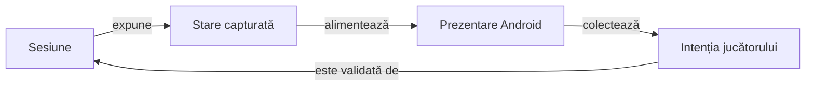

# Interfața Whist — atlas de orientare

## Pe scurt

Acest pachet compune interfața Android și transmite intențiile utilizatorului către `GameSession`. Motorul deține legalitatea și scorul; prezentarea deține geometria, textele, navigarea și accesibilitatea.

`MainActivity` coordonează sesiunea, persistența și ciclul Android. Componentele specializate măsoară și redau starea, iar verificările separă modelele geometrice de aspectul observat pe dispozitiv.

## Flux și responsabilități



<details>
<summary>Legendă: prezentarea consumă domeniul</summary>

[MainActivity](MainActivity.java) leagă comenzile de sesiune și recompune ecranele. [GameTablePanel](table/GameTablePanel.java) construiește masa, iar componentele de geometrie delimitează regiunile; modificarea spațiului disponibil păstrează cărțile și rezultatul calculate de motor.

</details>

## Traseul unei randări

| Zonă | Responsabilitate și sursă |
|---|---|
| Masă și licitare | [GameBoardLayout](table/GameBoardLayout.java), [TableGeometry](table/TableGeometry.java) și [BidGridMetrics](bidding/BidGridMetrics.java) măsoară locurile și regiunea centrală. |
| Mână | [HandLayoutMetrics](hand/HandLayoutMetrics.java) calculează evantaiul; [CenteredHandView](hand/CenteredHandView.java) gestionează poziția inițială a derulării. |
| Levată și atu | [TrickCardMetrics](table/TrickCardMetrics.java) ancorează cărțile după loc; [TrumpIndicatorView](table/TrumpIndicatorView.java) afișează informația despre atu. |
| Scor | [ScoreHistoryTable](score/ScoreHistoryTable.java) proiectează programul complet pentru toate locurile; [ScoreHistoryView](score/ScoreHistoryView.java) îl afișează cu descrieri accesibile. |
| Salvare și ciclu Android | [GameSessionStore](persistence/GameSessionStore.java) deține schema salvării; [CompletedTrickPause](lifecycle/CompletedTrickPause.java) delimitează pauza levatei. |
| Texte și stil | [WhistUiText](localization/WhistUiText.java) deține EN/RO; [WhistUiPalette](theme/WhistUiPalette.java) furnizează stilurile comune. |

Dimensiunile, pragurile și coeficienții de aranjare au sursa în componentele indicate. Atlasul păstrează relațiile și invariantele, astfel încât modificarea unui profil de ecran să poată fi urmărită din cod spre verificare.

## Principii de aranjare

- Locul omului rămâne sud; poziția cărții jucate depinde de locul actorului și de ordinea levatei.
- Licitarea și levata folosesc regiunea centrală; [TableViewportPolicy](table/TableViewportPolicy.java) adaptează spațiul decorativ și înălțimea fețelor pentru ferestre scunde.
- Profilul compact recuperează marginile mesei, spațiul din rame și distanța rândurilor levatei, păstrând dimensiunile mâinii, textului și țintelor tactile.
- Evantaiul ține cont de lățime, densitate, scara textului și banda măsurată a indicelui; conținutul care depășește fereastra păstrează derularea.
- Selecția unei cărți rezervă spațiul ridicării și păstrează locul omului; decorul cărții aparține [CardFaceBackground](cards/CardFaceBackground.java).
- Indicatorul de atu și locul activ folosesc stilurile comune; textul și descrierile accesibile completează diferențierea vizuală.
- Istoricul are toate locurile în același tabel cronologic, cu antete fixe la derularea verticală și deplasare orizontală comună.

## Istoricul scorului

Tabelul conține toate mâinile programate, iar fiecare loc are licitația cunoscută, punctele și totalul după încheiere. O licitație necunoscută are marcaj explicit, iar o salvare veche păstrează soldul de deschidere disponibil.

Punctele sunt derivate de domeniu din soldurile istoricului. Schema curentă nu stochează separat levatele câștigate pentru fiecare mână încheiată; [contractul istoricului](../../../../../../../../docs/game/ATF_ScoreHistory.md) descrie limita și evoluția ei.

## Profil și clasamente

[PlayerPreferences](profile/PlayerPreferences.java) păstrează numele preferat și limita de afișare. [HighScoreRepository](highscores/HighScoreRepository.java) actualizează topul local la încheiere, iar [contractul înregistrărilor](../../../../../../../../docs/game/ATF_PlayerRecords.md) definește partiționarea, exemplele marcate și prevenirea dublurilor.

## Cum verificăm

| Nivel | Proprietatea verificată |
|---|---|
| Componente JVM | [Aranjarea mesei](../../../../../test/java/ro/whistlab/app/table/GameTableLayoutComponentTest.java), [ancorele levatei](../../../../../test/java/ro/whistlab/app/table/TrickCardMetricsComponentTest.java) și [ferestrele compacte](../../../../../test/java/ro/whistlab/app/table/TableViewportPolicyTest.java) verifică modelele geometrice. |
| Componente ale scorului | [ScoreHistoryCheckpointTest](../../../../../test/java/ro/whistlab/app/score/ScoreHistoryCheckpointTest.java) verifică valorile și proiecția istoricului. |
| Android E2E | [Matricea vizuală](../../../../../../../../docs/testing/ATF_Display.md) verifică nodurile, interacțiunile și rasterul PNG pe profiluri explicite. |

Dintr-o copie temporară proprie a `whist-lab-app`, cu JDK, SDK Android și dependențele disponibile local:

```powershell
.\gradlew.bat :app:testDebugUnitTest --offline --no-daemon
```

Componentele geometrice verifică relații calculate. Captura fizică și interacțiunea cer acceptanța separată pe dispozitiv; oracolul raster are propriul domeniu și nu certifică singur calitatea estetică.

- Fixture-ul mâinii de 13 cărți păstrează titlul într-o captură separată, înregistrează derularea controlată și verifică apoi toate fețele întregi, centrate jos. [Matricea de ecrane](../../../../../../../../docs/testing/ATF_Display.md) deține profilurile responsive și criteriile raster curente.
- [DisplayFixtureDeals](fixtures/DisplayFixtureDeals.java) furnizează date deterministe, activate prin căile protejate de `BuildConfig.DEBUG` din activitate. Aceste stări servesc acceptanței și se disting de distribuțiile unei partide normale.

[Aplicația](../../../../../../../README.md) · [Testarea Android](../../../../../../../../docs/testing/ATF_Android.md) · [Regulile jocului](../../../../../../../../docs/game/README.md)
