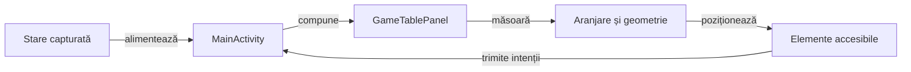

# Interfața Whist — atlas de orientare

## Pe scurt

Acest pachet compune interfața Android dintr-un `GameSession.Snapshot`.
Regulile, licitațiile legale și scorurile aparțin `game-core`; geometria nu
modifică distribuția sau rezultatele ca să facă un ecran să pară corect.

## Flux și responsabilități

Legendă și limite

Diagrama descrie prezentarea și interacțiunea. Motorul validează orice comandă rezultată, iar geometria adaptează spațiul fără a modifica regulile sau cărțile.

## Traseul unei randări

| Suprafață | Cod și rol |
|---|---|
| Masa | MainActivity alege starea, GameTablePanel construiește masa, iar GameBoardLayout și TableGeometry măsoară regiunile. |
| Mâna | HandLayoutMetrics distribuie cărțile în zona disponibilă. |
| Scor | ScoreTableView compară locurile. ScoreHistoryColumn furnizează licitația, punctele și totalul afișate în ScoreHistoryView pentru locul selectat. |

| Intrare | Responsabilitate și invariantă |
|---|---|
| `MainActivity` | Tranziții, persistență, meniu, limbă, pauza levatei; nu calculează coordonatele scaunelor. |
| `GameBoardLayout` | Măsoară scaunele și banda sigură. În joc, stratul transparent folosește lățimea mesei; la licitare, centrul rămâne exclusiv. |
| `TableGeometry` | Dreptunghiuri pentru scaune și banda sigură; omul rămâne sud. În joc, scaunele diagonale stau în afara rândurilor cărților. |
| `TrickCardMetrics` | Rezervă rândurile levatei și fixează sloturile după ancorele scaunelor. La patru jucători formează crucea, cu cartea omului jos și centrată. Fața are 104 dp; lățimea urmează spațiul. |
| `WhistUiPalette.seatFrame` | Furnizează același fundal și contur pentru scaunul activ și indicatorul de atu. `TrumpIndicatorView` primește starea turei de la `MainActivity`; E2E compară pixeli din captură în coordonate fizice. |
| `TableViewportPolicy` | Recuperează spațiu decorativ pe ferestre scunde; nu reduce țintele de 48 dp, înălțimea fețelor din mână de 98 dp sau fețele jucate de 104 dp. Când combinația masă–mână nu încape, zona vizibilă rămâne derulabilă. |
| `HandLayoutMetrics` | Păstrează un rând și un avans cel puțin egal cu banda măsurată a indicelui; textul mărit poate necesita derulare orizontală. |
| `CardFaceBackground` | Desenează simbolul central și colțul inversat. Semantica și indicele principal rămân în elementul vizual accesibil. |
| `DropdownBackground` | Săgeată vizibilă pe selectorul Android nativ; nu înlocuiește interacțiunile, focalizarea sau semantica acestuia. |
| `DisplayFixtureDeals` | Date deterministe pentru mesaje Android protejate de `BuildConfig.DEBUG`; cele patru culori de 10 apar fără cărți duplicate. Nu sunt distribuții ale pilotului normal. |
| `ScoreHistoryView` | Păstrează selectorul și antetele deasupra listei. Doar rândurile se derulează. Deschiderea din foaia consultativă păstrează masa dedesubt. |
| `ScoreHistoryColumn` | Asociază licitația locului selectat cu punctele și totalul de la încheierea mâinii. Produce aceeași ordine și aceleași valori pentru afișare, citire asistată și reluarea de componentă. |
| `WhistUiText` | Localizarea EN/RO; engleza este implicită la prima instalare. |

## Principii de aranjare

- Pâslă continuă, fără oval decorativ; tabla și decizia curentă sunt dominante.
- Nume, licitat și levate formează un grup compact. Valoarea este aliniată
  separat de etichetă; indicatorul turei folosește și text, nu numai culoare.
- Mâna omului stă jos, centrată după lățimea reală a ferestrei. La două sau
  trei cărți, avansul se oprește la 72% din lățimea feței. Dacă indicii cer
  derulare, vederea inițială pornește din mijloc, iar jucătorul poate ajunge
  la ambele capete. Treisprezece cărți au
  indici verticali expuși. Cartea selectată se ridică în spațiul rezervat și
  rămâne în spatele vecinelor; selectarea nu mută scaunul omului.
- Levata ocupă sloturile scaunelor: nord, vest, est și sud la patru jucători;
  alte configurații folosesc ancorele nord–sud disponibile. Slotul sudic al
  omului rămâne fix chiar dacă ordinea cărților jucate diferă. Rândurile
  libere sunt rezervate dinainte, astfel încât cărțile să nu sară între ture.
  Pe ecranele scunde, masa completă poate cere o derulare verticală; fața de
  104 dp trebuie să rămână întreagă după aducerea levatei în zona vizibilă.
- Atuul își măsoară chenarul după text și păstrează spațiu față de titlu și masă. Cartea întoarsă apare pe un fond ivoire, cu rang și simbol. Când regulile stabilesc doar culoarea, indicatorul o afișează cu explicația localizată.
  Fundalul și conturul indicatorului de atu urmează exact stilul scaunului al
  cărui rând este. Centrul mesei este al licitației sau al levatei.
- Selectorul limbii este listă derulantă. Configurarea păstrează opțiunile relevante,
  iar regulile și programul complet se consultă la cerere.
- Scorul precedă explicațiile. Navigarea secundară nu concurează cu acțiunea
  de continuare; foaia din timpul jocului nu confirmă licitația.
- Dacă dimensiunile sau textul mărit nu încap, păstrăm derularea accesibilă.
  Nu confundăm existența nodurilor XML cu absența decupării din captură.

## Cum verificăm

`TrickCardMetricsComponentTest` verifică sloturile ancorate, crucea cu patru
jucători, înălțimea de 104 dp, lipsa intersecțiilor cu scaunele și lățimi de
240–760 dp la trei scări de text. `GameTableLayoutComponentTest` verifică intersecțiile regiunilor, iar
`TableViewportPolicyTest` verifică ferestrele scunde și rotunjirea dp–pixeli.
`DisplayFixtureDealsTest` verifică unicitatea și diversitatea indicilor.

În `atf-test-android`, `WhistDenseLayoutE2eTest` compară banda expusă, pixelii
rangului și simbolului, înălțimea feței și zonele tactile. `HandIndexAudit` are
negative pentru simbol lipsă, indice acoperit și margine tăiată. Capturile sunt
revizuite și vizual; oracolul raster verifică lizibilitatea de bază, nu poate
certifica singur frumusețea interfeței sau identitatea optică a fiecărui simbol.

`WhistMenuLayoutE2eTest` parcurge meniurile normale în EN/RO.

- `WhistResponsivePlaySanityE2eTest` verifică profilele, fața jucată de 104 dp, slotul sudic, distanța față de rame și culoarea atuului. Pentru ecrane scunde, capturează separat starea de stil și zona derulată complet.
- Strategia Hard are o verificare separată de geometrie, cu bugetul de calcul declarat.
- Pilotul românesc joacă mâini normale și verifică scorul independent.
- Compilările rămân în TMP, iar rezultatele execuției în depozitul extern configurat.
