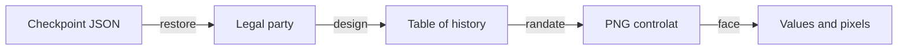

# Controlled yield of historical components

## Overview

The collection produces JVM images from the application projection and geometry, with controlled fonts. [Common strategy](../../../../docs/testing/README.md) holds the level and acceptance; Android pixels have a separate native qualification.

## Fluxul probei

Legend: actual projection and test graph adapter

The table and geometry come from the application. The font and drawing are the host's; the oracle compares values, limits and pixels, including after writing and rereading the checkpoint or PNG.

## Checked properties

- Historical balances and site association, independent of points of one hand.
- The series contour exclusively in the column of points with the color of the adjustment and four visible sides.
- Keeping the projection after salvare/reluare, the last hand, localization and increased text.
- Distance of separators and cell boundaries without changing the partition by rendering.
- The use of the width and height available in the portrait, tablet and wide windows; the letterheads, legend and closing action remain delimited.
- Red diagonals visible only in failed bids for each place, including zero contract; the difference in pixels is checked separately from the points' rectangle.

## Implementation and limits

[Gradle](../../build.gradle) compile the host's sources separately and execute `historyRasterTest`. [Ghidul display](../../../../docs/testing/ATF_DisplayComponents.md) explains the optional export to an external director; tests may only use their own time frames.

The sample label identifies the controlled rendering JVM. Acceptance of the identified APK checks separately the font measurement, clipping and interaction of the Android system.

- **Viewport:** [controlled composition](java/ro/whistlab/app/score/raster/HistoryViewportRaster.java) apply the full scale, grid policies. The title and controls use host fonts; image does not substitute native Android layout.

[Application components](../test/README.md) · [Common strategy](../../../../docs/testing/README.md) · [History contract](../../../../docs/game/ATF_ScoreHistory.md)
