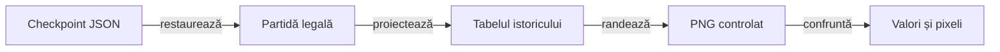

# Randarea controlată a componentelor istoricului

## Pe scurt

Colecția produce imagini JVM din proiecția și geometria aplicației, cu fonturi controlate. [Strategia comună](../../../../docs/testing/README.md) deține nivelul și acceptarea; pixelii Android au o calificare nativă separată.

## Fluxul probei

Legendă: proiecția reală și adaptorul grafic de test

Tabelul și geometria provin din aplicație. Fontul și desenarea sunt ale gazdei; oracolul compară valorile, limitele și pixelii, inclusiv după scrierea și recitirea checkpoint-ului ori PNG-ului.

## Proprietăți verificate

- Soldurile istorice și asocierea locului, independent de punctele unei singure mâini.
- Conturul de serie exclusiv în coloana punctelor, cu culoarea ajustării și patru laturi vizibile.
- Păstrarea proiecției după salvare/reluare, ultima mână, localizare și text mărit.
- Grosimea separatoarelor și limitele celulei, fără schimbarea partidei prin randare.

## Execuție și limite

[Gradle](../../build.gradle) compilează separat sursele gazdei și execută `historyRasterTest`. [Ghidul display](../../../../docs/testing/ATF_DisplayComponents.md) explică exportul opțional într-un director extern; testele pot folosi numai temporarele proprii.

Eticheta probei identifică randarea controlată JVM. Acceptarea APK-ului identificat verifică separat măsurarea fontului, clipping-ul și interacțiunea sistemului Android.

[Componentele aplicației](../test/README.md) · [Strategia comună](../../../../docs/testing/README.md) · [Contractul istoricului](../../../../docs/game/ATF_ScoreHistory.md)
