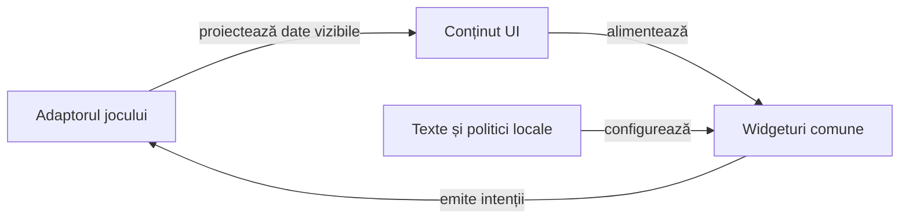

# atf-card-table-ui — interfața comună a jocurilor de cărți

## Pe scurt

`atf-card-table-ui` este modulul Android Library care deține componentele vizuale comune pentru Whist, Rentz și Hold’em. Are surse Java 17, resurse, teste JVM și componente Android instrumentate. Aplicațiile furnizează datele vizibile și intențiile de joc, iar biblioteca furnizează desenul și comportamentul widgeturilor.

| Intrare | Unde se verifică |
|---|---|
| Cod Java, resurse și contract Android | [Build-ul modulului](build.gradle) și [frontiera de sursă](src/test/java/ro/cardtable/ui/boundary/UiLibraryBoundaryComponentTest.java) |
| Geometrie, card highlight și realizări | [Componente JVM](src/test/README.md) și [probe instrumentate](src/androidTest/README.md) |
| Împachetare și inventar | [Publicarea AAR](#împachetare-și-consum) și [politica de guvernanță](../../config/atf-governance-policy.json) |

## Responsabilități și limite

| Pachet | Contract implementat |
|---|---|
| [screens](src/main/java/ro/cardtable/ui/screens/ScreenViews.java) | Aceiași constructori de pagini, texte, butoane și selectori; eticheta selectorului și protecția ferestrei sunt porturi furnizate de aplicație. |
| [menu](src/main/java/ro/cardtable/ui/menu/HomeMenuContent.java) | Ordine, etichete, tag-uri, stare de reluare și callback-uri; dropdown-ul păstrează cele două limbi și înregistrarea amânată a listenerului. |
| [profile](src/main/java/ro/cardtable/ui/profile/NameEdit.java) | Dialogul și ruta salvare/resetare; normalizarea, persistența și excepția originală aparțin consumatorului. |
| [cards](src/main/java/ro/cardtable/ui/cards/CardFace.java) | Însemne, proporții și marcaj crem-auriu. Jocul furnizează cartea vizibilă și decide când se marchează. |
| [hand](src/main/java/ro/cardtable/ui/hand/HandLayoutMetrics.java) | Geometrie, centrare/derulare și rendererul `HandFan`; `HandCard` furnizează numai identitate, însemne, accesibilitate și interactivitate. |
| [seat](src/main/java/ro/cardtable/ui/seat/SeatContent.java) | Nume, fapte ordonate și actor activ furnizate de joc; etichetele se măsoară la lățimea locului, iar cadrul primește aceeași rezervare între faze. |
| [table](src/main/java/ro/cardtable/ui/table/BoardLayout.java) | Regiuni ocupate, ordine vizuală, viewport și bandă centrală măsurată între locuri. Consumatorul compune conținutul benzii. |
| [turn](src/main/java/ro/cardtable/ui/turn/TurnPacing.java) | Așteaptă primul cadru vizibil, aplică intervalul comun și invalidează acțiunea dacă scena s-a schimbat. |
| [theme](src/main/java/ro/cardtable/ui/theme/TablePalette.java) și [widgets](src/main/java/ro/cardtable/ui/widgets/DropdownBackground.java) | Culori, chenare și desenul selectorului. |

Aplicația deține compoziția mesei, regulile, istoricul, câștigătorul și momentul afișării levatei. Biblioteca măsoară fețele și chenarul câștigător, apoi aplică mișcarea. Contractul comun folosește numai locuri și date vizibile.

`CardTableTheme` păstrează cele șase atribute Android ale reperului; `AppTheme` Whist este aliasul acestei resurse. Consumatorul o adoptă explicit în manifest; admiterea AAR-ului și build-ul nu declară comparație de pixeli sau focus Android.



<details>
<summary>Legendă: componente comune și proprietarul partidei</summary>

Proiecțiile nu calculează reguli. Aplicația validează comanda, păstrează preferințele și gestionează lifecycle-ul; biblioteca redă datele permise și trimite callback-ul asociat controlului.

</details>

## Integrarea existentă Whist

- Aplicația consumă modulul prin `implementation project(':atf-card-table-ui')`.
- `WhistMenuContent` proiectează textul real; `MenuScreens` păstrează navigarea, configurarea și instrucțiunile jocului.
- `PlayerSettingsDialog` păstrează `PlayerNames` și callback-ul de salvare; dialogul comun nu mută preferințele sau partida.
- Fațadele existente pentru geometrie, temă și desen delegă implementării comune, păstrând tipurile folosite de aplicație și testele sale. `WhistCardFace` proiectează cartea domeniului înaintea desenului.

Fațadele sunt adaptoare de compatibilitate, cu o singură implementare a algoritmului în bibliotecă. Eliminarea lor cere migrarea explicită a apelanților și păstrarea inventarului de teste.

## Verificare

Din copia temporară a rădăcinii Android `whist-lab-app`, cu PowerShell 7, JDK 21 și cache-ul Android pregătit, modulul se construiește fără sarcini ale aplicației.

```powershell
.\gradlew.bat --offline --no-daemon :atf-card-table-ui:testDebugUnitTest :atf-card-table-ui:lintRelease :atf-card-table-ui:assembleDebugAndroidTest
```

| Selecție | Așteptare independentă |
|---|---|
| Meniul comun | Ordine și tag-uri fixe, RO/EN, nume implicit/configurat, reluare dezactivată și callback-uri distincte. |
| Editarea numelui | Ordinea validare/salvare, identitatea erorii, refuz fără scriere și resetare fără validarea numelui gol. |
| Geometria mesei și a mâinii | 3–6 locuri, profiluri între 320 și 600 dp, font 1–2×, o carte centrată și indici măsurați. |
| Marcajul cărților | Aceeași paletă pentru evidențiere în poziție și ridicare la dezvăluire. Densitatea fracționară păstrează conturul în fâșia vizibilă a cărții. |
| Realizări | Ordine și identități stabile, încărcarea detaliilor la cerere, stări ambigue respinse. |
| Frontiera bibliotecii | Inventare Java distincte pentru producție, JVM și Android instrumentat. Manifest de bibliotecă fără aplicație ori permisiuni proprii. |
| Modele de masă | Identități stabile, fapte ordonate și imuabile, regiuni măsurate și dimensiuni identice indiferent de numărul locurilor. |
| Temporizarea turei automate | `TurnPacingComponentTest` verifică randarea înaintea întârzierii de 550 ms, acțiune unică și anulare pentru actor uman, blocaj sau scenă înlocuită. |
| Adaptoarele Whist | Textele reale, limba, callback-urile și însemnele tuturor cărților. |

Componentele existente de masă și mână rămân verificări de integrare, cu aserțiunile lor păstrate. Comparația cu snapshot-ul anterior și inspecția corpurilor de desen califică refactorizarea; pixelii, focusul și atingerea Android cer sanity nativ distinct.

## Separarea jocurilor și a componentelor

| Proprietar | Responsabilitate și teste |
|---|---|
| Biblioteca comună | Desen, măsurare, centrare, chenare, fapte afișate și mecanica widgeturilor; fără oracole de joc. |
| Whist | `WhistTableContent`, configurație, legalitate, licitație, atu, punctaj și lifecycle; componentele existente cu motor rămân în aplicația Whist, cu așteptările originale. |
| Consumator extern | Adaptor Android; păstrează regulile, sesiunea, checkpoint-ul și decizia în propriul motor, apoi folosește cadrul activ, temporizarea după primul cadru și geometria comună a mișcării. |

- Ordinea vizuală pentru 3–6 locuri păstrează omul la indicele zero; adaptorul deține maparea stabilă spre identitățile motorului și actorul real.
- `SeatContent.Fact` păstrează textul și ordinea; biblioteca nu adună puncte, nu interpretează valori negative și nu decide câștigătorul.
- `HandCard` nu conține mâini adverse sau comenzi. Adaptorul proiectează numai informația vizibilă și rezolvă identitatea selectată în snapshot-ul afișat.
- `PlayedCardsView` este prezentarea depunerilor pe locuri. Compoziția regiunii centrale aparține adaptorului activ.

[Testele Android ale modulului](src/androidTest/README.md) și [catalogul componentelor display](../../docs/testing/ATF_DisplayComponents.md) descriu selecțiile și limitele de acceptanță.

## Rânduri adaptive în chenar

Un rând de etichetă și valoare își rezervă spațiul măsurat pentru cifre. Când spațiul disponibil scade, valoarea trece sub etichetă. Jocul stabilește stilul textului și descrierea accesibilă a chenarului.

## Împachetare și consum

Din rădăcina ATF. Exportul folosește directorul libraries/card-table-ui din depozitul extern de dovezi. Parametrul `-Repository` permite o destinație Maven externă explicită.

```powershell
.\scripts\export-card-table-ui.ps1
```

- `:atf-card-table-ui` este numele proiectului Gradle. Coordonata de distribuție este `ro.cardtable:card-table-ui`, cu versiunea declarată în build. Exportul conține AAR, POM, metadate Gradle și JAR-ul de surse.
- [Exportul](../../scripts/export-card-table-ui.ps1) păstrează manifestul intrărilor de producție și SHA-256 pentru fiecare fișier al coordonatei. Un export repetat cu aceleași intrări verifică artefactele și le reutilizează. Modificarea intrărilor sub o coordonată existentă cere o versiune nouă.
- Whist consumă proiectul din sursă. Rentz și Hold’em admit fiecare versiunea fixată, după confruntarea conținutului și a provenienței. O mutare de director nu schimbă identitatea AAR-urilor deja distribuite.
- AAR-ul include clasele, manifestul și resursele Android, inclusiv CardTableTheme. Dependența se fixează prin coordonata Maven, cu proveniență și hash-uri, după modelul celorlalte biblioteci.
- [Politica de nume](../card-table-names/README.md) se publică separat ca JAR Java, pentru motoare și probe JVM. O componentă de geometrie poate avea propria coordonată JAR dacă este Android-independentă și are cel puțin doi consumatori JVM reali.

## Realizări

- `AchievementScreen` afișează lista virtualizată, bara de progres și detaliul la atingerea rândului. Jocul furnizează titlurile, ordinea, progresul, acțiunile și cheile unice de rând și restaurare.
- `AchievementNoticeView` desenează panoul de progres. Jocul stabilește momentul afișării și efectul închiderii. Catalogul YAML, metricile, deduplicarea și stocarea aparțin jocului.

[Proiecția Whist și catalogul său](../../docs/game/ATF_Achievements.md)

## Antetul mesei

[`GameTitleBar`](src/main/java/ro/cardtable/ui/screens/GameTitleBar.java) măsoară titlul și bifa nativă înainte de a alege rândul. Titlul poate ocupa cel mult două rânduri și păstrează descrierea completă pentru accesibilitate. Bifa rămâne pe primul rând cât timp titlul are cel puțin 1,5 ori lățimea acțiunii din stânga; controlul trece pe rândul următor când spațiul ar face titlul ilizibil.

- Rentz poate furniza două rânduri de titlu prin același antet măsurat. Jocul păstrează contractul, progresul și acțiunile din meniu.
- Adaptorul furnizează `Automat` în română și `Auto play` în engleză, descrierea acțiunii și valoarea curentă. Încărcarea stării nu emite intenții, iar o atingere emite o schimbare booleană.
- Sub antet, Whist așază progresul și licitațiile în stânga, iar atuul în dreapta. Rentz și Hold’em pot așeza în același loc detaliile specifice mâinii sau etapei.
- Verificările JVM acoperă decizia de dispunere, inclusiv la limita unui pixel. Proba instrumentată măsoară textele în RO și EN și ținta tactilă de minimum 48 × 48 dp. [Testele native](src/androidTest/README.md)

## Atingerea unei cărți indisponibile

Jocul transmite cărțile legale și activează indiciul când jucătorul poate muta.

- O atingere invalidă marchează cartea respinsă în roșu discret și cărțile legale în auriu.
- Indiciul expiră, dispare la o mutare acceptată și se resetează la refacerea mâinii.
- Marcajele păstrează geometria evantaiului pe ecrane compacte.

## Levata și informația din chenar

- `CollectionTarget` primește locurile cărților publice și locul câștigător calculat în joc. `TrickCollectionMotion` păstrează fereastra de 1500 ms și folosește ultimele 500 ms pentru colectare.
- `TrickCollectionRun` deține geometria, ciclul de viață și curățarea. Adaptorul Android caută fețele cărților și chenarul prin identitatea locului. Whist păstrează validarea snapshotului și momentul când publică levata.
- Cadrele Android folosesc ceasul monoton. Un callback întârziat sare la poziția corespunzătoare timpului scurs, iar un callback după termen termină mișcarea.
- `PlayerSeatFrame.buildInlineFacts` păstrează textul și înălțimea rândurilor; lățimea se adaptează după măsurarea finală a glifelor Android.
- [Componenta nativă a chenarului](src/androidTest/README.md) verifică 36 de combinații. Include 3–6 locuri, lățimi de 240/320/393 dp, font 1/1,5/2, diacritice și valori semnate lungi, inclusiv Δ și Σ.
- Biblioteca păstrează `minSdk 24`, compilare SDK 36 și Java 17. Consumatorul deține pachetul instalabil, versiunea și semnarea APK-ului.
- POM-ul păstrează runtime-ul Kotlin adăugat automat de toolchain, deja prezent în aplicația reper. [Kotlin integrat în AGP](https://developer.android.com/build/migrate-to-built-in-kotlin) și [dependența standard](https://kotlinlang.org/docs/gradle-configure-project.html) explică această contribuție.
- Admiterea confruntă SHA-256, conținutul AAR, manifestul și dependențele înaintea build-ului consumatorului. Publicarea locală nu închide acceptanța UI a consumatorului.

[Aplicația Whist](../app/src/main/java/ro/whistlab/app/README.md) · [Strategia componentelor](../../docs/testing/ATF_DisplayComponents.md) · [Extragerea rămasă](../../docs/feedback/ATF_CardUi_Extraction.md)
