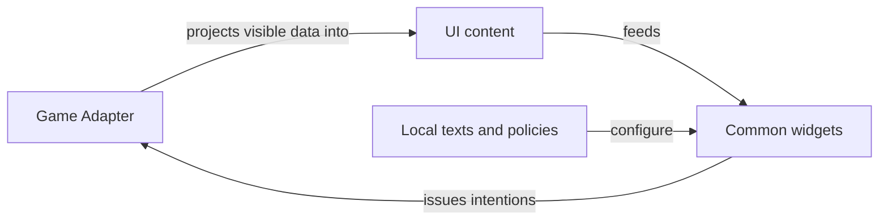

# atf-card-table-ui - common interface of card games

## Overview

`atf-card-table-ui` owns the Android visual components shared by Whist, Rentz and Hold'em. It contains Java 17 sources, resources, JVM tests and instrumented Android component tests. Games supply visible data and interaction intents; the library renders the widgets and handles their presentation behaviour.

| Entry point | Where to check |
|---|---|
| Java code, resources and Android contract | [Module build](build.gradle) and [source boundary](src/test/java/ro/cardtable/ui/boundary/UiLibraryBoundaryComponentTest.java) |
| Geometry, card highlighting and achievements | [JVM components](src/test/README.md) and [native instrumentation](src/androidTest/README.md) |
| Packaging and inventory | [Publication of the AAR](#packaging-and-consumption) and [governance policy](../../config/atf-governance-policy.json) |

## Responsibilities and limits

| Package | Implemented contract |
|---|---|
| [screens](src/main/java/ro/cardtable/ui/screens/ScreenViews.java) | Shared factories for pages, text, buttons and dropdowns; the app supplies dropdown labels and window protection. |
| [menu](src/main/java/ro/cardtable/ui/menu/HomeMenuContent.java) | Item order, labels, tags, resume state and callbacks; dropdowns preserve both locales and attach listeners after initialization. |
| [profile](src/main/java/ro/cardtable/ui/profile/NameEdit.java) | The dialog accepts the game's input policy. Normalization, persistence and the original failure cause belong to the consumer. |
| [cards](src/main/java/ro/cardtable/ui/cards/CardFace.java) | Rank and suit identity, proportions and cream/gold highlighting. The game provides the visible face and decides when to mark it. |
| [hand](src/main/java/ro/cardtable/ui/hand/HandLayoutMetrics.java) | Hand layout, scrolling and gestures. Adapters retain feedback duration, lift timing and gesture revisions through [HandInput](src/main/java/ro/cardtable/ui/hand/HandInput.java). |
| [seat](src/main/java/ro/cardtable/ui/seat/SeatContent.java) | Names, ordered facts and the active player come from the game; labels fit the measured seat width and frame reservations stay fixed across phases. |
| [table](src/main/java/ro/cardtable/ui/table/android/BoardLayout.java) | Occupied regions, visual orders, viewport and central band measured between places. The Android Adapter applies common geometry. |
| [turn](src/main/java/ro/cardtable/ui/turn/TurnPacing.java) | Wait for the first visible frame, apply the common range and invalidate the action if the scene has changed. |
| [animation](src/main/java/ro/cardtable/ui/animation/TrickCollectionMotion.java) | Validate the seating set and expose the break, duration and curve of the collection. Android draws native faces, and the website plays the same curve on the page elements. |
| [CardFaceView](src/main/java/ro/cardtable/ui/cards/CardFaceView.java) | The hand and table draw the rank and symbol in the corner, the central symbol and the inverted corner. The face dimensions are scaled for the table, and the collection moves the cards' views off the table. |
| [CardFaceMetrics](src/main/java/ro/cardtable/ui/cards/CardFaceMetrics.java) | Shared proportions, rank sizes and suit geometry. Each adapter applies the same face contract to hand, table and collection roles. |
| [ScoreGridStyle](src/main/java/ro/cardtable/ui/table/ScoreGridStyle.java) | Keep the proportions, height and colours of the score table for the Android adapter and browser. |
| [score](src/main/java/ro/cardtable/ui/score/README.md) | Neutral score and scrollable history widgets, immutable consumer content, measured columns and two-way pane synchronization. Game labels and scoring remain in adapters. |
| [theme](src/main/java/ro/cardtable/ui/theme/TablePalette.java) and [widgets](src/main/java/ro/cardtable/ui/widgets/DropdownBackground.java) | Colors, checkboxes and drawing of the selector. |

The game owns table composition, rules, history, winner selection and collection timing. The library measures card faces and the winning player frame, then applies the collection motion. The shared contract uses only visible seats and public data.

`CardTableTheme` defines six Android table attributes; Whist keeps `AppTheme` as an alias. Consumers adopt the theme explicitly in their manifests. Accepting the AAR and compiling it does not establish pixel parity or native focus behaviour.



<details>
<summary>Legend: Common components and owner of the match</summary>

Projections don't calculate rules. The application validates the order, retains the preferences and manages the lifecycle; the library returns the data allowed and sends the associated callback to the control.

</details>

## Existing integration of the Whist

- The application consumes the module through `implementation project(':atf-card-table-ui')`.
- `WhistMenuContent` designs the actual text; `MenuScreens` keeps the game navigation, configuration and instructions.
- `PlayerSettingsDialog` provides the Whist measurement of length after NFC and rescue callback. The common dialogue applies the filter to the field.
- The existing facades for geometry, theme and drawing delegated to joint implementation, keeping the types used by the application and its tests. `WhistCardFace` projects the domain card before the drawing.

The facades are compatibility adapters with a single implementation of the algorithm in the library. Their removal requires explicit migration of callers and the preservation of the inventory of tests.

## Verification

### Card rank typography

`CardFaceMetrics` owns rank typography for Android and Web. Table faces scale the complete hand contract; trump tiles keep their separate typography.

| Aspect | Contract |
|---|---|
| Hand face | 88 dp high, 19.5 sp rank, 13 sp suit index |
| Decorative marks | 13.5 dp inverted rank, 9 dp inverted suit, 28 dp central suit |
| Android text | Rank-only measured span; suit and accessible text remain intact |
| Fan overlap | Reserve the widest measured rank, including `10`, before overlap or scrolling |
| Web adapter | Receive rank scale through setup, independently of menu fonts |
| Shared verification | [Expected measurements](src/test/resources/card-typography.tsv) used by JVM components and distributed in the browser tests JAR |
| Native verification | Real shaping, clipping and draw/measure agreement at enlarged text sizes |

From the temporary copy of the Android root `whist-lab-app`, with PowerShell 7, JDK 21 and the Android cache prepared, the module is built without the application's tasks.

```powershell
.\gradlew.bat --offline --no-daemon :atf-card-table-ui:testDebugUnitTest :atf-card-table-ui:lintRelease :atf-card-table-ui:assembleDebugAndroidTest
```

| Selection | Independent waiting |
|---|---|
| Shared menu | Fixed orders and tags, RO/EN, implicit/configured name, disabled restart and distinct callbacks. |
| Edit Name | Proposed interval, retention of selection at refusal, deletion, order validation/persistence and cause of failure. |
| Table and hand geometry | 3–6 places, profiles between 320 and 600 dp, font 1–2 ×, a centred card and measured indices. |
| Bookmark | Same pallet for refusal and recommendation. The same [gestures scenario](src/test/resources/hand-feedback.tsv) checks the repeated touch in JVM and the web, the expiry after revision and the selection accepted once. |
| Achievements | Stable orders and identities, loading of details on request, ambiguous states rejected. |
| Library boundary | Java separate invention for production, JVM and Android instrumented. Library manifest without application or permissions. |
| Table models | Stable identities, orderly and immutable facts, measured regions and identical dimensions regardless of the number of seats. |
| Time-frame | `TurnPacingComponentTest` checks the rendering prior to the delay of 550 ms, single action and cancellation for human actor, block or replaced scene. |
| Adapters Whist | Real texts, language, callbacks and all card markings. |

Existing table and hand components remain integration checks with their retained assertions. Comparison with the previous snapshots and inspection of drawing bodies qualifies refactorization; pixels, focus and touch Android require native distinct sanity.

## Separation of games and components

| Owner | Liability and tests |
|---|---|
| Common Library | Drawing, measuring, centering, caging, displayed facts and widgework mechanics; no game oracles. |
| Whist | `WhistTableContent`, configuration, legality, bid, trump, score and lifecycle; existing engine components remain in the Whist application, with original expectations. |
| External consumer | Android Adapter; keeps the rules, session, checkpoint and decision in his own engine, then uses the active frame, the timing after the first frame and the common geometry of movement. |

- The visual order for 3–6 places keeps man at zero; the adapter holds the stable mapping to the engine identities and the actual actor.
- `SeatContent.Fact` keeps text and order; the library does not collect points, does not interpret negative values and does not decide the winner.
- `HandCard` does not contain any side hands or controls. The adapter only projects visible information and solves the identity selected in the displayed snapshots.
- `PlayedCardsView` is the presentation of deposits in place. The composition of the central region belongs to the active adapter.

Portable contracts are compiled by the web adapter as well. Governance verifies imports into common sources and effects with a real playing field are checked in the consumer project.

[Android module tests](src/androidTest/README.md) and [catalogue of display components](../../docs/testing/ATF_DisplayComponents.md) describe the selections and acceptance limits.

## Adaptive seat rows

A row of label and value reserves the space measured for figures. When the available space drops, the value passes under the label. The game sets text style and accessible box description.

## Packaging and consumption

ATF root. The export uses the libraries/card-table-ui directory from the external evidence repository. The parameter `-Repository` allows an explicit external Maven destination.

```powershell
.\scripts\export-card-table-ui.ps1
```

- `:atf-card-table-ui` is the name of the Gradle project. The distribution coordinate is `ro.cardtable:card-table-ui`, with the declared version in the building. The export contains AAR, POM, Gradle metadata and source JAR.
- [Export](../../scripts/export-card-table-ui.ps1) keeps the production input manifest and SHA-256 for each coordinate file. Repeated export with the same entries checks the artifacts and reuses them. The change of entries under an existing coordination requires a new version.
- Whist is consuming the project from the source. Rentz and Hold'em shall each accept the fixed version after the content and provenance have been confronted. The source version and each co-ordinated allowed to the consumer have their own evidence.
- The aARM includes Android classes, manifest and resources, including CardTableTheme. Addiction is fixed by the Maven coordinate, with provenance and hashes. [Web Distribution](../../atf-ui-browser/README.md#adapter-library) compiles directly a selection of portable sources from the module and publishes a separate JAR.
- [Name policy](../card-table-names/README.md) shall be published separately as JAR Java for JVM engines and samples. A geometry component can have its own JAR coordinated if it is independent android and has at least two real JVM consumers.

## Achievements

- `AchievementScreen` displays the virtualized list, the progress bar and the detail when reaching the row. The game provides titles, order, progress, actions and single common keys and restoration.
- `AchievementNoticeView` draws the progress panel. The game sets the time of display and the effect of closure. The YAML catalog, the metrics, the replenishment and storage belong to the game.

[Projection of Whist and its catalogue](../../docs/game/ATF_Achievements.md)

## Table header

The table popup uses `TableMenuContent`: a direct localized score-history action precedes game-specific routes. Adapters supply callbacks and retain the selected game and checkpoint when opening or closing history; an active AutoPlay may also expose its stop action in the menu.

[`GameTitleBar`](src/main/java/ro/cardtable/ui/screens/GameTitleBar.java) measures the title and the native tick before choosing the line. The title may take up to two rows and shall keep the full description for accessibility. The check shall be first as long as the title is at least 1,5 times the width of the action on the left; the check shall be carried out in the next row when the space would make the title illegible.

- Rentz may provide two rows of the title by the same measured header. The game keeps the contract, progress and actions on the menu.
- The adapter provides `Automat` in Romanian and `Auto play` in English, the description of the action and the current value. The state load does not emit intentions and a touch emits a boolean change.
- Under the header, Whist places progress and bids on the left, and the trump on the right. Rentz and Hold'em can place the hand or stage details in the same place.
- JVM checks cover the arrangement decision, including at the limit of a pixel. The instrumented sample measures the texts in EN and EN and the tactile target of minimum 48 × 48 d. [Tests native](src/androidTest/README.md)

The trump scale uses `TrumpTileMetrics` for shared nominal sizes and sizes. Android measures native glyphs, and the browser uses the calculated font of the item. Same sample checks rank, symbol and text classification without the trump.

## Touching an unavailable card

The game transmits the legal cards and activates the clue when the player can move.

- A disabled touch marks the rejected card in discreet red and the legal cards in gold.
- The clue expires, disappears to an accepted move and resets when the hand is restored.
- Markings keep fan geometry on compact screens.

## Trick and seat information

- `CollectionTarget` receives the seats of the public cards and the winning place calculated in the game. `TrickCollectionMotion` keeps the 1500 ms window and uses the last 500 ms for collection.
- `TrickCollectionRun` holds geometry, life cycle and cleaning. Android Adapter searches the cards faces and box through the location identity. Whist keeps the Snapshots validation and the moment when it publishes the trick.
- Android frames use monotonous clock. A delayed callback jumps to the position corresponding to the time elapsed, and a callback after term finishes the movement.
- `PlayerSeatFrame.buildInlineFacts` keeps text and height of rows; the width is adjusted after the final measurement of Android glyphs.
- [Native component of the box](src/androidTest/README.md) checks 36 combinations. Includes 3–6 places, 240/320/393 dp widths, font 1/1,5/2, diacritics and long signed values, including the "and" "s.
- The library keeps `minSdk 24`, compiling SDK 36 and Java 17. The consumer holds the installable package, version and signature of the APK.
- The POM keeps the Kotlin runtime automatically added by the toolchain, already present in the application reference [Kotlin integrated into AGP](https://developer.android.com/build/migrate-to-built-in-kotlin) and [standard dependence](https://kotlinlang.org/docs/gradle-configure-project.html) explains this contribution.
- Admission Face SHA-256, the content of the AAR, manifest and dependencies before the consumer's building. Local publication does not close the consumer's acceptance of the IU.

[Whist app](../app/src/main/java/ro/whistlab/app/README.md) · [Component strategy](../../docs/testing/ATF_DisplayComponents.md) · [Withdrawal remaining](../../docs/feedback/ATF_CardUi_Extraction.md)
