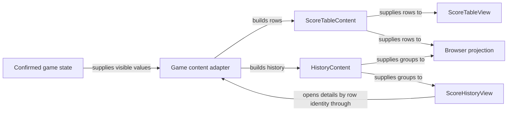

# Score and scrollable history widgets

## Overview

The game projects confirmed visible values; the library renders them. Column labels, score signs, player order, row identities and details actions remain consumer inputs. The widgets never calculate points or decide a winner.

Legend

- The game adapter owns confirmed values and row identities; Android widgets and the browser consume the same neutral content.
- A details callback returns the row identity to the adapter. The widgets do not mutate the game or calculate scores.

## Contracts

| Contract | Responsibility |
|---|---|
| `ScoreTableContent` | Immutable columns with weights and numeric alignment, stable rows, optional emphasis and underline. |
| `HistoryContent` | Immutable player groups, consumer column captions, pinned row labels, legend and accessible descriptions. Duplicate identities and ragged cells are refused before rendering. Empty history is valid. |
| `ScoreTableView` | Palette and row dimensions from `ScoreGridStyle`; adapter-supplied values, alignment and row emphasis. |
| `ScoreHistoryView` | Pinned labels, synchronized horizontal headings and values, vertically aligned rows and readable short-window fallback. The consumer may assign its own accessibility IDs through the pane accessors. |
| `HistoryGridMetrics` | Pixel measurements supplied by the platform; numeric minima remain complete, excess width is distributed and overflow stays scrollable. |
| `HistoryScrollSync` | Two-way pane synchronization without feedback loops; a failed target does not block later scrolls. |

The Android view measures actual text. JVM fixtures cover compact and wide windows, fractional density, enlarged fonts, the last player and the last row. They qualify the measurement contract and event policy; native rasterization, accessibility focus and touch gestures require a separate platform acceptance.

## Consumer integration

Create content from a confirmed snapshot, pass a callback keyed by stable row identity, and keep navigation and persistence outside the widget. Browser adapters compile the same portable content classes and translate them into their renderer protocol. A browser renderer's column capacity must be verified explicitly before adopting another column family.

[Module boundary and packaging](../../../../../../../README.md) · [Component strategy](../../../../../../../../../docs/testing/README.md)
